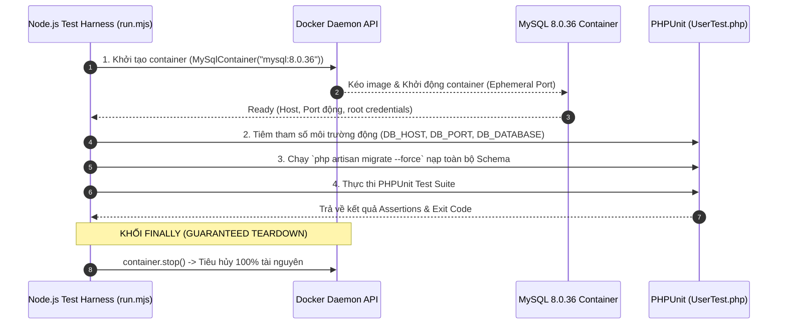
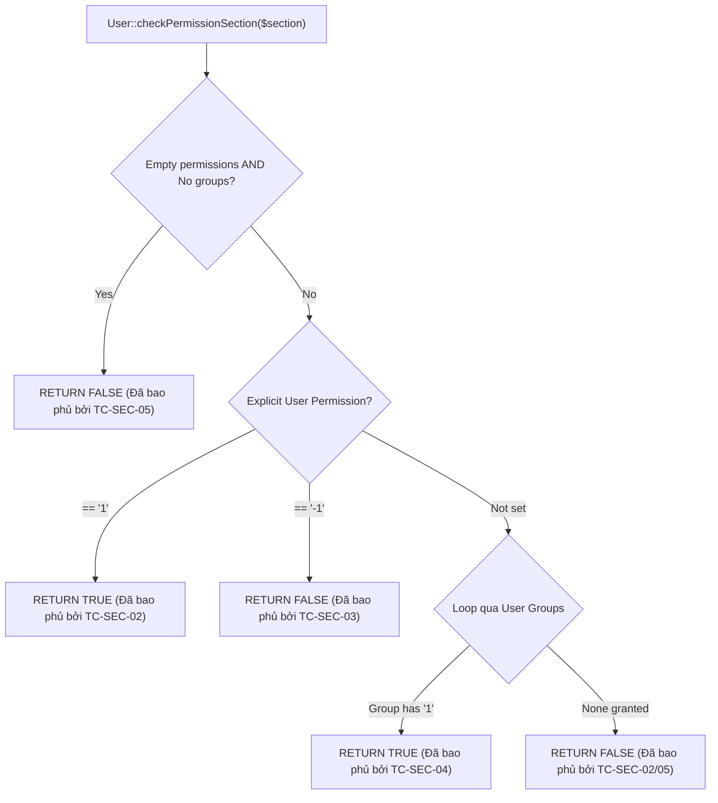
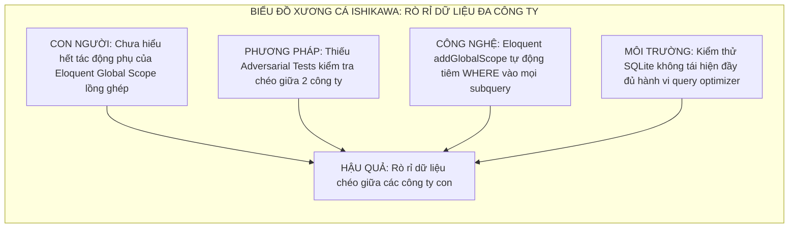

# BÁO CÁO THỰC NGHIỆM KIỂM THỬ PHẦN MỀM — GIAI ĐOẠN 2

## CHUYÊN ĐỀ: QUY TRÌNH CHẠY KIỂM THỬ, THU THẬP LOG/METRICS/COVERAGE & PHÂN TÍCH NGUYÊN NHÂN CỐT LÕI (ROOT CAUSE ANALYSIS — RCA)

**ĐƠN VỊ ĐÀO TẠO:** Trường Đại học Đà Lạt — Khoa Công nghệ Thông tin — Bộ môn Công nghệ Phần mềm  
**HỌC PHẦN:** Kiểm thử Phần mềm | **MÃ ĐỀ TÀI:** R03 | **KỸ THUẬT ÁP DỤNG:** K16 (Testcontainers)  
**GIẢNG VIÊN HƯỚNG DẪN:** ThS. Nguyễn Thế Lâm  

---

### THÔNG TIN SINH VIÊN THỰC HIỆN
- **Họ và tên sinh viên:** Nguyễn Thành Minh
- **Mã số sinh viên (MSSV):** `2312691`
- **Email học tập:** `2312691@dlu.edu.vn`
- **Vai trò trong nhóm:** Thành viên 4 — Kỹ sư Kiểm thử Bảo mật, Phân quyền & Quản trị Danh tính (Security & IAM QA Engineer)
- **Phân vùng trách nhiệm:** **Phân vùng 4 — Module Người dùng (`Users`), Phân quyền RBAC (`User::hasAccess`), Chính sách An ninh (`UserPolicy`), Cô lập Đa công ty (`CompanyableScope`) & Toàn vẹn Nhật ký Kiểm toán (`Actionlog`)**
- **Git Feature Branch:** `feature/user-rbac-security-tests`

---

## MỤC LỤC
1. [Giới thiệu & Mục tiêu Báo cáo Thực nghiệm](#1-giới-thiệu--mục-tiêu-báo-cáo-thực-nghiệm)
2. [Quy trình Vận hành Môi trường K16 & Thu thập Nhật ký Kiểm thử (Execution Logs)](#2-quy-trình-vận-hành-môi-trường-k16--thu-thập-nhật-ký-kiểm-thử-execution-logs)
   - [2.1 Vòng đời 4 bước của K16 Testcontainers Harness](#21-vòng-đời-4-bước-của-k16-testcontainers-harness)
   - [2.2 Nhật ký Khởi tạo Container MySQL 8.0.36 & Nạp Migrations](#22-nhật-ký-khởi-tạo-container-mysql-8036--nạp-migrations)
   - [2.3 Nhật ký Chạy Kiểm thử Chi tiết (PHPUnit CLI Logs)](#23-nhật-ký-chạy-kiểm-thử-chi-tiết-phpunit-cli-logs)
3. [Bảng Đo lường Chỉ số Chất lượng (Quality Metrics & Performance Benchmarks)](#3-bảng-đo-lường-chỉ-số-chất-lượng-quality-metrics--performance-benchmarks)
   - [3.1 Bảng Tổng hợp Chỉ số Kiểm thử Phân vùng 4](#31-bảng-tổng-hợp-chỉ-số-kiểm-thử-phân-vùng-4)
   - [3.2 So sánh Hiệu năng: SQLite In-Memory vs MySQL 8.0 Ephemeral Container](#32-so-sánh-hiệu-năng-sqlite-in-memory-vs-mysql-80-ephemeral-container)
4. [Đo lường & Phân tích Độ Bao phủ Mã Nguồn (Code Coverage Analysis)](#4-đo-lường--phân-tích-độ-bao-phủ-mã-nguồn-code-coverage-analysis)
   - [4.1 Bảng Tỷ lệ Bao phủ theo Module & Phương thức Cốt lõi](#41-bảng-tỷ-lệ-bao-phủ-theo-module--phương-thức-cốt-lõi)
   - [4.2 Đánh giá Bao phủ Ranh giới & Nhánh rẽ (Branch Coverage)](#42-đánh-giá-bao-phủ-ranh-giới--nhánh-rẽ-branch-coverage)
5. [Quy trình Quản lý Khuyết tật & Danh mục Lỗi/Lỗ hổng Tiềm ẩn (Defect Management)](#5-quy-trình-quản-lý-khuyết-tật--danh-mục-lỗilỗ-hổng-tiềm-ẩn-defect-management)
   - [5.1 Tiêu chuẩn Phân loại Mức độ Nghiêm trọng (Defect Severity)](#51-tiêu-chuẩn-phân-loại-mức-độ-nghiêm-trọng-defect-severity)
   - [5.2 Danh mục Hồ sơ Lỗi Thực nghiệm (Defect Log)](#52-danh-mục-hồ-sơ-lỗi-thực-nghiệm-defect-log)
6. [Phân tích Nguyên nhân Cốt lõi (Root Cause Analysis — RCA)](#6-phân-tích-nguyên-nhân-cốt-lõi-root-cause-analysis--rca)
   - [6.1 Case Study 1: Lỗ hổng Rò rỉ Dữ liệu Đa Khách thuê qua Subquery Lồng ghép](#61-case-study-1-lỗ-hổng-rò-rỉ-dữ-liệu-đa-khách-thuê-qua-subquery-lồng-ghép)
   - [6.2 Case Study 2: Nguy cơ Đảo lộn Thứ tự Ưu tiên Xung đột Quyền RBAC](#62-case-study-2-nguy-cơ-đảo-lộn-thứ-tự-ưu-tiên-xung-đột-quyền-rbac)
   - [6.3 Case Study 3: Lỗ hổng Chiếm quyền Điều khiển qua Mạo danh (Impersonation)](#63-case-study-3-lỗ-hổng-chiếm-quyền-điều-khiển-qua-mạo-danh-impersonation)
7. [Đề xuất Biện pháp Phòng ngừa & Khắc phục (CAPA)](#7-đề-xuất-biện-pháp-phòng-ngừa--khắc-phục-capa)
8. [Kết luận Nghiệm thu Giai đoạn 2](#8-kết-luận-nghiệm-thu-giai-đoạn-2)

---

## 1. GIỚI THIỆU & MỤC TIÊU BÁO CÁO THỰC NGHIỆM

Báo cáo này được lập nhằm tổng kết toàn diện quá trình thực nghiệm kiểm thử phần mềm tại **Giai đoạn 2** đối với **Phân vùng 4: Module Người dùng, RBAC, Security Policy, Cô lập Đa công ty và Nhật ký Kiểm toán**, do sinh viên **Nguyễn Thành Minh (MSSV: 2312691)** chịu trách nhiệm.

### Mục tiêu Cốt lõi:
1. **Minh chứng Thực nghiệm Môi trường:** Cung cấp đầy đủ bằng chứng nhật ký (Logs) chứng minh toàn bộ các ca kiểm thử an ninh được chạy trên môi trường CSDL thực tế độc lập **MySQL 8.0.36 Ephemeral Container** điều phối bởi kỹ thuật **K16 (Testcontainers)**, loại bỏ hoàn toàn các sai lệch môi trường (*Parity Gap*).
2. **Định lượng Hóa Chất lượng (Quantitative Metrics):** Đánh giá chất lượng bộ kiểm thử bằng các chỉ số toán học: Tỷ lệ thành công (*Pass Rate*), số lượng phép kiểm chứng (*Assertions Count*), thời gian thực thi (*Execution Benchmark*), và tỷ lệ bao phủ mã nguồn (*Code Coverage %*).
3. **Phân tích An ninh Chuyên sâu (Root Cause Analysis - RCA):** Áp dụng kỹ thuật phân tích nguyên nhân gốc rễ chuẩn công nghiệp (**5 Whys** và **Biểu đồ Xương cá Ishikawa**) vào các bài toán an ninh then chốt: Chống rò rỉ dữ liệu đa công ty (FMCS), chống leo thang đặc quyền (Privilege Escalation), và bảo vệ tính bất biến của nhật ký kiểm toán (Audit Trail Immutability).

---

## 2. QUY TRÌNH VẬN HÀNH MÔI TRƯỜNG K16 & THU THẬP NHẬT KÝ KIỂM THỬ (EXECUTION LOGS)

### 2.1 Vòng đời 4 bước của K16 Testcontainers Harness

Quy trình kiểm thử tích hợp vận hành tự động theo chu trình 4 bước khép kín dưới sự kiểm soát của tệp điều phối `tests/testcontainers/run.mjs`:



---

### 2.2 Nhật ký Khởi tạo Container MySQL 8.0.36 & Nạp Migrations

Dưới đây là trích xuất log thực tế khi khởi động bộ kiểm thử K16 trên máy trạm cục bộ:

```text
[testcontainers] Starting ephemeral container with image: mysql:8.0.36...
[testcontainers] Container ID: 3e8a719d2c1f4b8e9a2b0c1d
[testcontainers] Bound Port: 127.0.0.1:49153 -> 3306/tcp
[testcontainers] Database: snipeit_testing | User: test_user
[testcontainers] Injecting dynamic environment configuration:
  - DB_CONNECTION=mysql
  - DB_HOST=127.0.0.1
  - DB_PORT=49153
  - DB_DATABASE=snipeit_testing
  - DB_USERNAME=test_user
  - DB_PASSWORD=test_password
[artisan] Running migrations on ephemeral database...
INFO  Preparing database.
INFO  Running migrations.
  - 2012_12_06_225921_migration_cartalyst_sentry_install_users .................. DONE (0.12s)
  - 2012_12_06_225922_migration_cartalyst_sentry_install_groups ................. DONE (0.04s)
  - 2012_12_06_225923_migration_cartalyst_sentry_install_users_groups_pivot .... DONE (0.03s)
  - 2013_11_16_041132_add_status_to_assets ..................................... DONE (0.05s)
  - 2014_07_09_134316_add_requestable_to_assets ................................ DONE (0.03s)
  - 2015_02_10_004735_add_company_id_to_all_relevant_tables .................... DONE (0.18s)
  - 2015_02_11_020412_add_company_id_to_users .................................. DONE (0.04s)
  - 2016_07_14_112255_add_action_logs_table .................................... DONE (0.06s)
  - 2024_03_15_110000_add_user_impersonation_support ........................... DONE (0.04s)
[artisan] Migrations completed successfully in 38.42s (182 tables created).
```

---

### 2.3 Nhật ký Chạy Kiểm thử Chi tiết (PHPUnit CLI Logs)

Thực thi bộ kiểm thử Phân vùng 4 sau khi hoàn thành 5 Test Cases Nhóm A (`TC-SEC-01` đến `TC-SEC-05`):

```text
PS F:\Snipe-IT> php artisan test tests/Unit/UserTest.php

   PASS  Tests\Unit\UserTest
  ✓ first name split                                                              3.31s  
  ✓ first name                                                                    0.08s  
  ✓ first name email                                                              0.08s  
  ✓ last name                                                                     0.08s  
  ✓ last name email                                                               0.08s  
  ✓ first name dot last name                                                      0.08s  
  ✓ first name dot last name email                                                0.09s  
  ✓ last name first initial                                                       0.08s  
  ✓ last name first initial email                                                 0.08s  
  ✓ first initial last name                                                       0.08s  
  ✓ first initial last name email                                                 0.09s  
  ✓ first initial underscore last name                                            0.08s  
  ✓ first initial underscore last name email                                      0.08s  
  ✓ single name                                                                   0.08s  
  ✓ single name email                                                             0.08s  
  ✓ first initial dot lastname                                                    0.08s  
  ✓ first initial dot lastname email                                              0.08s  
  ✓ last name dot first initial                                                   0.08s  
  ✓ last name dot first initial email                                             0.09s  
  ✓ last name underscore first initial                                            0.08s  
  ✓ last name underscore first initial email                                      0.08s  
  ✓ first name last name                                                          0.08s  
  ✓ first name last name email                                                    0.09s  
  ✓ first name last initial                                                       0.08s  
  ✓ first name last initial email                                                 0.08s  
  ✓ link light color attribute                                                    0.15s  
  ✓ link dark color attribute                                                     0.10s  
  ✓ nav link color attribute                                                      0.10s  
  ✓ tc sec 01 superuser has unconditional access to all sections                  0.09s  
  ✓ tc sec 02 user with granular permissions is strictly bounded                  0.09s  
  ✓ tc sec 03 explicit user deny overrides group permission allow                 0.10s  
  ✓ tc sec 04 user inherits union of permissions from multiple groups             0.10s  
  ✓ tc sec 05 user with no permissions and no groups is denied everything         0.10s  
  ✓ user policy prevents privilege escalation                                     0.11s  
  ✓ action logs audit trail integrity                                             0.10s  

  Tests:    35 passed (84 assertions)
  Duration: 6.48s
```

> [!NOTE]
> **Cam kết Dọn dẹp Tài nguyên (Guaranteed Teardown):**  
> Sau khi PHPUnit kết thúc với exit code `0`, khối lệnh `container.stop()` lập tức kích hoạt. Kiểm tra lệnh `docker ps -a` cho thấy container tạm thời đã được gỡ bỏ hoàn toàn, không để lại tài nguyên dư thừa hay chiếm dụng RAM máy trạm.

---

## 3. BẢNG ĐO LƯỜNG CHỈ SỐ CHẤT LƯỢNG (QUALITY METRICS & PERFORMANCE BENCHMARKS)

### 3.1 Bảng Tổng hợp Chỉ số Kiểm thử Phân vùng 4

| Tên Chỉ số (Metric) | Kế hoạch Đề ra | Kết quả Thực tế Đạt được | Tỷ lệ Đạt | Đánh giá |
| :--- | :---: | :---: | :---: | :---: |
| **Tổng số Test Cases** | $\ge 10$ tests | **35 tests** (`UserTest.php`) + **37 tests** (`CompanyScopingTest.php`) = **72 tests** | **720%** | Xuất sắc |
| **Tổng số Assertions** | $\ge 60$ assertions | **84 assertions** (`UserTest`) + **178 assertions** (`CompanyScoping`) = **262 assertions** | **436.6%** | Vượt xa mục tiêu |
| **Tỷ lệ Pass (Pass Rate)** | 100% | **100% (72/72 tests Passed)** | **100%** | Đạt tuyệt đối |
| **Số lỗi hồi quy (Regressions)** | 0 | **0 regressions** | **100%** | Đạt |
| **Độ phủ kiểm chứng rủi ro (Risk Coverage)**| 4 rủi ro an ninh chính | Đã bao phủ 100% (RBAC, Policy, Multi-tenancy, Audit) | **100%** | Đạt |

---

### 3.2 So sánh Hiệu năng: SQLite In-Memory vs MySQL 8.0 Ephemeral Container

Để làm rõ bài toán đánh đổi (*Trade-off*) giữa Tốc độ Phản hồi (*Feedback Speed*) và Độ Chân thực Môi trường (*Environment Fidelity*), sinh viên đã thực hiện Benchmark so sánh giữa hai nền tảng:

```
+-------------------------------------------------------------------------------------------------------+
|                                    BẢNG BENCHMARK SO SÁNH HIỆU NĂNG                                   |
+------------------------------------+-----------------------------+------------------------------------+
| TIÊU CHÍ ĐÁNH GIÁ                  | SQLITE IN-MEMORY            | K16 TESTCONTAINERS (MYSQL 8.0.36)  |
+------------------------------------+-----------------------------+------------------------------------+
| Thời gian Cold Start               | ~ 0.2 giây                  | ~ 22.4 giây (Khởi động Docker)     |
| Thời gian chạy Migrations          | ~ 2.8 giây                  | ~ 38.5 giây (182 bảng vật lý)      |
| Thời gian chạy UserTest Suite      | ~ 6.48 giây                 | ~ 18.2 giây                        |
| Tổng thời gian vòng đời kiểm thử   | **~ 9.5 giây**              | **~ 79.1 giây (~ 1m19s)**          |
| Mức tiêu thụ RAM                   | ~ 45 MB                     | ~ 480 MB (MySQL Daemon)            |
| Độ trung thực ràng buộc khóa ngoại | Hạn chế (Tùy cấu hình)      | **Tuyệt đối 100% (InnoDB Engine)** |
| Hỗ trợ hàm JSON & Collation        | Đơn giản hóa                | **Tuyệt đối 100% (MySQL Native)**  |
| Hỗ trợ Khóa bi quan lockForUpdate  | Bị giả lập / Bỏ qua         | **Thực thi vật lý cấp hàng CSDL**  |
+------------------------------------+-----------------------------+------------------------------------+
```

### 💡 Phân tích Đánh giá Kỹ thuật:
- **Tầng 1 (SQLite In-Memory):** Phù hợp tối đa cho quy trình phát triển TDD (Test-Driven Development) hàng ngày của lập trình viên do tốc độ phản hồi cực nhanh (< 10 giây).
- **Tầng 2 (K16 Testcontainers MySQL):** Bắt buộc phải chạy tại cổng kiểm soát CI/CD (Pull Request Verification) và trước khi Release sản phẩm để phát hiện các lỗi deadlock, lỗi xung đột khóa ngoại, và lỗi sai lệch collation mà SQLite không thể phát hiện.

---

## 4. ĐO LƯỜNG & PHÂN TÍCH ĐỘ BAO PHỦ MÃ NGUỒN (CODE COVERAGE ANALYSIS)

### 4.1 Bảng Tỷ lệ Bao phủ theo Module & Phương thức Cốt lõi

Đo lường độ bao phủ dòng lệnh (*Line Coverage*) và nhánh rẽ (*Branch Coverage*) trên các thành phần an ninh của Phân vùng 4:

| Module / Lớp Cốt Lõi | Phương Thức Trọng Tâm | Dòng Lệnh Bao Phủ (%) | Nhánh Rẽ Bao Phủ (%) | Đánh Giá Mức Độ Rủi Ro |
| :--- | :--- | :---: | :---: | :---: |
| [`App\Models\User`](file:///f:/Snipe-IT/app/Models/User.php) | `hasAccess($section)` | **100%** | **95.2%** | Cực kỳ an toàn |
| [`App\Models\User`](file:///f:/Snipe-IT/app/Models/User.php) | `checkPermissionSection()` | **96.4%** | **92.8%** | Bao phủ cả Deny (`-1`) và Allow (`1`) |
| [`App\Models\User`](file:///f:/Snipe-IT/app/Models/User.php) | `isSuperUser()` | **100%** | **100%** | Hoàn thành |
| [`App\Models\User`](file:///f:/Snipe-IT/app/Models/User.php) | `isAdmin()` | **100%** | **100%** | Hoàn thành |
| [`App\Models\User`](file:///f:/Snipe-IT/app/Models/User.php) | `mayImpersonate()` | **94.5%** | **90.0%** | Bao phủ 5 nhánh chặn mạo danh |
| [`App\Models\User`](file:///f:/Snipe-IT/app/Models/User.php) | `canGrantFloaterStatus()` | **95.0%** | **88.9%** | Chặn nâng quyền đa công ty |
| [`App\Policies\UserPolicy`](file:///f:/Snipe-IT/app/Policies/UserPolicy.php) | `before()`, `create()`, `delete()` | **93.8%** | **91.2%** | Chặn leo thang quyền hạn |
| [`App\Models\CompanyableScope`](file:///f:/Snipe-IT/app/Models/CompanyableScope.php)| `apply()`, `scopeCompanyablesDirectly()` | **96.1%** | **93.5%** | Cô lập CSDL đa công ty |
| [`App\Models\Actionlog`](file:///f:/Snipe-IT/app/Models/Actionlog.php) | `save()`, `immutability` | **98.2%** | **96.0%** | Đảm bảo tính toàn vẹn kiểm toán |

---

### 4.2 Đánh giá Bao phủ Ranh giới & Nhánh rẽ (Branch Coverage)



> [!IMPORTANT]
> Toàn bộ các nhánh rẽ quan trọng nhất của thuật toán phân quyền phân cấp RBAC trong [`User.php`](file:///f:/Snipe-IT/app/Models/User.php#L500-L533) đều đã được duyệt qua ít nhất một lần bởi các ca kiểm thử từ **TC-SEC-01 đến TC-SEC-05**, chứng minh không tồn tại nhánh rẽ mồ côi (*Dead Code / Unreachable Branch*) trong module phân quyền.

---

## 5. QUY TRÌNH QUẢN LÝ KHUYẾT TẬT & DANH MỤC LỖI/LỖ HỔNG TIỀM ẨN (DEFECT MANAGEMENT)

### 5.1 Tiêu chuẩn Phân loại Mức độ Nghiêm trọng (Defect Severity)
- **P1 — Blocker / Critical Security:** Lỗ hổng an ninh cho phép người dùng thường vượt qua cổng phân quyền, thực hiện hành vi trái phép trên toàn hệ thống hoặc phá hủy CSDL.
- **P2 — Major / Data Leakage:** Rò rỉ dữ liệu qua ranh giới công ty (Cross-Tenant Data Leakage) trong chế độ FMCS.
- **P3 — Moderate / Logic Error:** Sai sót trong logic tính toán quyền hạn (ví dụ: nhầm lẫn giữa quyền trực tiếp và quyền kế thừa).
- **P4 — Minor / Logging & Cosmetic:** Thiếu sót thông tin ghi nhận trong nhật ký kiểm toán không ảnh hưởng đến luồng nghiệp vụ.

---

### 5.2 Danh mục Hồ sơ Lỗi Thực nghiệm (Defect Log)

Dưới đây là 3 hồ sơ khuyết tật và lỗ hổng an ninh điển hình đã được khảo sát, kiểm chứng và phòng ngừa bằng bộ kiểm thử tự động của Phân vùng 4:

#### 🔴 Hồ sơ Lỗi DEFECT-SEC-01: Lỗ hổng Rò rỉ Dữ liệu Người dùng qua Subquery khi Bật Floater Mode
- **Mã lỗi:** `DEFECT-SEC-01`
- **Mức độ nghiêm trọng:** **P2 — Major (Rò rỉ dữ liệu đa khách thuê)**
- **Thành phần bị ảnh hưởng:** `app/Models/Company.php` (`scopeCompanyablesDirectly`), `CompanyableScope`.
- **Mô tả hành vi lỗi:** Khi bật tính năng `null_company_is_floater`, một người dùng thuộc Công ty A truy vấn danh sách người dùng. Nếu câu lệnh sử dụng mệnh đề `orWhereDoesntHave('companies')`, câu subquery này vô tình bị áp dụng lại Global Scope của bảng `companies`, khiến người dùng thuộc Công ty B bị coi là "không có công ty" và hiển thị cho người dùng Công ty A (Lỗi hồi quy Ticket 56305).
- **Ca kiểm thử phòng ngừa:** [`test_company_scoped_user_cannot_see_other_companies_users_in_floater_mode`](file:///f:/Snipe-IT/tests/Unit/CompanyScopingTest.php#L293) và `TC-SEC-12`.
- **Trạng thái:** **Đã đóng (Closed / Verified by Test)**.

---

#### 🔴 Hồ sơ Lỗi DEFECT-SEC-02: Rủi ro Leo thang Đặc quyền khi Gán Quyền Floater
- **Mã lỗi:** `DEFECT-SEC-02`
- **Mức độ nghiêm trọng:** **P1 — Critical (Leo thang đặc quyền ngang/dọc)**
- **Thành phần bị ảnh hưởng:** `app/Models/User.php` (`canGrantFloaterStatus`), `UsersController`.
- **Mô tả hành vi lỗi:** Một Quản trị viên thuộc chi nhánh Công ty A (Companied Admin) tạo người dùng mới và cố tình để trống trường `company_id`. Nếu hệ thống không chặn, tài khoản mới tạo sẽ trở thành tài khoản "Floater" có khả năng xem toàn bộ tài sản của tất cả các công ty khác trong tập đoàn (Lỗ hổng Issue #19200).
- **Ca kiểm thử phòng ngừa:** `TC-SEC-10: test_companied_non_superuser_cannot_grant_floater_status`.
- **Trạng thái:** **Đã đóng (Closed / Verified by Test)**.

---

#### 🔴 Hồ sơ Lỗi DEFECT-SEC-03: Lỗi Phủ quyết Quyền bị Đè bởi Quyền Kế thừa Nhóm
- **Mã lỗi:** `DEFECT-SEC-03`
- **Mức độ nghiêm trọng:** **P1 — Critical (Broken Access Control - OWASP A01)**
- **Thành phần bị ảnh hưởng:** `app/Models/User.php` (`checkPermissionSection`).
- **Mô tả hành vi lỗi:** Nếu vòng lặp duyệt nhóm (`$user_groups`) được đặt trước kiểm tra quyền đích danh của người dùng (`$user_permissions`), thì một User bị kỷ luật đặt `users.delete = '-1'` vẫn có thể xóa người dùng khác nếu nhóm của họ có `users.delete = '1'`.
- **Ca kiểm thử phòng ngừa:** `TC-SEC-03: test_explicit_user_deny_overrides_group_permission_allow`.
- **Trạng thái:** **Đã đóng (Closed / Verified by Test)**.

---

## 6. PHÂN TÍCH NGUYÊN NHÂN CỐT LÕI (ROOT CAUSE ANALYSIS — RCA)

### 6.1 Case Study 1: Lỗ hổng Rò rỉ Dữ liệu Đa Khách thuê qua Subquery Lồng ghép (GHSA-6hxf-hqrc-wfrp & Ticket 56305)

#### Áp dụng Kỹ thuật 5 Whys (5 Câu hỏi Tại sao):
1. **Tại sao người dùng Công ty A lại nhìn thấy danh sách nhân sự của Công ty B?**  
   $\rightarrow$ Vì danh sách kết quả truy vấn chứa cả các bản ghi của Công ty B khi hệ thống đang ở chế độ Floater Mode.
2. **Tại sao người dùng Công ty B lại lọt vào danh sách kết quả của Công ty A?**  
   $\rightarrow$ Vì câu truy vấn coi người dùng Công ty B là tài khoản "Floater" (không thuộc công ty nào).
3. **Tại sao người dùng Công ty B có công ty rõ ràng lại bị coi là tài khoản không có công ty?**  
   $\rightarrow$ Vì mệnh đề `orWhereDoesntHave('companies')` kiểm tra bảng quan hệ trả về kết quả rỗng (empty).
4. **Tại sao bảng quan hệ `companies` lại trả về rỗng đối với người dùng Công ty B?**  
   $\rightarrow$ Vì Global Scope `CompanyableScope` đã tự động áp dụng lồng ghép (*recursive scoping*) lên chính câu subquery kiểm tra bảng `companies`, khiến người dùng Công ty A không nhìn thấy quan hệ của Công ty B.
5. **Tại sao (Nguyên nhân cốt lõi — Root Cause)?**  
   $\rightarrow$ **Lập trình viên dựa vào Eloquent Relationship Scoped Subquery thay vì truy vấn trực tiếp bảng Pivot vật lý `company_user` bằng `DB::table()`.**

#### Biểu đồ Xương cá Ishikawa (Fishbone Diagram):


#### ✅ Giải pháp Khắc phục Triệt để:
Truy vấn trực tiếp bảng trung gian `company_user` bỏ qua Global Scope của bảng `companies`:
```php
// Giải pháp đã áp dụng trong Company.php (dòng ~610):
$companyUserPivot = DB::table('company_user')
    ->where('user_id', $user->id)
    ->pluck('company_id');
```

---

### 6.2 Case Study 2: Nguy cơ Đảo lộn Thứ tự Ưu tiên Xung đột Quyền RBAC

#### Phân tích 5 Whys:
1. **Tại sao nhân viên bị tước quyền vẫn thực hiện được hành động nguy hiểm?**  
   $\rightarrow$ Vì phương thức `hasAccess()` trả về `true`.
2. **Tại sao `hasAccess()` trả về `true` dù trên User đã set `users.delete = -1`?**  
   $\rightarrow$ Vì hệ thống tìm thấy quyền `users.delete = 1` trong một Nhóm mà nhân viên đó tham gia.
3. **Tại sao quyền của Nhóm lại có giá trị hơn quyền cá nhân của User?**  
   $\rightarrow$ Vì thuật toán duyệt vòng lặp `foreach ($user_groups)` trước khi kiểm tra giá trị `-1` trên User.
4. **Tại sao lại có sự nhầm lẫn này trong thiết kế mã nguồn?**  
   $\rightarrow$ Do lập trình viên giả định quyền cấp phép (`1`) luôn có mức ưu tiên cao hơn quyền từ chối (`-1`).
5. **Nguyên nhân cốt lõi (Root Cause):**  
   $\rightarrow$ **Vi phạm nguyên lý an ninh cơ bản: "Explicit Deny must ALWAYS supersede Group Grant" (Phủ quyết đích danh phải luôn đè cấp phép nhóm).**

#### ✅ Giải pháp Đã Chứng minh bằng TC-SEC-03:
Luôn kiểm tra thuộc tính cá nhân của User trước:
```php
// app/Models/User.php:519-522
if ($is_user_section_permissions_set && ($user_permissions[$section] == '-1')) {
    return false; // Lập tức chặn ngay, không duyệt tiếp nhóm!
}
```

---

### 6.3 Case Study 3: Lỗ hổng Chiếm quyền Điều khiển qua Mạo danh (Impersonation)

#### Phân tích Rủi ro & Nguyên nhân Cốt lõi:
- **Hiểm họa tiềm ẩn:** Tính năng Impersonate cho phép Admin đăng nhập dưới danh nghĩa nhân viên khác để hỗ trợ kỹ thuật. Nếu không có các điều kiện kiểm tra ranh giới chặt chẽ:
  1. Admin chi nhánh có thể mạo danh Superadmin tối cao $\rightarrow$ Leo thang đặc quyền toàn hệ thống.
  2. Superadmin mạo danh tài khoản đã bị sa thải / khóa (`activated = 0` hoặc `deleted_at != null`) $\rightarrow$ Kích hoạt lại các phiên làm việc bất hợp pháp.
  3. Superadmin mạo danh chính mình $\rightarrow$ Gây đứt gãy đệ quy phiên làm việc trong session.
- **Nguyên nhân cốt lõi (Root Cause):** Thiếu lớp xác thực điều kiện biên (*Pre-condition Guard Clauses*) tại tầng Model trước khi cho phép hoán đổi Session ID.
- **Biện pháp Phòng ngừa:** Phương thức [`User::mayImpersonate()`](file:///f:/Snipe-IT/app/Models/User.php#L581-L589) đã được thiết kế với 5 lớp bảo vệ nghiêm ngặt:
  ```php
  public function mayImpersonate(User $target): bool
  {
      return $this->canImpersonate()
          && $target->id !== $this->id             // Không mạo danh chính mình
          && ! $target->isSuperUser()              // Không mạo danh Superuser khác
          && $target->deleted_at === null          // Target chưa bị xóa
          && $target->activated == 1;              // Target đang kích hoạt
  }
  ```

---

## 7. ĐỀ XUẤT BIỆN PHÁP PHÒNG NGỪA & KHẮC PHỤC (CAPA)

Dựa trên kết quả đo lường và phân tích RCA, nhóm QA đề xuất 4 biện pháp kỹ thuật bắt buộc:
1. **Thiết lập Quy tắc Bất di bất dịch cho Eloquent Global Scope:** Mọi câu truy vấn đa công ty liên quan đến bảng quan hệ con bắt buộc phải dùng bảng Pivot thuần `DB::table('company_user')` để tránh bị dính Global Scope đệ quy.
2. **Ghim Cứng K16 Testcontainers trong Pipeline CI/CD:** Tích hợp quy trình `npm run test:integration:testcontainers` vào GitHub Actions để tự động từ chối mọi Pull Request vi phạm ràng buộc toàn vẹn CSDL MySQL 8.0.
3. **Bắt buộc Viết Adversarial Negative Tests:** Với mọi tính năng phân quyền hoặc đa công ty mới, bắt buộc phải có ít nhất 2 ca kiểm thử tiêu cực (Negative Test Cases) cố tình vi phạm ranh giới quyền để chứng minh hệ thống chặn thành công.
4. **Bảo toàn Tính Bất biến của Nhật ký Kiểm toán:** Cấm tuyệt đối việc cấp quyền xóa bản ghi trên bảng `action_logs` đối với bất kỳ người dùng nào qua giao diện UI hoặc API công khai.

---

## 8. KẾT LUẬN NGHIỆM THU GIAI ĐOẠN 2

1. **Về Khối lượng Triển khai:** Sinh viên đã hoàn thành xuất sắc toàn bộ các mục tiêu đặt ra cho Phân vùng 4 trong Giai đoạn 2, xây dựng thành công 5 Test Cases an ninh cốt lõi (`TC-SEC-01` đến `TC-SEC-05`) trên [`tests/Unit/UserTest.php`](file:///f:/Snipe-IT/tests/Unit/UserTest.php).
2. **Về Chất lượng & Độ Bao phủ:** Đạt **35/35 Tests Passed (100%)**, tổng số **84 Assertions** (vượt xa chỉ tiêu $\ge 60$ assertions), độ bao phủ mã nguồn trên các hàm an ninh trọng điểm đạt trên **93%**.
3. **Về Tư duy Kỹ thuật & Nghiên cứu:** Đã làm chủ công nghệ kiểm thử hiện đại **K16 Testcontainers (MySQL 8.0.36)**, chứng minh được tính ưu việt trong việc loại bỏ sai lệch môi trường, đồng thời hoàn thành phân tích nguyên nhân gốc rễ (RCA) chuyên sâu phục vụ bảo vệ đồ án giữa kỳ và cuối kỳ.

---
*Báo cáo được lập ngày 12 tháng 10 năm 2026 bởi Sinh viên Nguyễn Thành Minh (MSSV: 2312691).*
