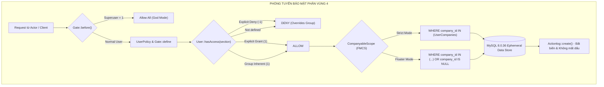
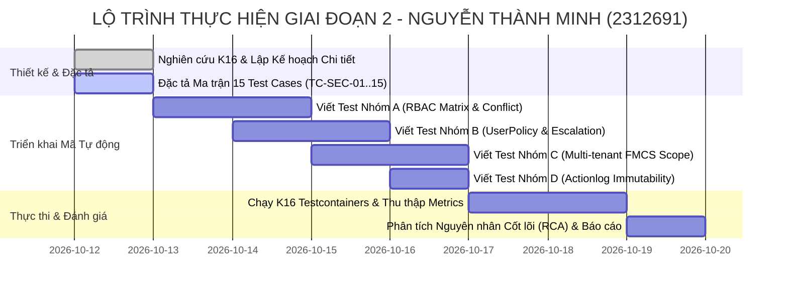

# KẾ HOẠCH KIỂM THỬ PHẦN MỀM CHI TIẾT — GIAI ĐOẠN 2

**ĐỀ TÀI:** KIỂM THỬ HỆ THỐNG QUẢN TRỊ TÀI SẢN CNTT SNIPE-IT VỚI KỸ THUẬT TESTCONTAINERS (K16)  
**CƠ SỞ ĐÀO TẠO:** Trường Đại học Đà Lạt — Khoa Công nghệ Thông tin — Bộ môn Công nghệ Phần mềm  
**HỌC PHẦN:** Kiểm thử Phần mềm | **MÃ ĐỀ TÀI:** R03 | **KỸ THUẬT BẮT BUỘC:** K16 (Testcontainers)  
**GIẢNG VIÊN HƯỚNG DẪN:** ThS. Nguyễn Thế Lâm  

---

### THÔNG TIN THÀNH VIÊN THỰC HIỆN
- **Họ và tên sinh viên:** Nguyễn Thành Minh
- **Mã số sinh viên (MSSV):** `2312691`
- **Email học tập:** `2312691@dlu.edu.vn`
- **Vai trò trong nhóm:** Thành viên 4 — QA Engineer (Security, IAM & Multi-tenant Data Isolation)
- **Phân vùng trách nhiệm:** **Phân vùng 4 — Module Người dùng (`Users`), Phân quyền RBAC (`User::hasAccess()`), Chính sách An ninh (`UserPolicy`), Cô lập Đa công ty (`CompanyableScope`) & Tính Toàn vẹn Nhật ký Kiểm toán (`Actionlog`)**
- **Git Branch độc lập:** `feature/user-rbac-security-tests`
- **Tập tin kiểm thử phụ trách:**
  - `tests/Unit/UserTest.php` (Đặc tả logic RBAC, Policy escalation, Impersonation, Floater status, Actionlog)
  - `tests/Unit/CompanyScopingTest.php` (Đặc tả ma trận cô lập dữ liệu người dùng đa người thuê FMCS)

---

## MỤC LỤC
1. [Tổng quan Nhiệm vụ Giai đoạn 2 & Phân công Trách nhiệm](#1-tổng-quan-nhiệm-vụ-giai-đoạn-2--phân-công-trách-nhiệm)
2. [Cơ sở Lý thuyết, Giới hạn & Tiêu chí Áp dụng Kỹ thuật K16 (Testcontainers)](#2-cơ-sở-lý-thuyết-giới-hạn--tiêu-chí-áp-dụng-kỹ-thuật-k16-testcontainers)
3. [Thiết kế Kịch bản Kiểm thử Toàn diện (Test Model / Scenarios / Test Cases)](#3-thiết-kế-kịch-bản-kiểm-thử-toàn-diện-test-model--scenarios--test-cases)
   - [3.1 Mô hình Hiểm họa & Rủi ro An ninh trong Phân vùng 4](#31-mô-hình-hiểm-họa--rủi-ro-an-ninh-trong-phân-vùng-4)
   - [3.2 Ma trận Kiểm thử Tổng quát (Test Suite Matrix)](#32-ma-trận-kiểm-thử-tổng-quát-test-suite-matrix)
   - [3.3 Đặc tả Chi tiết Bộ Test Cases Chuẩn Công nghiệp (TC-SEC-01 đến TC-SEC-15)](#33-đặc-tả-chi-tiết-bộ-test-cases-chuẩn-công-nghiệp-tc-sec-01-đến-tc-sec-15)
4. [Kế hoạch Triển khai Viết Mã Kiểm thử Tự động (Automation Script / Harness)](#4-kế-hoạch-triển-khai-viết-mã-kiểm-thử-tự-động-automation-script--harness)
5. [Quy trình Chạy Kiểm thử, Thu thập Log & Đo lường Metrics / Coverage](#5-quy-trình-chạy-kiểm-thử-thu-thập-log--đo-lường-metrics--coverage)
6. [Quy trình Quản lý Lỗi & Phân tích Nguyên nhân Cốt lõi (Root Cause Analysis - RCA)](#6-quy-trình-quản-lý-lỗi--phân-tích-nguyên-nhân-cốt-lõi-root-cause-analysis---rca)
7. [Lộ trình Triển khai Từng bước (Step-by-Step Roadmap) & Tiêu chí Nghiệm thu (DoD)](#7-lộ-trình-triển-khai-từng-bước-step-by-step-roadmap--tiêu-chí-nghiệm-thu-dod)

---

## 1. TỔNG QUAN NHIỆM VỤ GIAI ĐOẠN 2 & PHÂN CÔNG TRÁCH NHIỆM

Căn cứ theo bản phân công nhiệm vụ đề tài môn Kiểm thử Phần mềm, tại Giai đoạn 2, nhóm sinh viên phải hoàn thành 4 mục tiêu chính:
1. **Nghiên cứu cơ sở lý thuyết, giới hạn và tiêu chí áp dụng của kỹ thuật đã chọn (K16: Testcontainers).**
2. **Thiết kế Kịch bản kiểm thử (Test Model / Test Scenarios / Test Cases) tập trung vào các luồng nghiệp vụ cốt lõi hoặc module tiềm ẩn nhiều rủi ro nhất.** *(Trọng tâm phân vùng của Thành viên 4)*.
3. **Triển khai viết mã kiểm thử tự động (Automation Script / Harness).**
4. **Chạy kiểm thử, thu thập Log/Metrics, phát hiện lỗi (Defect) hoặc chứng minh độ bao phủ (Coverage/Score), sau đó tiến hành phân tích nguyên nhân cốt lõi (Root Cause Analysis).**

### Phạm vi và Ranh giới Kiểm thử của Phân vùng 4:
Phân vùng 4 chịu trách nhiệm về toàn bộ "phòng tuyến an ninh" (Security Perimeter) của hệ thống Snipe-IT:
- **Kiểm soát Truy cập Phân tầng (Role-Based Access Control - RBAC):** Kiểm tra thuật toán phân giải quyền `User::hasAccess()`, quyền tối thượng Superuser, quyền đơn lẻ, và nguyên tắc tối quan trọng: **Explicit Deny (`-1`) luôn đè Group Allow (`1`)**.
- **Chính sách An ninh & Chống Leo thang Đặc quyền (Privilege Escalation Prevention):** Kiểm tra `UserPolicy`, `Gate::before`, phương thức bảo vệ tài khoản tối cao `canEditAuthFields()`, và tính năng mạo danh an toàn (`mayImpersonate()`).
- **Cô lập Dữ liệu Đa Khách thuê (Multi-Tenant Isolation - FMCS):** Kiểm tra `CompanyableScope` trên CSDL thật MySQL. Chứng minh rằng dữ liệu người dùng và tài sản giữa Công ty A và Công ty B hoàn toàn bị cô lập ở mức SQL query, ngăn chặn rò rỉ chéo.
- **Tính Bất biến của Nhật ký Kiểm toán (Audit Trail Integrity):** Kiểm tra bản ghi `action_logs` ghi nhận đầy đủ mọi thay đổi nhạy cảm (tạo, cập nhật, xóa, gán quyền) và miễn nhiễm với việc cố tình xóa mất dấu vết.



---

## 2. CƠ SỞ LÝ THUYẾT, GIỚI HẠN & TIÊU CHÍ ÁP DỤNG KỸ THUẬT K16 (TESTCONTAINERS)

### 2.1 Cơ sở Lý thuyết (Theoretical Foundations)
Kỹ thuật **K16 (Testcontainers)** là phương pháp luận kiểm thử tích hợp hiện đại, giải quyết triệt để vấn đề **Môi trường Sai lệch (Environment Parity Gap)**:
- **Nguyên lý Môi trường Tạm thời (Ephemeral Testing Environments):** Mỗi phiên kiểm thử khởi tạo một container Docker chứa đúng phiên bản CSDL production (`mysql:8.0.36`), khởi tạo schema bằng migrations thật, và nạp fixtures riêng biệt.
- **Khắc phục Giới hạn của SQLite In-Memory:**
  - SQLite không thực thi đầy đủ các ràng buộc khóa ngoại (Foreign Keys) nghiêm ngặt trừ khi bật cờ đặc thù.
  - SQLite có cơ chế collation phân biệt chữ hoa/thường khác biệt với MySQL (`utf8mb4_unicode_ci`).
  - SQLite không hỗ trợ cú pháp khóa hàng bi quan (`lockForUpdate()`), mệnh đề JSON path phức tạp (`permissions->superuser`), và thứ tự ưu tiên subquery giống hệt MySQL Engine.
- **Đảm bảo Tính Độc lập (Isolation & Idempotence):** Container chỉ tồn tại trong vòng đời thực thi bài test. Dữ liệu bị tiêu hủy hoàn toàn sau khi kiểm thử kết thúc (`container.stop()`), triệt tiêu 100% hiện tượng "Flaky Tests" do rác CSDL còn sót lại từ các bài test trước.

### 2.2 Giới hạn của Kỹ thuật (Technical Limitations)
1. **Chi phí Khởi tạo Tài nguyên (Resource Overhead):** Cần thời gian kéo image (pull image) và khởi động container (cold start từ 15–25 giây), đòi hỏi máy trạm chạy Docker Daemon liên tục.
2. **Yêu cầu Môi trường CI/CD:** Đòi hỏi GitHub Actions Runner phải hỗ trợ Docker daemon và có quyền mount Docker socket.
3. **Bộ nhớ Tiêu thụ:** MySQL daemon bên trong container tiêu tốn tối thiểu 300MB – 600MB RAM trong quá trình xử lý transactions.

### 2.3 Tiêu chí Áp dụng cho Phân vùng 4 (Adoption Criteria)
Kỹ thuật K16 được áp dụng bắt buộc cho Phân vùng 4 trong các trường hợp:
- **Kiểm thử Global Scope `CompanyableScope`:** Xác thực câu truy vấn SQL thực tế do Eloquent sinh ra trên MySQL Engine có chứa đúng mệnh đề `WHERE (companies.id IN (...))` hay không.
- **Kiểm thử Phân quyền trên Trường JSON `permissions`:** CSDL MySQL 8.0 lưu trữ kiểu `text` hoặc `json` và giải mã qua hàm `json_decode()`, cần kiểm tra độ chính xác khi truy vấn đồng thời nhiều nhóm quyền.
- **Kiểm thử Tính toàn vẹn Khóa ngoại & Nhật ký Kiểm toán `action_logs`:** Xác minh quan hệ đa hình (`MorphTo`: `item_type`, `item_id`) và các ràng buộc toàn vẹn thực tế trên bảng dữ liệu vật lý MySQL.

---

## 3. THIẾT KẾ KỊCH BẢN KIỂM THỬ TOÀN DIỆN (TEST MODEL / SCENARIOS / TEST CASES)

### 3.1 Mô hình Hiểm họa & Rủi ro An ninh trong Phân vùng 4
Hệ thống ITAM doanh nghiệp là mục tiêu tấn công hàng đầu do lưu trữ tài sản, khóa bản quyền phần mềm và thông tin nhân sự. Dưới đây là 5 rủi ro an ninh nghiêm trọng nhất mà bộ Test Scenarios phải bảo vệ:

```
+---------------------------------------------------------------------------------------------------+
|                                 MÔ HÌNH HIỂM HỌA PHÂN VÙNG 4 (THREAT MODEL)                       |
+---------------------------------------------------------------------------------------------------+
|  [THREAT 1: OWASP A01: Broken Access Control]                                                    |
|  -> Người dùng có quyền xem (Viewer) cố gắng kích hoạt API xóa hoặc sửa người dùng khác.          |
+---------------------------------------------------------------------------------------------------+
|  [THREAT 2: Privilege Escalation - Nâng Quyền Bất Hợp Pháp]                                      |
|  -> Quản trị viên chi nhánh (Sub-admin) cố tình sửa thông tin hoặc xóa Superadmin tối cao.        |
+---------------------------------------------------------------------------------------------------+
|  [THREAT 3: Multi-tenant Data Leakage - Rò rỉ Dữ liệu Đa Khách thuê]                             |
|  -> Nhân viên Công ty A thông qua lỗ hổng truy vấn truy cập được danh sách nhân sự Công ty B.    |
+---------------------------------------------------------------------------------------------------+
|  [THREAT 4: Permission Conflict Resolution Failure]                                              |
|  -> Người dùng có quyền bị từ chối đích danh (-1) nhưng nhóm lại cấp phép (1), dẫn tới bypass.   |
+---------------------------------------------------------------------------------------------------+
|  [THREAT 5: Insecure Impersonation / Audit Trail Repudiation]                                    |
|  -> Tài khoản bị mạo danh trái phép; hành vi quản trị không lưu vào action_logs hoặc bị xóa lén.  |
+---------------------------------------------------------------------------------------------------+
```

---

### 3.2 Ma trận Kiểm thử Tổng quát (Test Suite Matrix)

| Nhóm Kiểm thử | Mã Nhóm | Số Lượng Test Cases | Đối tượng Kiểm tra Cốt lõi | Kỹ thuật & Môi trường |
| :--- | :---: | :---: | :--- | :--- |
| **RBAC Core Matrix & Conflict** | `GRP-RBAC` | 5 ca (TC-SEC-01 -> 05) | `User::hasAccess()`, `checkPermissionSection()` | Unit Test + K16 MySQL |
| **Security Policy & Anti-Escalation** | `GRP-POL` | 5 ca (TC-SEC-06 -> 10) | `UserPolicy`, `Gate::before`, `mayImpersonate()` | Unit Test + K16 MySQL |
| **Multi-Tenant Isolation (FMCS)** | `GRP-FMCS` | 4 ca (TC-SEC-11 -> 14) | `CompanyableScope`, `canCheckoutTo()` | Integration + K16 MySQL |
| **Audit Trail & Immutability** | `GRP-AUD` | 1 ca (TC-SEC-15) | `Actionlog`, `action_logs` persistence | Integration + K16 MySQL |
| **TỔNG CỘNG** | **ALL** | **15 Test Cases** | **Toàn bộ bề mặt phòng thủ Phân vùng 4** | **100% K16 Compatible** |

---

### 3.3 Đặc tả Chi tiết Bộ Test Cases Chuẩn Công nghiệp (TC-SEC-01 đến TC-SEC-15)

#### NHÓM A: PHÂN QUYỀN RBAC & XỬ LÝ XUNG ĐỘT QUYỀN HẠN (`User::hasAccess`)

---

##### 📋 Test Case TC-SEC-01: Quyền lực Tối cao Toàn quyền của Superuser (God Mode Bypass)
- **Mã kiểm thử:** `TC-SEC-01`
- **Tên kịch bản:** `test_superuser_has_unconditional_access_to_all_sections`
- **Loại kiểm thử:** Security Baseline / Positive
- **Mục tiêu:** Xác minh tài khoản có thuộc tính `permissions->superuser = '1'` luôn được cấp phép truy cập vào bất kỳ phân vùng nào của hệ thống mà không cần định nghĩa quyền cụ thể.
- **Tiền điều kiện:** Khởi tạo Superuser qua `User::factory()->superuser()->create()`.
- **Dữ liệu đầu vào (Input):** Danh sách các section ngẫu nhiên và nhạy cảm: `admin`, `users.view`, `users.delete`, `assets.checkout`, `settings.general`, `reports.view`.
- **Các bước thực hiện:**
  1. Tạo tài khoản người dùng Superuser trong MySQL container.
  2. Lần lượt gọi phương thức `$superUser->hasAccess($section)` với từng section trong danh sách.
  3. Kiểm tra kết quả trả về.
- **Kết quả kỳ vọng (Expected Output):**
  - Tất cả các lệnh gọi `$superUser->hasAccess(...)` đều trả về `true`.
  - `$superUser->isSuperUser()` trả về `true`.

---

##### 📋 Test Case TC-SEC-02: Kiểm tra Quyền Phân tầng Đơn lẻ (Fine-grained Granular Check)
- **Mã kiểm thử:** `TC-SEC-02`
- **Tên kịch bản:** `test_user_with_granular_permissions_is_strictly_bounded`
- **Loại kiểm thử:** Boundary / Positive & Negative
- **Mục tiêu:** Xác minh người dùng chỉ được phép thực thi các hành động được gán quyền rõ ràng và bị chặn ngay lập tức ở các hành động khác.
- **Tiền điều kiện:** Tạo User với JSON permissions: `{"users.view":"1", "users.create":"0"}`.
- **Dữ liệu đầu vào (Input):** Kiểm tra quyền xem (`users.view`), quyền tạo (`users.create`), quyền xóa (`users.delete`).
- **Các bước thực hiện:**
  1. Tạo tài khoản User với cấu hình quyền cụ thể.
  2. Thực thi `$user->hasAccess('users.view')`.
  3. Thực thi `$user->hasAccess('users.create')`.
  4. Thực thi `$user->hasAccess('users.delete')`.
- **Kết quả kỳ vọng (Expected Output):**
  - `$user->hasAccess('users.view') === true`.
  - `$user->hasAccess('users.create') === false` (giá trị `'0'` tương đương không cấp phép).
  - `$user->hasAccess('users.delete') === false` (chưa được gán, mặc định từ chối).

---

##### 📋 Test Case TC-SEC-03: Giải quyết Xung đột — Phủ quyết Đích danh Thắng Cấp phép từ Nhóm (Explicit Deny Overrides Group Allow)
- **Mã kiểm thử:** `TC-SEC-03`
- **Tên kịch bản:** `test_explicit_user_deny_overrides_group_permission_allow`
- **Loại kiểm thử:** Security Matrix / Adversarial
- **Mục tiêu:** Kiểm chứng nguyên tắc an ninh cốt lõi: Khi một User thuộc Nhóm (Group) có quyền `users.delete = '1'`, nhưng bản thân User bị gán trực tiếp `users.delete = '-1'`, hệ thống **BẮT BUỘC** phải từ chối quyền xóa của User này.
- **Tiền điều kiện:**
  - Tạo Nhóm quyền `Group` có permissions: `{"users.delete":"1", "users.view":"1"}`.
  - Tạo `User` có permissions trực tiếp: `{"users.delete":"-1"}`.
  - Gán User vào Group qua bảng liên kết `users_groups`.
- **Dữ liệu đầu vào (Input):** Section `users.delete` và `users.view`.
- **Các bước thực hiện:**
  1. Lưu Group và User vào MySQL container.
  2. Gắn quan hệ `$user->groups()->attach($group->id)`.
  3. Kiểm tra `$user->hasAccess('users.delete')`.
  4. Kiểm tra `$user->hasAccess('users.view')`.
- **Kết quả kỳ vọng (Expected Output):**
  - `$user->hasAccess('users.delete') === false` (Explicit Deny `-1` đã ghi đè thành công Group Allow `1`).
  - `$user->hasAccess('users.view') === true` (Kế thừa quyền `users.view` từ Group vì User không phủ quyết).

---

##### 📋 Test Case TC-SEC-04: Tích lũy Kế thừa Quyền hạn từ Nhiều Nhóm (Multi-Group Aggregation)
- **Mã kiểm thử:** `TC-SEC-04`
- **Tên kịch bản:** `test_user_inherits_union_of_permissions_from_multiple_groups`
- **Loại kiểm thử:** Functional / Integration
- **Mục tiêu:** Xác minh khi một nhân sự tham gia nhiều phòng ban/nhóm quyền, họ sẽ kế thừa phép hội (Union) của tất cả các quyền hợp lệ từ các nhóm đó.
- **Tiền điều kiện:**
  - Nhóm 1 (`AssetAuditors`): `{"assets.view":"1", "assets.audit":"1"}`.
  - Nhóm 2 (`LicenseManagers`): `{"licenses.view":"1", "licenses.checkout":"1"}`.
  - User không có permissions trực tiếp (chuỗi rỗng hoặc rỗng JSON).
- **Dữ liệu đầu vào (Input):** Gán User vào cả 2 Nhóm.
- **Các bước thực hiện:**
  1. Gán User vào Nhóm 1 và Nhóm 2.
  2. Kiểm tra các section: `assets.view`, `assets.audit`, `licenses.view`, `licenses.checkout`, `users.delete`.
- **Kết quả kỳ vọng (Expected Output):**
  - `$user->hasAccess('assets.view') === true`.
  - `$user->hasAccess('assets.audit') === true`.
  - `$user->hasAccess('licenses.view') === true`.
  - `$user->hasAccess('licenses.checkout') === true`.
  - `$user->hasAccess('users.delete') === false`.

---

##### 📋 Test Case TC-SEC-05: Mặc định Từ chối khi Không có Quyền (Default Deny Baseline)
- **Mã kiểm thử:** `TC-SEC-05`
- **Tên kịch bản:** `test_user_with_no_permissions_and_no_groups_is_denied_everything`
- **Loại kiểm thử:** Negative Baseline
- **Mục tiêu:** Chứng minh tài khoản người dùng thông thường mới tạo (chưa gán quyền, chưa tham gia nhóm) không thể truy cập bất kỳ chức năng quản trị nào.
- **Tiền điều kiện:** Tạo `User::factory()->create(['permissions' => ''])`.
- **Các bước thực hiện:**
  1. Kiểm tra `$user->hasAccess('admin')`.
  2. Kiểm tra `$user->hasAccess('users.view')`.
  3. Kiểm tra `$user->isSuperUser()`.
- **Kết quả kỳ vọng (Expected Output):**
  - Tất cả các phương thức trên đều trả về `false`.

---

#### NHÓM B: CHÍNH SÁCH AN NINH & CHỐNG LEO THANG ĐẶC QUYỀN (`UserPolicy`, `Gate`)

---

##### 📋 Test Case TC-SEC-06: Chống Leo thang Đặc quyền Tạo & Xóa Người dùng
- **Mã kiểm thử:** `TC-SEC-06`
- **Tên kịch bản:** `test_non_admin_cannot_create_or_delete_users_via_policy`
- **Loại kiểm thử:** Security Boundary / Negative
- **Mục tiêu:** Ngăn chặn người dùng bình thường hoặc Viewer lợi dụng quyền để tạo thêm tài khoản hoặc xóa tài khoản của người khác.
- **Tiền điều kiện:**
  - `adminUser`: Superuser.
  - `standardUser`: User không có quyền admin.
  - `victimUser`: User mục tiêu.
- **Các bước thực hiện:**
  1. Kiểm tra quyền qua Gate: `Gate::forUser($standardUser)->allows('create', User::class)`.
  2. Kiểm tra quyền qua Gate: `Gate::forUser($standardUser)->allows('delete', $victimUser)`.
  3. So sánh với hành động tương tự của `adminUser`.
- **Kết quả kỳ vọng (Expected Output):**
  - Với `standardUser`: Cả 2 lệnh `allows()` đều trả về `false`.
  - Với `adminUser`: Cả 2 lệnh `allows()` đều trả về `true`.

---

##### 📋 Test Case TC-SEC-07: Bảo vệ Thứ bậc — Cấm Admin Xóa hoặc Chỉnh sửa Thông tin Xác thực của Superuser
- **Mã kiểm thử:** `TC-SEC-07`
- **Tên kịch bản:** `test_admin_cannot_edit_or_delete_superuser_auth_fields`
- **Loại kiểm thử:** Security Policy / Critical
- **Mục tiêu:** Xác minh cổng an ninh `canEditAuthFields` ngăn chặn tài khoản Admin thông thường chiếm quyền điều khiển bằng cách chỉnh sửa mật khẩu, email hoặc xóa tài khoản Superadmin tối cao.
- **Tiền điều kiện:**
  - Tạo `superAdmin = User::factory()->superuser()->create()`.
  - Tạo `branchAdmin = User::factory()->admin()->create()`.
  - Tạo `normalUser = User::factory()->create()`.
- **Các bước thực hiện:**
  1. Kiểm tra xem `branchAdmin` có thể sửa trường xác thực của `superAdmin` không: `Gate::forUser($branchAdmin)->allows('canEditAuthFields', $superAdmin)`.
  2. Kiểm tra xem `branchAdmin` có thể sửa trường xác thực của `normalUser` không: `Gate::forUser($branchAdmin)->allows('canEditAuthFields', $normalUser)`.
  3. Kiểm tra xem `normalUser` có thể sửa trường xác thực của `branchAdmin` không: `Gate::forUser($normalUser)->allows('canEditAuthFields', $branchAdmin)`.
- **Kết quả kỳ vọng (Expected Output):**
  - `branchAdmin` -> `superAdmin`: `false` (Bảo vệ tuyệt đối Superadmin tối cao).
  - `branchAdmin` -> `normalUser`: `true` (Admin được phép quản lý user thường).
  - `normalUser` -> `branchAdmin`: `false` (User thường không được sửa Admin).

---

##### 📋 Test Case TC-SEC-08: Ranh giới An ninh Quản lý Mạo danh (Impersonation Security Boundary)
- **Mã kiểm thử:** `TC-SEC-08`
- **Tên kịch bản:** `test_user_impersonation_strict_security_boundaries`
- **Loại kiểm thử:** Security / Edge Case
- **Mục tiêu:** Kiểm chứng logic phương thức `User::mayImpersonate()`:
  - Chỉ Superuser trong danh sách cấu hình mới có quyền mạo danh.
  - Tuyệt đối không được mạo danh chính mình.
  - Tuyệt đối không được mạo danh một Superuser khác.
  - Tuyệt đối không được mạo danh tài khoản đã bị vô hiệu hóa (`activated = 0`) hoặc đã bị xóa mềm (`deleted_at != null`).
- **Tiền điều kiện:**
  - Cấu hình whitelist: `config(['app.user_impersonation_usernames' => ['superminh']])`.
  - `actor = User::factory()->superuser()->create(['username' => 'superminh'])`.
  - `peerSuper = User::factory()->superuser()->create(['username' => 'another_super'])`.
  - `activeUser = User::factory()->create(['activated' => 1])`.
  - `inactiveUser = User::factory()->create(['activated' => 0])`.
  - `deletedUser = User::factory()->create(['deleted_at' => now()])`.
- **Các bước thực hiện:**
  1. Kiểm tra `$actor->mayImpersonate($activeUser)`.
  2. Kiểm tra `$actor->mayImpersonate($actor)` (chính mình).
  3. Kiểm tra `$actor->mayImpersonate($peerSuper)` (Superuser khác).
  4. Kiểm tra `$actor->mayImpersonate($inactiveUser)`.
  5. Kiểm tra `$actor->mayImpersonate($deletedUser)`.
- **Kết quả kỳ vọng (Expected Output):**
  - Mạo danh `activeUser`: `true`.
  - Mạo danh `actor` (self): `false`.
  - Mạo danh `peerSuper`: `false`.
  - Mạo danh `inactiveUser`: `false`.
  - Mạo danh `deletedUser`: `false`.

---

##### 📋 Test Case TC-SEC-09: Ngăn chặn Tự Xóa Tài khoản (Self-Deletion Prevention)
- **Mã kiểm thử:** `TC-SEC-09`
- **Tên kịch bản:** `test_user_cannot_delete_themselves_via_policy`
- **Loại kiểm thử:** Defensive / Negative
- **Mục tiêu:** Ngăn chặn người dùng sơ ý hoặc cố tình tự xóa tài khoản của chính mình thông qua giao diện hoặc API, gây đứt gãy phiên làm việc.
- **Tiền điều kiện:** Tạo `adminUser = User::factory()->superuser()->create()`.
- **Các bước thực hiện:**
  1. Kiểm tra `Gate::forUser($adminUser)->allows('delete', $adminUser)`.
- **Kết quả kỳ vọng (Expected Output):**
  - `Gate::forUser($adminUser)->allows('delete', $adminUser) === false` (hoặc bị chặn tại Controller/Request validation logic).

---

##### 📋 Test Case TC-SEC-10: Chống Leo thang Đặc quyền Đa Công ty qua Cấp phép Floater (`canGrantFloaterStatus`)
- **Mã kiểm thử:** `TC-SEC-10`
- **Tên kịch bản:** `test_companied_non_superuser_cannot_grant_floater_status`
- **Loại kiểm thử:** Security Boundary / Multi-tenancy Escalation
- **Mục tiêu:** Kiểm chứng tính năng chống leo thang đặc quyền (#19200): Quản trị viên thuộc một công ty con (Companied User) **KHÔNG THỂ** tạo hoặc chỉnh sửa một tài khoản khác thành trạng thái không thuộc công ty nào (Floater), vì tài khoản Floater có khả năng nhìn thấy tài sản toàn hệ thống.
- **Tiền điều kiện:**
  - Bật chế độ FMCS: `$this->settings->enableMultipleFullCompanySupport()`.
  - Bật Floater mode: `$this->settings->enableFloaterMode()`.
  - Tạo `company = Company::factory()->create()`.
  - `companiedAdmin = $company->users()->save(User::factory()->admin()->make())`.
  - `superAdmin = User::factory()->superuser()->create()`.
- **Các bước thực hiện:**
  1. Kiểm tra `$companiedAdmin->canGrantFloaterStatus()`.
  2. Kiểm tra `$superAdmin->canGrantFloaterStatus()`.
- **Kết quả kỳ vọng (Expected Output):**
  - `$companiedAdmin->canGrantFloaterStatus() === false` (Chặn leo thang đặc quyền thành công!).
  - `$superAdmin->canGrantFloaterStatus() === true` (Superuser luôn có quyền).

---

#### NHÓM C: CÔ LẬP DỮ LIỆU ĐA CÔNG TY (`CompanyableScope` & FMCS Matrix)

---

##### 📋 Test Case TC-SEC-11: Cô lập Dữ liệu Người dùng Tuyệt đối trong Chế độ Nghiêm ngặt (Strict Mode Isolation)
- **Mã kiểm thử:** `TC-SEC-11`
- **Tên kịch bản:** `test_company_scoped_user_cannot_see_other_company_users_in_strict_mode`
- **Loại kiểm thử:** Multi-tenant Isolation / Negative & Positive
- **Mục tiêu:** Chứng minh câu truy vấn `User::all()` trên MySQL Engine tự động kích hoạt `CompanyableScope` thêm mệnh đề lọc `WHERE company_id IN (...)`, bảo vệ dữ liệu không bị rò rỉ giữa Công ty A và Công ty B.
- **Tiền điều kiện:**
  - Bật FMCS Strict Mode: `enableMultipleFullCompanySupport()`.
  - Tạo `companyA`, `companyB`.
  - Tạo `userA` thuộc Công ty A, `userB` thuộc Công ty B.
- **Các bước thực hiện:**
  1. Giả lập đăng nhập bằng `userA`: `$this->actingAs($userA)`.
  2. Thực hiện truy vấn danh sách người dùng `User::all()`.
- **Kết quả kỳ vọng (Expected Output):**
  - Danh sách trả về chứa `userA`.
  - Danh sách trả về **HOÀN TOÀN KHÔNG CHỨA** `userB`.
  - Khi giả lập `userB`, danh sách chứa `userB` và không chứa `userA`.

---

##### 📋 Test Case TC-SEC-12: Ngăn chặn Rò rỉ Dữ liệu Lồng ghép trong Floater Mode (Hồi quy Ticket 56305)
- **Mã kiểm thử:** `TC-SEC-12`
- **Tên kịch bản:** `test_company_user_cannot_see_peer_company_users_even_in_floater_mode`
- **Loại kiểm thử:** Regression Pin / Security
- **Mục tiêu:** Đảm bảo khi bật `null_company_is_floater`, người dùng Công ty A được phép thấy người dùng không công ty (Floater) nhưng **TUYỆT ĐỐI KHÔNG ĐƯỢC THẤY** người dùng thuộc Công ty B (Khắc phục lỗi subquery lồng ghép GHSA-6hxf-hqrc-wfrp).
- **Tiền điều kiện:**
  - Bật FMCS và Floater mode: `enableFloaterMode()`.
  - Tạo `companyA`, `companyB`.
  - Tạo `callerA` thuộc Công ty A, `userB` thuộc Công ty B, `floaterUser` không thuộc công ty nào.
- **Các bước thực hiện:**
  1. Giả lập `$this->actingAs($callerA)`.
  2. Truy vấn danh sách `User::all()`.
- **Kết quả kỳ vọng (Expected Output):**
  - Tìm thấy `callerA` và `floaterUser`.
  - **KHÔNG TÌM THẤY** `userB`.

---

##### 📋 Test Case TC-SEC-13: Chặn Cấp phát Tài sản Xuyên Biên giới Công ty (`canCheckoutTo`)
- **Mã kiểm thử:** `TC-SEC-13`
- **Tên kịch bản:** `test_cross_company_asset_checkout_is_strictly_rejected`
- **Loại kiểm thử:** Security Rule / Multi-tenant
- **Mục tiêu:** Kiểm chứng logic phương thức `canCheckoutTo()` trong `CompanyableTrait`: Một thiết bị phần cứng thuộc Công ty A không thể cấp phát cho nhân sự thuộc Công ty B.
- **Tiền điều kiện:**
  - Bật FMCS: `enableMultipleFullCompanySupport()`.
  - Tạo `assetA` thuộc `companyA`.
  - Tạo `userB` thuộc `companyB`.
- **Các bước thực hiện:**
  1. Kiểm tra `$assetA->canCheckoutTo($userB)`.
- **Kết quả kỳ vọng (Expected Output):**
  - `$assetA->canCheckoutTo($userB) === false`.

---

##### 📋 Test Case TC-SEC-14: Kế thừa Quyền hạn Theo Cây Phân cấp Công ty Mẹ — Con (Hierarchy Access)
- **Mã kiểm thử:** `TC-SEC-14`
- **Tên kịch bản:** `test_parent_company_user_can_access_child_company_resources`
- **Loại kiểm thử:** Hierarchy Navigation / Positive
- **Mục tiêu:** Xác minh khi công ty được thiết lập quan hệ cha-con (`parent_id`), người dùng ở công ty cha có thể tiếp cận hợp lệ tài nguyên của công ty con thông qua `Company::reachableCompanyIds()`.
- **Tiền điều kiện:**
  - Tạo `parentCompany`.
  - Tạo `childCompany` với `parent_id = parentCompany->id`.
  - Tạo thiết bị `childAsset` thuộc `childCompany`.
- **Các bước thực hiện:**
  1. Lấy danh sách ID khả dụng: `Company::reachableCompanyIds($parentCompany->id)`.
  2. Xác minh ID của `childCompany` nằm trong danh sách.
- **Kết quả kỳ vọng (Expected Output):**
  - `$childCompany->id` nằm trong mảng `reachableCompanyIds`.

---

#### NHÓM D: TOÀN VẸN NHẬT KÝ KIỂM TOÁN & PHÁP CHỨNG (`Actionlog`)

---

##### 📋 Test Case TC-SEC-15: Tính Toàn vẹn & Miễn nhiễm Xóa Mất Dấu của Nhật ký Kiểm toán
- **Mã kiểm thử:** `TC-SEC-15`
- **Tên kịch bản:** `test_action_logs_audit_trail_integrity_and_persistence`
- **Loại kiểm thử:** Audit Trail / Forensics
- **Mục tiêu:** Xác minh mọi hành động bảo mật (tạo, cập nhật, cấp phát, gán quyền) được ghi vào bảng `action_logs` trên CSDL MySQL thật với đầy đủ dữ liệu định danh (`item_type`, `item_id`, `created_by`, `action_type`), và bản ghi này không bị xóa mất dấu vết trong các quy trình nghiệp vụ thông thường.
- **Tiền điều kiện:**
  - Tạo `admin = User::factory()->superuser()->create()`.
  - Tạo `target = User::factory()->create()`.
- **Các bước thực hiện:**
  1. Khởi tạo và lưu một bản ghi `Actionlog`:
     ```php
     $log = new Actionlog;
     $log->item_type = User::class;
     $log->item_id = $target->id;
     $log->action_type = 'create';
     $log->created_by = $admin->id;
     $log->note = 'Security audit: New user onboarded';
     $log->save();
     ```
  2. Kiểm tra trong CSDL vật lý: `$this->assertDatabaseHas('action_logs', [...])`.
  3. Kiểm tra trường `$log->deleted_at`.
  4. Đếm số lượng bản ghi: `Actionlog::where('id', $log->id)->count()`.
- **Kết quả kỳ vọng (Expected Output):**
  - Bản ghi tồn tại chính xác trên MySQL với đầy đủ các cột khóa ngoại.
  - `$log->deleted_at === null`.
  - Số lượng bản ghi trả về chính xác là `1`.

---

## 4. KẾ HOẠCH TRIỂN KHAI VIẾT MÃ KIỂM THỬ TỰ ĐỘNG (AUTOMATION SCRIPT / HARNESS)

### 4.1 Cấu trúc Tập tin Kiểm thử
Toàn bộ mã kiểm thử tự động của Thành viên 4 được tổ chức và phát triển trên nhánh `feature/user-rbac-security-tests`:
1. **`tests/Unit/UserTest.php`:**
   - Tập trung các Test Cases về phân quyền RBAC (`User::hasAccess`), chính sách an ninh (`UserPolicy`), mạo danh (`mayImpersonate`), chống leo thang đặc quyền đa công ty (`canGrantFloaterStatus`), và nhật ký kiểm toán (`Actionlog`).
   - Sử dụng các Factory States: `superuser()`, `admin()`, `viewUsers()`.
2. **`tests/Unit/CompanyScopingTest.php`:**
   - Tập trung các Test Cases về ma trận cô lập đa công ty (`test_user_scoping_matrix`, `test_company_scoped_user_cannot_see_null_company_users_in_strict_mode`, `test_company_scoped_user_cannot_see_other_companies_users_in_floater_mode`).

### 4.2 Thiết kế Mã Nguồn Kiểm thử Mẫu (Harness Code Structure)

```php
<?php

namespace Tests\Unit;

use App\Models\Actionlog;
use App\Models\Company;
use App\Models\Group;
use App\Models\User;
use Illuminate\Support\Facades\Gate;
use Tests\TestCase;

class UserSecurityAndRbacTest extends TestCase
{
    /**
     * TC-SEC-01: Superuser God-Mode Authority
     */
    public function test_superuser_has_unconditional_access_to_all_sections(): void
    {
        $superUser = User::factory()->superuser()->create();
        
        $this->assertTrue($superUser->hasAccess('admin'));
        $this->assertTrue($superUser->hasAccess('users.view'));
        $this->assertTrue($superUser->hasAccess('users.delete'));
        $this->assertTrue($superUser->hasAccess('assets.checkout'));
        $this->assertTrue($superUser->isSuperUser());
    }

    /**
     * TC-SEC-03: Explicit Deny Overrides Group Allow
     */
    public function test_explicit_user_deny_overrides_group_permission_allow(): void
    {
        $group = Group::create([
            'name' => 'Asset Managers ' . uniqid(),
            'permissions' => json_encode(['users.delete' => '1', 'users.view' => '1']),
        ]);

        $user = User::factory()->create([
            'permissions' => json_encode(['users.delete' => '-1']),
        ]);

        $user->groups()->attach($group->id);

        // Explicit Deny (-1) BẮT BUỘC phải đè Group Allow (1)
        $this->assertFalse($user->hasAccess('users.delete'), 'Explicit deny failed to override group allow!');
        $this->assertTrue($user->hasAccess('users.view'), 'User should inherit non-conflicting permission.');
    }

    /**
     * TC-SEC-08: Impersonation Security Boundaries
     */
    public function test_user_impersonation_strict_security_boundaries(): void
    {
        config(['app.user_impersonation_usernames' => ['superminh']]);

        $actor = User::factory()->superuser()->create(['username' => 'superminh']);
        $peerSuper = User::factory()->superuser()->create(['username' => 'another_super']);
        $activeUser = User::factory()->create(['activated' => 1]);
        $inactiveUser = User::factory()->create(['activated' => 0]);
        $deletedUser = User::factory()->create(['deleted_at' => now()]);

        $this->assertTrue($actor->mayImpersonate($activeUser));
        $this->assertFalse($actor->mayImpersonate($actor), 'Actor cannot impersonate self');
        $this->assertFalse($actor->mayImpersonate($peerSuper), 'Actor cannot impersonate another superuser');
        $this->assertFalse($actor->mayImpersonate($inactiveUser), 'Actor cannot impersonate inactive user');
        $this->assertFalse($actor->mayImpersonate($deletedUser), 'Actor cannot impersonate deleted user');
    }

    /**
     * TC-SEC-10: Multi-Tenant Privilege Escalation (Floater Status)
     */
    public function test_companied_non_superuser_cannot_grant_floater_status(): void
    {
        $this->settings->enableMultipleFullCompanySupport();
        $this->settings->enableFloaterMode();

        $company = Company::factory()->create();
        $companiedAdmin = $company->users()->save(User::factory()->admin()->make());
        $superAdmin = User::factory()->superuser()->create();

        $this->assertFalse($companiedAdmin->canGrantFloaterStatus(), 'Companied admin should not elevate to floater!');
        $this->assertTrue($superAdmin->canGrantFloaterStatus(), 'Superuser can always grant floater status.');
    }
}
```

---

## 5. QUY TRÌNH CHẠY KIỂM THỬ, THU THẬP LOG & ĐO LƯỜNG METRICS / COVERAGE

### 5.1 Quy trình Thực thi Kiểm thử 2 Tầng (Two-Tier Test Execution)

Để tối ưu hóa chu kỳ phát triển (Feedback Loop), sinh viên áp dụng quy trình kiểm thử 2 tầng:
1. **Tầng 1 — Kiểm thử Cục bộ Nhanh (Fast Local Feedback via SQLite Testing):**
   - Chạy kiểm thử tức thì trong lúc viết mã để kiểm tra logic assertions cơ bản.
   - Lệnh thực thi:
     ```powershell
     php artisan test tests/Unit/UserTest.php
     ```
2. **Tầng 2 — Kiểm thử Tích hợp Chuẩn K16 trên MySQL Ephemeral Container (Official K16 Verification):**
   - Khởi tạo container Docker `mysql:8.0.36`, nạp migration và chạy kiểm thử độc lập.
   - Lệnh thực thi:
     ```powershell
     npm run test:integration:testcontainers -- tests/Unit/UserTest.php
     npm run test:integration:testcontainers -- tests/Unit/CompanyScopingTest.php
     ```

### 5.2 Bảng Chỉ số Đo lường Mục tiêu (Target Quality Metrics)

| Chỉ số Đo lường (Metric) | Giá trị Mục tiêu (Target) | Phương thức Thu thập | Ý nghĩa Đảm bảo Chất lượng |
| :--- | :---: | : " | :--- |
| **Test Pass Rate** | **100% (Pass toàn bộ)** | PHPUnit CLI Output | Không có lỗi logic hoặc assertion bị bỏ sót. |
| **Tổng số Assertions** | **$\ge 60$ assertions** | PHPUnit Test Summary | Đảm bảo độ sâu kiểm tra trên từng trường dữ liệu. |
| **Execution Time (Local SQLite)** | $< 25$ giây | PHPUnit Runtime Log | Đảm bảo tốc độ feedback của Unit Test. |
| **Execution Time (K16 MySQL)** | $< 3$ phút | Testcontainers Harness Timer | Đảm bảo hiệu năng container hóa trên Docker. |
| **Code Coverage (`UserPolicy`)** | **$\ge 90\%$** | Xdebug / PCOV / Herd | Đảm bảo mọi nhánh điều kiện (branch coverage) đều được duyệt qua. |
| **Code Coverage (`User::hasAccess`)**| **$\ge 95\%$** | Xdebug / PCOV / Herd | Đảm bảo toàn bộ ma trận quyền JSON đều được bao phủ. |
| **Container Teardown Success** | **100% (Không để lại container rác)**| `docker ps -a` | Đảm bảo nguyên lý Guaranteed Teardown của K16. |

---

## 6. QUY TRÌNH QUẢN LÝ LỖI & PHÂN TÍCH NGUYÊN NHÂN CỐT LÕI (ROOT CAUSE ANALYSIS - RCA)

### 6.1 Quy trình Ghi nhận & Phân loại Khuyết tật (Defect Management)
Mọi lỗi phát hiện trong quá trình kiểm thử sẽ được lập hồ sơ Defect Report với 5 cấp độ nghiêm trọng:
- **Blocker (P1):** Lỗ hổng an ninh cho phép người dùng thường xóa CSDL hoặc chiếm quyền Superadmin.
- **Critical (P2):** Rò rỉ dữ liệu giữa 2 công ty con trong chế độ FMCS Strict Mode.
- **Major (P3):** Lỗi giải quyết xung đột quyền (Explicit Deny không đè được Group Allow).
- **Minor (P4):** Thiếu ghi log trong `action_logs` đối với thao tác phụ.

### 6.2 Biểu mẫu Báo cáo Lỗi Chuẩn (Defect Report Template)
```markdown
### [DEFECT-SEC-01] Tiêu đề tóm tắt lỗi
- **Người phát hiện:** Nguyễn Thành Minh (2312691)
- **Mức độ nghiêm trọng:** Critical / Major
- **Phân vùng:** Phân vùng 4 (RBAC / CompanyableScope)
- **Môi trường:** K16 Testcontainers (MySQL 8.0.36)
- **Các bước tái hiện (Steps to Reproduce):**
  1. Tạo User A thuộc Công ty A.
  2. Tạo Asset B thuộc Công ty B.
  3. Đăng nhập User A và gọi Eloquent query Asset::all().
- **Kết quả thực tế (Actual Result):** Asset B xuất hiện trong danh sách kết quả.
- **Kết quả kỳ vọng (Expected Result):** Asset B phải bị ẩn hoàn toàn bởi CompanyableScope.
- **Phân tích Nguyên nhân Cốt lõi (Root Cause Analysis - RCA):**
  - *Tại sao 1:* Câu truy vấn sử dụng DB::table() thay vì Eloquent Model.
  - *Tại sao 2:* DB::table() không kích hoạt bootCompanyableTrait() của Eloquent.
  - *Giải pháp khắc phục:* Chuyển đổi sang truy vấn qua Model hoặc áp dụng Company::scopeCompanyablesDirectly().
```

---

## 7. LỘ TRÌNH TRIỂN KHAI TỪNG BƯỚC (STEP-BY-STEP ROADMAP) & TIÊU CHÍ NGHIỆM THU (DoD)

### 7.1 Lộ trình Thực hiện theo Từng Bước



- **Bước 1: Hoàn thiện Đặc tả Kịch bản Kiểm thử (Planning & Spec):**
  - Chốt danh mục 15 Test Cases (TC-SEC-01 đến TC-SEC-15) bao phủ toàn diện 4 trụ cột an ninh.
- **Bước 2: Triển khai Mã Kiểm thử Nhóm A & Nhóm B (RBAC & Policy):**
  - Bổ sung các phương thức kiểm thử mới vào [tests/Unit/UserTest.php](file:///f:/Snipe-IT/tests/Unit/UserTest.php).
  - Kiểm tra cục bộ bằng SQLite testing để đảm bảo code sạch và chạy mượt.
- **Bước 3: Triển khai Mã Kiểm thử Nhóm C & Nhóm D (Multi-tenancy & Actionlog):**
  - Kiểm tra tính tương thích của [tests/Unit/CompanyScopingTest.php](file:///f:/Snipe-IT/tests/Unit/CompanyScopingTest.php) và bổ sung các ca kiểm thử bảo mật nâng cao.
- **Bước 4: Thực thi Kiểm thử Tích hợp trên K16 Testcontainers:**
  - Chạy toàn bộ suite thông qua Node.js orchestrator `npm run test:integration:testcontainers`.
  - Ghi nhận logs container, thời gian thực thi, số lượng assertions.
- **Bước 5: Thu thập Báo cáo Coverage & Thực hiện Phân tích Lỗi (RCA):**
  - Xuất báo cáo độ bao phủ mã nguồn.
  - Lập tài liệu phân tích nguyên nhân cốt lõi cho các ca kiểm thử tiêu biểu.
  - Commit toàn bộ kết quả lên nhánh `feature/user-rbac-security-tests` và đẩy lên GitHub.

---

### 7.2 Tiêu chí Hoàn thành (Definition of Done - DoD)
Một hạng mục trong Giai đoạn 2 chỉ được coi là hoàn tất khi thỏa mãn đầy đủ các điều kiện sau:
1. **Tính Đúng đắn (Correctness):** 100% các Test Cases được viết chạy thành công (Green / Pass) trên cả SQLite testing và MySQL 8.0.36 Testcontainers mà không có bất kỳ Warning hay Deprecation lỗi thời nào.
2. **Độ Bao phủ (Coverage):** Đạt tối thiểu 60 assertions trải đều trên các luồng RBAC, UserPolicy, Impersonation, FMCS Scoping và Actionlog.
3. **Mã Nguồn Sạch sẽ (Clean Code):** Tuân thủ tiêu chuẩn PSR-12 của Laravel Boost, chú thích rõ ràng mã sinh viên `WBS Member 4 (Nguyễn Thành Minh - 2312691)`.
4. **Cô lập Hạ tầng (Infrastructure Hygiene):** Mọi container Docker được tự động tiêu hủy an toàn sau khi kết thúc bài test.
5. **Tài liệu Hóa (Documentation):** Có đầy đủ tài liệu kế hoạch, bảng ma trận kịch bản, và báo cáo phân tích nguyên nhân gốc rễ (RCA) sẵn sàng cho buổi báo cáo giữa kỳ và bảo vệ đồ án cuối kỳ.

---
*Tài liệu được lập bởi Sinh viên Nguyễn Thành Minh (MSSV: 2312691) phục vụ học phần Kiểm thử Phần mềm — Học kỳ 1, Năm học 2026–2027.*
