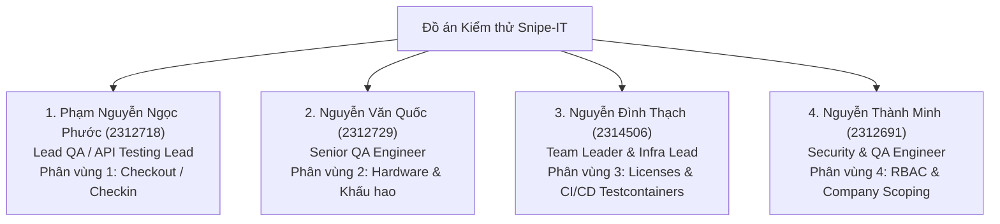
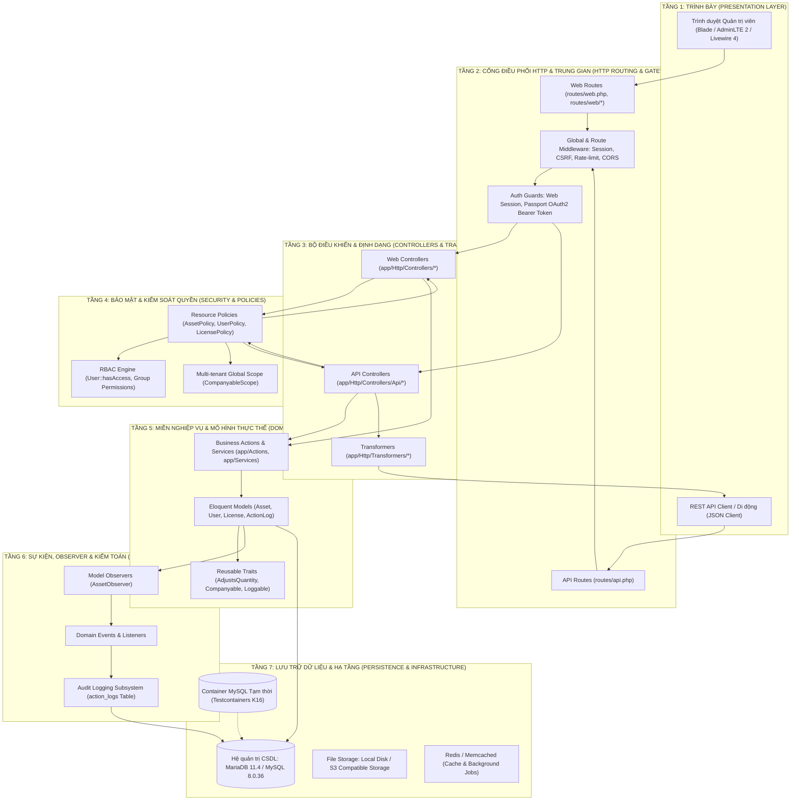
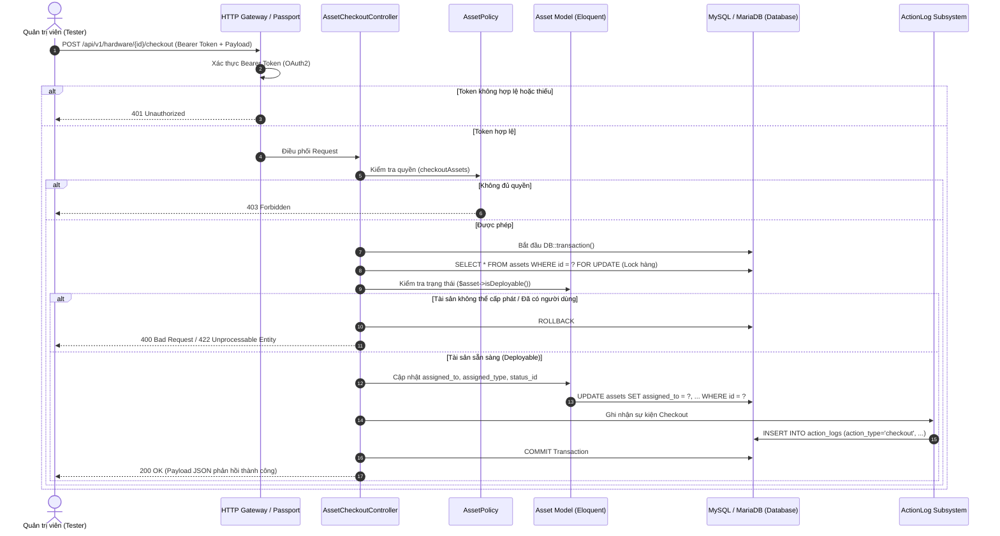

# 🛡️ ĐỒ ÁN KIỂM THỬ PHẦN MỀM: HỆ THỐNG QUẢN LÝ TÀI SẢN CNTT SNIPE-IT
> **Đề tài:** Phân tích Kiến trúc và Thực thi Kiểm thử Tự động Hệ thống Snipe-IT (R03 × K16 Testcontainers)  
> **Nền tảng:** Laravel Framework 12.x | PHP 8.2+ | MariaDB 11.4 / MySQL 8.0.36 | Docker Desktop | Testcontainers Node.js  
> **Kho mã nguồn:** [Snipe-IT Repository](https://github.com/Bee-Max-Ne/Snipe-IT)  
> **Môi trường cục bộ:** `http://127.0.0.1:8000` (hoặc `http://localhost:8000`)

---

## 📑 MỤC LỤC TỔNG QUAN

1. [Giới thiệu Đề tài & Tổng quan Hệ thống](#1-giới-thiệu-đề-tài--tổng-quan-hệ-thống)
2. [Phân công Nhiệm vụ 4 Thành viên (WBS Chi tiết)](#2-phân-công-nhiệm-vụ-4-thành-viên-wbs-chi-tiết)
3. [Bóc tách Kiến trúc Hệ thống Chi tiết (7 Tầng Kiến trúc)](#3-bóc-tách-kiến-trúc-hệ-thống-chi-tiết-7-tầng-kiến-trúc)
4. [4 Phân vùng Kiểm thử Trọng tâm & Cơ chế Kỹ thuật Cốt lõi](#4-4-phân-vùng-kiểm-thử-trọng-tâm--cơ-chế-kỹ-thuật-cốt-lõi)
5. [Đặc tả Chi tiết Bộ Test Cases API (TC-CO-01 đến TC-CO-07)](#5-đặc-tả-chi-tiết-bộ-test-cases-api-tc-co-01-đến-tc-co-07)
6. [Hiện trạng Cơ sở Dữ liệu & Dữ liệu Mẫu (Seeding Data)](#6-hiện-trạng-cơ-sở-dữ-liệu--dữ-liệu-mẫu-seeding-data)
7. [Hướng dẫn Cài đặt, Vận hành & Thực thi Kiểm thử Tự động](#7-hướng-dẫn-cài-đặt-vận-hành--thực-thi-kiểm-thử-tự-động)

---

## 1. GIỚI THIỆU ĐỀ TÀI & TỔNG QUAN HỆ THỐNG

### 1.1 Bối cảnh Đề tài
Snipe-IT là hệ thống Quản lý Tài sản Doanh nghiệp (Enterprise IT Asset Management - ITAM) mã nguồn mở hàng đầu thế giới, được xây dựng trên nền tảng **Laravel Framework 12** và **PHP 8.2**. Hệ thống cung cấp giải pháp toàn diện cho hoạt động vận hành CNTT (IT Operations):
- Quản trị toàn bộ vòng đời tài sản (Lifecycle Asset Management): từ mua sắm, nhập kho, định danh mã vạch/QR/RFID, khấu hao tài chính, đến thanh lý.
- Quản lý quy trình cấp phát (Checkout) và thu hồi (Checkin) tài sản cho nhân viên hoặc địa điểm với lịch sử kiểm toán bất biến (Immutable Audit Trail).
- Quản lý giấy phép phần mềm (Software Licenses), ghế sử dụng (Seats Pool), phụ kiện (Accessories), linh kiện (Components) và vật tư tiêu hao (Consumables).
- Phân quyền người dùng dựa trên vai trò (Role-Based Access Control - RBAC) và cách ly dữ liệu đa tổ chức/công ty con (Multi-Tenant Company Scoping).

### 1.2 Mục tiêu Kiểm thử của Đồ án
Đồ án không dừng lại ở kiểm thử hộp đen (Black-box testing) giao diện, mà đào sâu vào:
1. **Kiểm thử Tích hợp & API (Integration & API Testing):** Xác thực tính toàn vẹn của các luồng nghiệp vụ thông qua RESTful API v1 được bảo vệ bởi OAuth2 Bearer Tokens (Laravel Passport).
2. **Kiểm chứng Cơ chế Chống Tranh chấp Dữ liệu Đồng thời (Concurrency & Race Condition Guard):** Kiểm tra cơ chế khóa bi quan (*Pessimistic Concurrency Locking*: `DB::transaction()` kết hợp `lockForUpdate()`) trên cơ sở dữ liệu quan hệ thực tế.
3. **Kiểm thử Cô lập với K16 Testcontainers:** Ứng dụng kỹ thuật Testcontainers (Node.js) để tự động khởi tạo môi trường container Docker MySQL 8.0.36 độc lập (ephemeral database) cho từng phiên chạy kiểm thử tự động, loại bỏ hoàn toàn sự phụ thuộc và rủi ro sai lệch dữ liệu của SQLite in-memory.
4. **Kiểm thử Bảo mật & Phân quyền (Security & IAM Testing):** Kiểm chứng ma trận chính sách `Policy` nhằm phát hiện và ngăn chặn các lỗ hổng leo thang đặc quyền (Privilege Escalation) và rò rỉ dữ liệu đa người thuê (Multi-tenant Data Leaks).

---

## 2. PHÂN CÔNG NHIỆM VỤ 4 THÀNH VIÊN (WBS CHI TIẾT)

Dự án được phân chia theo Cơ cấu Phân rã Công việc (Work Breakdown Structure - WBS) gắn liền với 4 phân vùng kiểm thử và cấu trúc mã nguồn thực tế của hệ thống:



### 2.1 Bảng Tổng hợp Phân công Trách nhiệm

| STT | Họ và Tên | Mã Sinh Viên | Vai trò Dự án | Phân vùng Trọng tâm | Bộ Test Suite Phụ trách Chính |
| :---: | :--- | :---: | :--- | :--- | :--- |
| **1** | **Phạm Nguyễn Ngọc Phước** | **2312718** | **Lead QA (Senior Testing Engineer)** | **Phân vùng 1:** Module API Checkout, Checkin & Quy trình Cấp phát / Thu hồi | `tests/Feature/Checkouts/Api/AssetCheckoutTest.php`<br/>`tests/Feature/Checkins/Api/AssetCheckinTest.php` |
| **2** | **Nguyễn Văn Quốc** | **2312729** | **QA Engineer (Senior Automation Tester)** | **Phân vùng 2:** Module Quản lý Tài sản Phần cứng, Dòng Model & Khấu hao | `tests/Unit/AssetTest.php`<br/>`tests/Unit/DepreciationTest.php`<br/>`tests/Unit/AssetModelTest.php` |
| **3** | **Nguyễn Đình Thạch** | **2314506** | **Team Leader & Infrastructure Lead** | **Phân vùng 3:** Module Bản quyền Phần mềm, Phụ kiện, Linh kiện & CI/CD Testcontainers | `tests/testcontainers/run.mjs`<br/>`.github/workflows/testcontainers.yml`<br/>`tests/Unit/Models/LicenseTest.php` |
| **4** | **Nguyễn Thành Minh** | **2312691** | **QA Engineer (Security & Access Control)** | **Phân vùng 4:** Module Người dùng, Phân quyền RBAC, Đa công ty & Security Policy | `tests/Unit/UserTest.php`<br/>`tests/Unit/CompanyScopingTest.php` |

---

### 2.2 Chi tiết Nhiệm vụ Từng Thành viên

#### 👤 1. Phạm Nguyễn Ngọc Phước — Lead QA (Senior Testing Engineer)
- **Mã sinh viên:** `2312718`
- **Vai trò:** Trưởng nhóm Kiểm thử API & Quy trình Cấp phát (Lead QA / API Testing Lead)
- **Nhiệm vụ cụ thể:**
  1. **Chủ trì Phân vùng 1:** Thiết kế, xây dựng và thực thi bộ kiểm thử tự động toàn diện cho quy trình Cấp phát và Thu hồi tài sản qua API v1:
     - [AssetCheckoutTest.php](file:///d:/KIEM_THU_PHAN_MEM/Do_An/snipe-it-master/tests/Feature/Checkouts/Api/AssetCheckoutTest.php)
     - [AssetCheckinTest.php](file:///d:/KIEM_THU_PHAN_MEM/Do_An/snipe-it-master/tests/Feature/Checkins/Api/AssetCheckinTest.php)
  2. **Đặc tả 7 Test Cases Trọng điểm (TC-CO-01 đến TC-CO-07):** Xây dựng kịch bản kiểm thử bao phủ toàn bộ luồng cấp phát cho User, Location, thu hồi về kho, kiểm tra phản hồi HTTP (200 OK, 401 Unauthorized, 403 Forbidden, 422 Unprocessable Entity).
  3. **Kiểm thử Cơ chế Khóa Bi quan (Pessimistic Concurrency Locking):** Kiểm chứng khả năng chống Race Condition khi có nhiều yêu cầu checkout đồng thời đối với cùng một tài sản (`DB::transaction` kết hợp `lockForUpdate()`), đảm bảo không xảy ra hiện tượng Double-Allocation.
  4. **Kiểm thử Tính Toàn vẹn Nhật ký (Audit Trail Integrity):** Xác minh bản ghi nhật ký tại bảng `action_logs` được ghi nhận chuẩn xác với đầy đủ `action_type = 'checkout'`, `target_id`, `target_type`, `admin_id`, và ghi chú `note`.
  5. **Bóc tách Kiến trúc 7 Tầng:** Phối hợp cùng Team Leader xây dựng tài liệu bóc tách kiến trúc và sơ đồ tuần tự các luồng nghiệp vụ.

#### 👤 2. Nguyễn Văn Quốc — QA Engineer (Senior Automation Tester)
- **Mã sinh viên:** `2312729`
- **Vai trò:** Kỹ sư Kiểm thử Phần cứng & Vòng đời Tài chính (Hardware & Financial Life-cycle Tester)
- **Nhiệm vụ cụ thể:**
  1. **Chủ trì Phân vùng 2:** Quản lý và kiểm thử tự động vòng đời tài sản phần cứng, chủng loại Model và thuật toán khấu hao tài chính:
     - [AssetTest.php](file:///d:/KIEM_THU_PHAN_MEM/Do_An/snipe-it-master/tests/Unit/AssetTest.php)
     - `tests/Unit/DepreciationTest.php`
     - `tests/Unit/AssetModelTest.php`
  2. **Kiểm thử Ràng buộc Toàn vẹn Dữ liệu Duy nhất (Unique Tag Constraint):** Xây dựng ca kiểm thử `test_asset_tag_unique_constraint_prevents_duplicate_tag()` xác minh hệ số duy nhất trên trường `assets.asset_tag`, ngăn chặn lỗi trùng lặp mã định danh phần cứng ở cả tầng Controller và Database Index.
  3. **Kiểm chứng Thuật toán Khấu hao Tuyến tính (Linear Depreciation Algorithm):** Kiểm tra phương thức `getLinearDepreciatedValue()` theo thời gian, đảm bảo giá trị khấu hao hàng tháng được trừ chính xác theo công thức kế toán và giá trị tài sản còn lại không bao giờ giảm xuống dưới giá trị sàn tối thiểu (`depreciation_min`).
  4. **Kiểm thử Dynamic Custom Fields & Mã hóa (Encryption):** Xác minh cơ chế gán Custom Fieldset vào Model thiết bị, kiểm tra cơ chế mã hóa AES đối với các trường thông tin nhạy cảm (như MAC Address, IMEI) và bộ lọc Regex chuẩn hóa dữ liệu.
  5. **Kiểm thử Vòng đời Trạng thái Thiết bị:** Kiểm chứng chuyển đổi trạng thái máy: Deployable, Pending, Archived, Defective / Broken.

#### 👤 3. Nguyễn Đình Thạch — Team Leader & Infrastructure Lead
- **Mã sinh viên:** `2314506`
- **Vai trò:** Trưởng nhóm Dự án & Kỹ sư Kiến trúc Tự động hóa Hạ tầng (Project Lead & Test Automation Architect)
- **Nhiệm vụ cụ thể:**
  1. **Chủ trì Hạ tầng Kiểm thử Tự động & Testcontainers (K16):**
     - Xây dựng và tối ưu hóa bộ điều phối [run.mjs](file:///d:/KIEM_THU_PHAN_MEM/Do_An/snipe-it-master/tests/testcontainers/run.mjs) dựa trên `@testcontainers/mysql`, ghim phiên bản Docker `mysql:8.0.36`.
     - Tự động hóa việc sinh cặp khóa OAuth RSA 2048-bit động trong bộ nhớ cho Laravel Passport (`oauth-private.key` và `oauth-public.key`) phục vụ kiểm thử API mà không làm thay đổi filesystem.
     - Thiết lập cơ chế tự dọn dẹp container (`container.stop()`) trong khối `finally`, đảm bảo không để lại tài nguyên rác (container rò rỉ) kể cả khi kiểm thử gặp lỗi.
  2. **Quản trị Đường ống Tích hợp Liên tục CI/CD:**
     - Thiết lập và bảo trì pipeline kiểm thử tự động tại [.github/workflows/testcontainers.yml](file:///d:/KIEM_THU_PHAN_MEM/Do_An/snipe-it-master/.github/workflows/testcontainers.yml).
     - Tối ưu hóa thời gian chạy, thiết lập bộ đệm (cache Composer & npm) và cô lập hoàn toàn môi trường CI.
  3. **Chủ trì Phân vùng 3 (Licenses, Accessories, Components):**
     - Thực thi bộ kiểm thử [LicenseTest.php](file:///d:/KIEM_THU_PHAN_MEM/Do_An/snipe-it-master/tests/Unit/Models/LicenseTest.php), kiểm chứng phương thức `availCount()` tính toán chính xác số lượng ghế bản quyền còn trống, ngăn chặn việc cấp phát vượt quá giới hạn (Over-allocation).
     - Kiểm thử bảo mật rò rỉ mã bản quyền: Xác minh tính năng Masking Product Key, đảm bảo người dùng không có quyền `viewKeys` sẽ không thể xem chuỗi serial trong phản hồi JSON.
     - Kiểm thử cơ chế tự động điều phối số lượng tồn kho (Inventory Auto-adjustment) qua trait `AdjustsQuantity` đối với Phụ kiện và Linh kiện.

#### 👤 4. Nguyễn Thành Minh — QA Engineer (Security & Access Control)
- **Mã sinh viên:** `2312691`
- **Vai trò:** Kỹ sư Kiểm thử Bảo mật, Phân quyền & Quản trị Danh tính (Security & IAM Testing Engineer)
- **Nhiệm vụ cụ thể:**
  1. **Chủ trì Phân vùng 4 (RBAC, Multi-tenancy, Security Policies):**
     - Thực thi bộ kiểm thử quyền hạn người dùng [UserTest.php](file:///d:/KIEM_THU_PHAN_MEM/Do_An/snipe-it-master/tests/Unit/UserTest.php).
     - Xây dựng ma trận kiểm thử phân quyền RBAC đa chiều thông qua phương thức `User::hasAccess()`.
  2. **Kiểm thử Ngăn chặn Leo thang Đặc quyền (Privilege Escalation Prevention):** Kiểm chứng chính sách `UserPolicy::update()` và `UserPolicy::delete()`, đảm bảo người dùng có quyền quản trị thông thường (Staff/Admin) không thể tự sửa quyền hạn của chính mình, không thể tự gán quyền Superadmin, và không thể xóa tài khoản Superadmin tối cao.
  3. **Kiểm chứng Cơ chế Cách ly Dữ liệu Đa Công ty (Multi-Tenant Company Scoping):** Kiểm thử Global Scope `CompanyableScope` trên toàn bộ các truy vấn Eloquent, đảm bảo người dùng thuộc Công ty A hoàn toàn không thể xem, tìm kiếm hoặc cấp phát tài sản thuộc quyền sở hữu của Công ty B.
  4. **Kiểm thử Tính Bất biến của Nhật ký Kiểm toán (Audit Log Immutability):** Xác minh các bản ghi hành động trong bảng `action_logs` không thể bị chỉnh sửa hoặc xóa thông qua bất kỳ endpoint API người dùng nào.

---

## 3. BÓC TÁCH KIẾN TRÚC HỆ THỐNG CHI TIẾT (7 TẦNG KIẾN TRÚC)

Mã nguồn Snipe-IT được thiết kế theo kiến trúc **Domain-Driven Multi-Tier Architecture** mở rộng trên nền tảng Laravel 12. Dưới đây là mô hình phân tầng chi tiết:



### 3.1 Chi tiết Trách nhiệm Từng Tầng Kiến trúc

#### 🔹 Tầng 1: Tầng Trình bày (Presentation Layer)
- **Công nghệ:** Blade Templates, AdminLTE v2, Bootstrap 3, JavaScript ES6 (biên dịch qua Laravel Mix & Webpack), Livewire 4 cho các component tương tác phản hồi nhanh, Chart.js 2.9.4 hiển thị biểu đồ báo cáo tài chính.
- **Trách nhiệm:** Kết xuất giao diện quản trị Server-Side Rendering (SSR), tiếp nhận tương tác người dùng, hiển thị thông báo flash message, mã QR/Barcode tài sản.

#### 🔹 Tầng 2: Cổng tiếp nhận HTTP & Middleware (Routing & Gateway Layer)
- **Tập tin định tuyến:** `routes/web.php`, các module chia nhỏ tại `routes/web/*.php`, và `routes/api.php` (prefix `/api/v1`).
- **Middleware cốt lõi:**
  - `web`: Quản lý Session, mã hóa Cookie, xác thực mã chống giả mạo `VerifyCsrfToken`.
  - `auth:api`: Sử dụng **Laravel Passport** kiểm thực OAuth2 Bearer Token. Trả về mã lỗi chuẩn `401 Unauthorized` nếu token không hợp lệ hoặc thiếu.
  - `throttle:api`: Giới hạn tần suất gọi API (Rate limiting) bảo vệ hệ thống trước tấn công DoS/Brute-force.

#### 🔹 Tầng 3: Bộ điều khiển & Biến đổi Dữ liệu (Controllers & Transformers)
- **Web Controllers (`app/Http/Controllers/`):** Tiếp nhận dữ liệu biểu mẫu HTTP, điều phối view Blade hoặc chuyển hướng URL (`RedirectResponse`).
- **API Controllers (`app/Http/Controllers/Api/`):** Xử lý các yêu cầu RESTful thuần túy, trả về dữ liệu chuẩn JSON.
- **Transformers (`app/Http/Transformers/`):** Đóng vai trò là lớp Data Transfer Object (DTO) trung gian. Tách biệt hoàn toàn thuộc tính nội bộ của Eloquent Model với cấu trúc JSON bên ngoài. Thực hiện ẩn (mask) các thông tin nhạy cảm như `serial`, `product_key` dựa trên quyền hạn của người gọi API.

#### 🔹 Tầng 4: Bảo mật & Kiểm soát Truy cập (Security, RBAC & Policies)
- **RBAC Engine:** Quản lý phân quyền dựa trên quyền hạn chi tiết gắn với người dùng hoặc nhóm (Group). Kiểm tra thông qua `User::hasAccess('hardware.checkout')`.
- **Resource Policies (`app/Policies/`):** 
  - [AssetPolicy.php](file:///d:/KIEM_THU_PHAN_MEM/Do_An/snipe-it-master/app/Policies/AssetPolicy.php): Kiểm tra quyền `checkout()`, `checkin()`, `view()`, `create()`, `delete()`.
  - [UserPolicy.php](file:///d:/KIEM_THU_PHAN_MEM/Do_An/snipe-it-master/app/Policies/UserPolicy.php): Ngăn chặn leo thang quyền hạn quản trị.
  - [LicensePolicy.php](file:///d:/KIEM_THU_PHAN_MEM/Do_An/snipe-it-master/app/Policies/LicensePolicy.php): Kiểm soát quyền xem khóa bản quyền (`viewKeys`).
- **Multi-Tenant Scope (`CompanyableScope`):** Tự động tiêm điều kiện lọc `WHERE company_id = ?` vào toàn bộ các câu lệnh SQL nếu tính năng Đa công ty (Full Multiple Companies Support) được kích hoạt trong cài đặt.

#### 🔹 Tầng 5: Miền Nghiệp vụ & Mô hình Thực thể (Domain & Business Logic Layer)
- **Eloquent Models (`app/Models/`):** Các thực thể trọng tâm: `Asset`, `User`, `License`, `LicenseSeat`, `AssetModel`, `Depreciation`, `Location`, `Company`.
- **Cơ chế Khóa Bi quan (Pessimistic Concurrency Locking):** Luồng Checkout/Checkin sử dụng giao dịch cơ sở dữ liệu:
  ```php
  DB::transaction(function () use ($asset, $target) {
      $lockedAsset = Asset::where('id', $asset->id)->lockForUpdate()->first();
      // Kiểm tra trạng thái deployable và tiến hành cấp phát
  });
  ```
- **Traits dùng chung:** 
  - `AdjustsQuantity`: Tự động cộng/trừ số lượng tồn kho khả dụng khi cấp phát/thu hồi Phụ kiện và Linh kiện.
  - `Companyable`: Tự động áp dụng ràng buộc công ty cho mô hình.

#### 🔹 Tầng 6: Sự kiện, Observer & Kiểm toán Bất biến (Events, Observers & Audit Trail)
- **Model Observers (`app/Observers/`):** [AssetObserver.php](file:///d:/KIEM_THU_PHAN_MEM/Do_An/snipe-it-master/app/Observers/AssetObserver.php) lắng nghe các sự kiện vòng đời `creating`, `updating`, `deleting`.
- **Audit Logging Subsystem:** Mọi hành vi làm thay đổi trạng thái của tài sản đều tự động kích hoạt tạo bản ghi tại bảng `action_logs`. Bản ghi lưu trữ đầy đủ: thời điểm thao tác, loại hành động (`checkout`, `checkin`, `update`), người thực hiện (`created_by`), đối tượng nhận (`target_id`, `target_type`), và ghi chú chi tiết.

#### 🔹 Tầng 7: Lưu trữ & Hạ tầng (Persistence & Infrastructure Layer)
- **Hệ quản trị CSDL chính:** MariaDB 11.4 (môi trường Docker Compose phát triển) / MySQL 8.0 (môi trường máy chủ).
- **Hạ tầng Kiểm thử Cô lập (Testcontainers K16):** Docker engine tự động kích hoạt container MySQL 8.0.36 độc lập với cổng động, thực thi migration sạch cho từng phiên kiểm thử tích hợp.
- **Storage Subsystem:** Lưu trữ tài liệu đính kèm, ảnh đại diện tài sản tại đĩa cục bộ hoặc Amazon S3 / MinIO.

---

### 3.2 Sơ đồ Tuần tự Luồng Cấp phát Tài sản qua API (Asset Checkout Sequence)



---

## 4. 4 PHÂN VÙNG KIỂM THỬ TRỌNG TÂM & CƠ CHẾ KỸ THUẬT CỐT LÕI

### 4.1 Phân vùng 1: API Checkout, Checkin & Cơ chế Khóa Đồng thời
- **Tập tin kiểm thử:** 
  - [AssetCheckoutTest.php](file:///d:/KIEM_THU_PHAN_MEM/Do_An/snipe-it-master/tests/Feature/Checkouts/Api/AssetCheckoutTest.php)
  - [AssetCheckinTest.php](file:///d:/KIEM_THU_PHAN_MEM/Do_An/snipe-it-master/tests/Feature/Checkins/Api/AssetCheckinTest.php)
- **Cơ chế kỹ thuật cốt lõi:**
  - **Khóa Bi quan (Pessimistic Concurrency Locking):** Sử dụng câu lệnh SQL `SELECT ... FOR UPDATE` bên trong `DB::transaction()`. Khi tiến trình A đang thực hiện checkout tài sản ID = X, tiến trình B cố gắng checkout cùng tài sản X sẽ bị chặn ở mức Database Engine cho đến khi A hoàn tất COMMIT hoặc ROLLBACK.
  - **Kiểm thử Luồng Khép kín (Closed-loop Lifecycle):** Kiểm tra trạng thái trước cấp phát (`assigned_to = null`) ➔ Sau cấp phát (`assigned_to = 2`, `assigned_type = App\Models\User`) ➔ Sau thu hồi (`assigned_to = null`, trạng thái trở về kho).

### 4.2 Phân vùng 2: Quản lý Tài sản Phần cứng, Dòng Model & Khấu hao
- **Tập tin kiểm thử:**
  - [AssetTest.php](file:///d:/KIEM_THU_PHAN_MEM/Do_An/snipe-it-master/tests/Unit/AssetTest.php)
  - `tests/Unit/DepreciationTest.php`
- **Cơ chế kỹ thuật cốt lõi:**
  - **Ràng buộc Duy nhất Mã Tài sản (`asset_tag`):** Được bảo vệ bởi chỉ mục duy nhất `UNIQUE KEY assets_asset_tag_unique (asset_tag)` trong schema MySQL. Phương thức `test_asset_tag_unique_constraint_prevents_duplicate_tag()` kiểm chứng việc kích hoạt ngoại lệ `QueryException` khi cố tình tạo 2 tài sản trùng tag.
  - **Thuật toán Khấu hao Tuyến tính (Linear Depreciation):** 
    $$\text{Khấu hao hàng tháng} = \frac{\text{Giá mua (Purchase Cost)} - \text{Giá trị sàn (Floor Value)}}{\text{Thời gian khấu hao (Số tháng)}}$$
    Phương thức `getLinearDepreciatedValue()` đảm bảo giá trị sổ sách còn lại luôn không nhỏ hơn giá trị sàn (`depreciation_min`).

### 4.3 Phân vùng 3: Bản quyền Phần mềm, Phụ kiện, Linh kiện & CI/CD Testcontainers
- **Tập tin kiểm thử & Hạ tầng:**
  - [LicenseTest.php](file:///d:/KIEM_THU_PHAN_MEM/Do_An/snipe-it-master/tests/Unit/Models/LicenseTest.php)
  - [run.mjs](file:///d:/KIEM_THU_PHAN_MEM/Do_An/snipe-it-master/tests/testcontainers/run.mjs)
  - [.github/workflows/testcontainers.yml](file:///d:/KIEM_THU_PHAN_MEM/Do_An/snipe-it-master/.github/workflows/testcontainers.yml)
- **Cơ chế kỹ thuật cốt lõi:**
  - **Kiểm soát Ghế Giấy phép (`LicenseSeat::availCount()`):** Giấy phép có tổng số ghế $N$. Mỗi lần cấp phát cho User hoặc Asset, hệ thống chiếm dụng 1 ghế (`assigned_to IS NOT NULL`). Khi số ghế khả dụng $= 0$, hệ thống chặn toàn bộ yêu cầu checkout tiếp theo.
  - **Bảo mật Che Khóa Bản quyền (Key Masking):** API Transformer tự động che giấu chuỗi bản quyền (ví dụ `XXXXX-XXXXX-XXXXX-1234`) nếu người dùng không sở hữu quyền `licenses.viewKeys`.
  - **Bộ điều phối Testcontainers K16:** Tự động sinh container Docker MySQL 8.0.36, cấu hình dynamic port, cấp phát cặp khóa Passport RSA trong memory, thực thi kiểm thử và dọn sạch môi trường hoàn toàn tự động.

### 4.4 Phân vùng 4: Quản lý Người dùng, Phân quyền RBAC & Đa công ty
- **Tập tin kiểm thử:**
  - [UserTest.php](file:///d:/KIEM_THU_PHAN_MEM/Do_An/snipe-it-master/tests/Unit/UserTest.php)
  - `tests/Unit/CompanyScopingTest.php`
- **Cơ chế kỹ thuật cốt lõi:**
  - **Ma trận Phân quyền RBAC:** Phương thức `User::hasAccess('tên_quyền')` kết hợp quyền cá nhân (`permissions` JSON) với quyền kế thừa từ các nhóm (`groups`).
  - **Ngăn chặn Leo thang Đặc quyền (Privilege Escalation):** Chính sách `UserPolicy` chặn đứng việc tài khoản người dùng thông thường tự gửi payload cập nhật để nâng `is_superuser = 1` hoặc tự gán các quyền quản trị tối cao.
  - **Cách ly Dữ liệu Đa Công ty (`CompanyableScope`):** Áp dụng Global Scope trên Eloquent ORM. Toàn bộ các truy vấn danh sách thiết bị, bản quyền, người dùng đều tự động được bao bọc bởi điều kiện công ty của người dùng hiện hành, bảo vệ tuyệt đối tính riêng tư giữa các tổ chức.

---

## 5. ĐẶC TẢ CHI TIẾT BỘ TEST CASES API (TC-CO-01 ĐẾN TC-CO-07)

Toàn bộ các ca kiểm thử thuộc Phân vùng 1 được biên soạn tại [AssetCheckoutTest.php](file:///d:/KIEM_THU_PHAN_MEM/Do_An/snipe-it-master/tests/Feature/Checkouts/Api/AssetCheckoutTest.php) và [AssetCheckinTest.php](file:///d:/KIEM_THU_PHAN_MEM/Do_An/snipe-it-master/tests/Feature/Checkins/Api/AssetCheckinTest.php).

### 📋 Bảng Tổng hợp Đặc tả Test Cases

```text
+----------+---------------------------------------------------------+--------------------+---------------+
| Mã Test  | Tên Phương Thức Kiểm Thử                                | Loại Kiểm Thử      | Mã HTTP Kỳ vọng|
+----------+---------------------------------------------------------+--------------------+---------------+
| TC-CO-01 | test_asset_can_be_checked_out_through_api               | Positive / Core    | 200 OK        |
| TC-CO-02 | test_asset_can_be_checked_out_to_location_through_api   | Positive / Core    | 200 OK        |
| TC-CO-03 | test_cannot_checkout_undeployable_asset                 | Negative / Rule    | 400 Bad Req   |
| TC-CO-04 | test_cannot_checkout_already_checked_out_asset          | Negative / State   | 400 Bad Req   |
| TC-CO-05 | test_unauthenticated_request_is_rejected_at_gateway     | Security / Auth    | 401 Unauth    |
| TC-CO-06 | test_checkout_fails_validation_with_missing_target      | Validation / Data  | 422 Unproc    |
| TC-CO-07 | test_asset_can_be_checked_in_through_api                | Positive / Loop    | 200 OK        |
+----------+---------------------------------------------------------+--------------------+---------------+
```

---

### Chi tiết Từng Kịch bản Kiểm thử

#### 🔹 TC-CO-01: Cấp phát Tài sản Thành công cho Người dùng qua API
- **Phương thức:** `test_asset_can_be_checked_out_through_api()`
- **Phân loại:** Functional / Positive Testing
- **Điều kiện tiên quyết:** 
  - Một tài sản `$asset` tồn tại ở trạng thái sẵn sàng cấp phát (`status.deployable = 1`, `assigned_to = null`).
  - Một người dùng mục tiêu `$targetUser` hợp lệ.
  - Quản trị viên `$admin` được cấp quyền `checkoutAssets`.
- **Payload Yêu cầu (POST `/api/v1/hardware/{id}/checkout`):**
  ```json
  {
      "checkout_to_type": "user",
      "assigned_user": 2,
      "status_id": 1,
      "checkout_at": "2026-10-11",
      "note": "Cấp phát máy tính làm việc cho nhân viên mới"
  }
  ```
- **Xác minh Kết quả (Assertions):**
  1. Mã HTTP trả về là `200 OK`, JSON có thuộc tính `status === 'success'`.
  2. Bảng `assets`: Cột `assigned_to = 2`, `assigned_type = 'App\\Models\\User'`.
  3. Bảng `action_logs`: Bản ghi mới có `action_type = 'checkout'`, `target_id = 2`, `note` trùng khớp với payload.

---

#### 🔹 TC-CO-02: Cấp phát Tài sản Thành công cho Vị trí / Chi nhánh qua API
- **Phương thức:** `test_asset_can_be_checked_out_to_location_through_api()`
- **Phân loại:** Functional / Positive Testing
- **Điều kiện tiên quyết:** Tài sản sẵn sàng cấp phát; địa điểm `$location` hợp lệ tồn tại trong hệ thống.
- **Payload Yêu cầu (POST `/api/v1/hardware/{id}/checkout`):**
  ```json
  {
      "checkout_to_type": "location",
      "assigned_location": 3,
      "status_id": 1,
      "note": "Cấp phát máy in cho Phòng Họp Tầng 2"
  }
  ```
- **Xác minh Kết quả (Assertions):**
  1. Mã HTTP trả về là `200 OK`.
  2. Bảng `assets`: `assigned_to = 3`, `assigned_type = 'App\\Models\\Location'`.
  3. Bảng `action_logs`: Ghi nhận `target_type = 'App\\Models\\Location'`, `target_id = 3`.

---

#### 🔹 TC-CO-03: Chặn Cấp phát Tài sản Không Sẵn sàng (Undeployable / Hỏng hóc)
- **Phương thức:** `test_cannot_checkout_undeployable_asset()`
- **Phân loại:** Negative / Business Rule Enforcement
- **Điều kiện tiên quyết:** Tài sản gắn với trạng thái không cho phép cấp phát (`status.deployable = 0`, ví dụ: Đang sửa chữa / Chờ thanh lý).
- **Payload Yêu cầu:** Thử gửi request checkout cho người dùng hợp lệ.
- **Xác minh Kết quả (Assertions):**
  1. Mã HTTP trả về là `400 Bad Request` (hoặc phản hồi lỗi nghiệp vụ từ API).
  2. Dữ liệu trong CSDL: `assigned_to` của tài sản vẫn giữ nguyên giá trị `null`.
  3. Không có bản ghi cấp phát thành công nào được ghi vào `action_logs`.

---

#### 🔹 TC-CO-04: Chặn Cấp phát Tài sản Đã có Người Sử dụng (Double-Checkout Guard)
- **Phương thức:** `test_cannot_checkout_already_checked_out_asset()`
- **Phân loại:** Negative / State Conflict & Concurrency Testing
- **Điều kiện tiên quyết:** Tài sản đang được gán cho User A (`assigned_to = 2`).
- **Thao tác:** Quản trị viên gửi request checkout tài sản này cho User B mà không thực hiện checkin trước đó.
- **Xác minh Kết quả (Assertions):**
  1. API từ chối thao tác, trả về thông báo lỗi tài sản đã được cấp phát.
  2. Trường `assigned_to` của tài sản trong CSDL vẫn giữ nguyên User A (`2`), không bị ghi đè lên User B.

---

#### 🔹 TC-CO-05: Chặn Yêu cầu khi Thiếu Xác thực Token tại Gateway
- **Phương thức:** `test_unauthenticated_request_is_rejected_at_gateway()`
- **Phân loại:** Security / Authentication Enforcement
- **Thao tác:** Gửi request POST tới `/api/v1/hardware/1/checkout` nhưng cố tình không kèm Header `Authorization: Bearer {token}` hoặc kèm Bearer Token giả mạo/hết hạn.
- **Xác minh Kết quả (Assertions):**
  1. HTTP Gateway trả về ngay lập tức mã lỗi `401 Unauthorized`.
  2. Request bị chặn hoàn toàn tại tầng Middleware, không đi vào Controller hay chạm tới Database.

---

#### 🔹 TC-CO-06: Xác thực Dữ liệu Đầu vào (Validation Failure)
- **Phương thức:** `test_checkout_fails_validation_with_missing_target()`
- **Phân loại:** Validation Testing / Negative
- **Thao tác:** Gửi request checkout với payload rỗng `{}` hoặc thiếu trường bắt buộc `checkout_to_type`.
- **Xác minh Kết quả (Assertions):**
  1. API trả về mã lỗi `422 Unprocessable Entity`.
  2. JSON trả về danh sách các trường vi phạm luật xác thực dữ liệu (Validation errors).

---

#### 🔹 TC-CO-07: Thu hồi Tài sản (Checkin) Thành công và Hoàn trả Kho
- **Phương thức:** `test_asset_can_be_checked_in_through_api()`
- **Phân loại:** Functional / Closed-loop Lifecycle
- **Điều kiện tiên quyết:** Tài sản đang ở trạng thái đã cấp phát cho một User hoặc Location.
- **Payload Yêu cầu (POST `/api/v1/hardware/{id}/checkin`):**
  ```json
  {
      "status_id": 1,
      "note": "Nhân viên hoàn trả thiết bị khi hết hạn dự án"
  }
  ```
- **Xác minh Kết quả (Assertions):**
  1. Mã HTTP trả về là `200 OK`, JSON có trạng thái thành công.
  2. Bảng `assets`: Cột `assigned_to` trở về `null`, `assigned_type` trở về `null`.
  3. Bảng `action_logs`: Ghi nhận sự kiện `action_type = 'checkin from'` với đầy đủ thông tin kiểm toán.

---

## 6. HIỆN TRẠNG CƠ SỞ DỮ LIỆU & DỮ LIỆU MẪU (SEEDING DATA)

Hệ thống đã được khởi tạo và kiểm chứng với bộ dữ liệu mẫu doanh nghiệp hoàn chỉnh thông qua seeder chuyên dụng [SystemSampleDataSeeder.php](file:///d:/KIEM_THU_PHAN_MEM/Do_An/snipe-it-master/database/seeders/SystemSampleDataSeeder.php).

### 6.1 Thống kê Số lượng Dữ liệu Mẫu (Tất cả $\ge 10$ Bản ghi)

| STT | Bảng Cơ sở Dữ liệu (`Table`) | Mô tả Thực thể | Số lượng Bản ghi Thực tế | Trạng thái Nghiệm thu |
| :---: | :--- | :--- | :---: | :---: |
| 1 | `companies` | Doanh nghiệp / Chi nhánh pháp nhân | **10** | Đạt ($\ge 10$) |
| 2 | `locations` | Vị trí địa lý / Tòa nhà / Kho bãi | **12** | Đạt ($\ge 10$) |
| 3 | `departments` | Phòng ban chức năng | **14** | Đạt ($\ge 10$) |
| 4 | `groups` | Nhóm vai trò phân quyền RBAC | **12** | Đạt ($\ge 10$) |
| 5 | `users` | Người dùng & Tài khoản nhân viên | **12** | Đạt ($\ge 10$) |
| 6 | `manufacturers` | Hãng sản xuất phần cứng / thiết bị | **10** | Đạt ($\ge 10$) |
| 7 | `suppliers` | Nhà cung cấp thiết bị & dịch vụ | **11** | Đạt ($\ge 10$) |
| 8 | `categories` | Danh mục phân loại tài sản & vật tư | **19** | Đạt ($\ge 10$) |
| 9 | `depreciations` | Bảng thiết lập chu kỳ khấu hao | **13** | Đạt ($\ge 10$) |
| 10 | `status_labels` | Nhãn trạng thái (Deployable, Pending...) | **15** | Đạt ($\ge 10$) |
| 11 | `models` | Dòng đời Model thiết bị | **17** | Đạt ($\ge 10$) |
| 12 | `assets` | Thiết bị phần cứng (Laptop, Server...) | **15** | Đạt ($\ge 10$) |
| 13 | `licenses` | Giấy phép phần mềm doanh nghiệp | **10** | Đạt ($\ge 10$) |
| 14 | `license_seats` | Ghế sử dụng bản quyền chi tiết | **865** | Đạt ($\ge 10$) |
| 15 | `accessories` | Phụ kiện CNTT (Chuột, Phím, Màn hình...) | **10** | Đạt ($\ge 10$) |
| 16 | `consumables` | Vật tư tiêu hao (Mực in, Giấy in, Cáp...) | **10** | Đạt ($\ge 10$) |
| 17 | `components` | Linh kiện phần cứng (RAM, SSD, CPU...) | **10** | Đạt ($\ge 10$) |
| 18 | `action_logs` | Nhật ký kiểm toán thao tác hệ thống | **127** | Đạt ($\ge 10$) |

### 6.2 Tài khoản Quản trị Tối cao (Superadmin)
Hệ thống bảo toàn tài khoản quản trị tối cao đã được xác thực:
- **User ID:** `1`
- **Họ và tên:** `Phạm Nguyễn Ngọc Phước`
- **Username:** `Bee`
- **Email:** `2312718@dlu.edu.vn`
- **Vai trò:** Superadmin / Lead QA (Sở hữu đầy đủ quyền hạn tối cao trên toàn hệ thống).

---

## 7. HƯỚNG DẪN CÀI ĐẶT, VẬN HÀNH & THỰC THI KIỂM THỬ TỰ ĐỘNG

### 7.1 Yêu cầu Tiên quyết Môi trường
- **PHP:** `8.2.0` trở lên (bao gồm các extensions bắt buộc: `pdo_mysql`, `mbstring`, `curl`, `openssl`, `fileinfo`, `gd`, `bcmath`).
- **Composer:** Phiên bản `2.x`.
- **Node.js & npm:** Node.js `18.x` hoặc `20.x`.
- **Docker Desktop:** Cài đặt và đang chạy dịch vụ (bắt buộc khi chạy kiểm thử tích hợp Testcontainers).

---

### 7.2 Cài đặt & Khởi chạy Ứng dụng Cục bộ (Local Development)

Mở PowerShell tại thư mục gốc dự án:

```powershell
# 1. Cài đặt các gói phụ thuộc PHP và Node.js
composer install
npm install

# 2. Tạo khóa mã hóa ứng dụng Laravel
php artisan key:generate

# 3. Chạy cập nhật cấu trúc bảng cơ sở dữ liệu
php artisan migrate

# 4. Nạp bộ dữ liệu mẫu chuẩn (chuẩn bị sẵn >= 10 bản ghi cho tất cả các bảng)
php artisan db:seed --class=SystemSampleDataSeeder

# 5. Liên kết thư mục lưu trữ tệp tin
php artisan storage:link

# 6. Biên dịch tài nguyên giao diện
npm run dev

# 7. Khởi động máy chủ ứng dụng web
php artisan serve --host=127.0.0.1 --port=8000
```

Truy cập hệ thống tại: `http://127.0.0.1:8000`

---

### 7.3 Khởi chạy Nhanh bằng Docker Compose

Dự án cung cấp cấu hình Docker Compose đồng bộ sẵn với MariaDB 11.4:

```powershell
# Khởi động dịch vụ MariaDB và Snipe-IT App
docker compose up -d

# Kiểm tra trạng thái các container
docker compose ps

# Xem nhật ký khởi động ứng dụng
docker compose logs -f app
```

---

### 7.4 Thực thi Bộ Kiểm thử Tự động với PHPUnit

Chạy toàn bộ các bài kiểm thử đơn vị và tính năng:

```powershell
# Chạy toàn bộ Test Suites
php artisan test

# Hoặc thực thi qua vendor PHPUnit trực tiếp:
./vendor/bin/phpunit

# Chạy riêng biệt bộ kiểm thử API Checkout / Checkin của Phân vùng 1:
php artisan test tests/Feature/Checkouts/Api/AssetCheckoutTest.php

# Chạy riêng bộ kiểm thử Bản quyền phần mềm của Phân vùng 3:
php artisan test tests/Unit/Models/LicenseTest.php

# Chạy riêng bộ kiểm thử Phân quyền người dùng của Phân vùng 4:
php artisan test tests/Unit/UserTest.php
```

---

### 7.5 Thực thi Kiểm thử Tích hợp Cô lập với K16 Testcontainers

Bộ điều phối Testcontainers sử dụng Node.js để tự động kích hoạt container MySQL 8.0.36 sạch, cấp phát cổng ngẫu nhiên và tiêm trực tiếp vào tiến trình PHPUnit:

```powershell
# Thực thi kiểm thử vòng đời Asset Checkout/Checkin trên MySQL thật cô lập:
npm run test:integration:testcontainers -- tests/Feature/Checkouts/Api/AssetCheckoutTest.php --filter=test_asset_can_be_checked_out_and_checked_back_in_through_api
```

**Quy trình vận hành tự động của Testcontainers:**
1. Khởi động container Docker từ image `mysql:8.0.36`.
2. Tạo cơ sở dữ liệu và tài khoản ngẫu nhiên, chờ đợi tín hiệu Docker Healthcheck sẵn sàng.
3. Sinh cặp khóa OAuth RSA 2048-bit động trong bộ nhớ cho Laravel Passport.
4. Nạp biến môi trường động vào tiến trình con PHPUnit (`DB_HOST`, `DB_PORT`, `DB_DATABASE`).
5. Thực thi câu lệnh `php artisan migrate --force` bên trong container tạm.
6. Chạy các ca kiểm thử tích hợp và thu thập kết quả Assertions.
7. Tự động hủy và dọn dẹp sạch sẽ container MySQL ngay khi tiến trình kết thúc (`container.stop()`).

---

### 7.6 Tích hợp Tự động hóa CI/CD với GitHub Actions

Đồ án đã cấu hình quy trình CI tự động tại tập tin [.github/workflows/testcontainers.yml](file:///d:/KIEM_THU_PHAN_MEM/Do_An/snipe-it-master/.github/workflows/testcontainers.yml).
- Mỗi khi có sự kiện `push` hoặc tạo `pull_request` vào nhánh `main`, GitHub Actions runner sẽ:
  1. Thiết lập môi trường PHP 8.2 và Node.js.
  2. Bật dịch vụ Docker Engine trên runner.
  3. Tự động kích hoạt Testcontainers runner để kiểm thử toàn bộ các ca kiểm thử trọng điểm trên môi trường sạch.
  4. Đảm bảo chất lượng mã nguồn trước khi hợp nhất.

---

## 8. TỔNG KẾT & LIÊN HỆ DỰ ÁN

Tài liệu này phản ánh trung thực kiến trúc mã nguồn thực tế của hệ thống Snipe-IT tại thời điểm hiện tại, đồng thời đặc tả rõ ràng phân công công việc của từng thành viên trong nhóm đồ án.

- **Đơn vị đào tạo:** Bộ môn Kiểm thử Phần mềm
- **Nhóm sinh viên thực hiện:**
  - Phạm Nguyễn Ngọc Phước (MSSV: `2312718`) — *Lead QA / API Testing Lead*
  - Nguyễn Văn Quốc (MSSV: `2312729`) — *QA Engineer (Hardware & Financial Life-cycle)*
  - Nguyễn Đình Thạch (MSSV: `2314506`) — *Team Leader & Test Automation Architect*
  - Nguyễn Thành Minh (MSSV: `2312691`) — *QA Engineer (Security & IAM Testing)*
