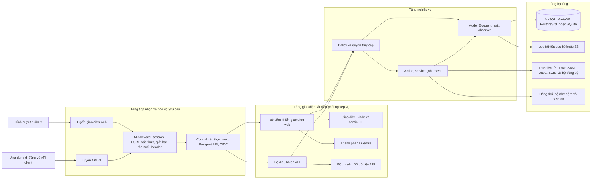

[](https://crowdin.com/project/snipe-it) [](https://hub.docker.com/r/snipe/snipe-it/)  [](https://github.com/grokability/snipe-it/actions/workflows/tests-mysql.yml)
[](#contributing) [](https://discord.gg/yZFtShAcKk)

## Snipe-IT - Open Source Asset Management System

This is a FOSS project for asset management in IT Operations. Knowing who has which laptop, when it was purchased in order to depreciate it correctly, handling software licenses, etc.

It is built on [Laravel 12](http://laravel.com).

Snipe-IT is actively developed and we [release quite frequently](https://github.com/grokability/snipe-it/releases). ([Check out the live demo here](https://snipeitapp.com/demo/).)

> [!TIP]
> __This is web-based software__. This means there is no executable file (aka no .exe files), and it must be run on a web server and accessed through a web browser. It runs on any Mac OSX, any flavor of Linux, as well as Windows, and we have a [Docker image](https://snipe-it.readme.io/docs/docker) available if that's what you're into.

---

### Table of Contents

* [Installation](#installation)
* [Tổng quan chức năng và mã nguồn](#tong-quan-chuc-nang-va-ma-nguon)
* [Kiến trúc hệ thống](#kien-truc-he-thong)
* [Hướng dẫn tiếp nhận nhà phát triển](#huong-dan-tiep-nhan-nha-phat-trien)
* [Kế hoạch triển khai K16 Testcontainers](#ke-hoach-trien-khai-k16-testcontainers)
* [User&#39;s Manual](#users-manual)
* [Bug Reports &amp; Feature Requests](#bug-reports--feature-requests)
* [Security](#security)
* [Upgrading](#upgrading)
* [Translations!](#translations-)
* [Libraries, Modules &amp; Related Projects](#libraries-modules--related-projects)
* [Join the Community!](#join-the-community)
* [Contributing](#contributing)
* [Announcement List](#announcement-list)

---

### Installation

For instructions on installing and configuring Snipe-IT on your server, check out the [installation manual](https://snipe-it.readme.io/docs). (Please see the [requirements documentation](https://snipe-it.readme.io/docs/requirements) for full requirements.)

If you're having trouble with the installation, please check the [Common Issues](https://snipe-it.readme.io/docs/common-issues) and [Getting Help](https://snipe-it.readme.io/docs/getting-help) documentation, and search this repository's open *and* closed issues for help.

---

`<a id="tong-quan-chuc-nang-va-ma-nguon"></a>`

## Tổng quan chức năng và mã nguồn

Snipe-IT là ứng dụng web mã nguồn mở dùng để quản lý vòng đời tài sản CNTT. Quản trị viên theo dõi tài sản, thiết bị đang được cấp cho ai, thông tin mua sắm, bảo hành và khấu hao; người dùng có thể xem tài sản được cấp, gửi yêu cầu mượn và xác nhận nhận/trả tài sản tùy theo quyền được cấp.

### Chức năng chính

| Nhóm chức năng          | Nội dung                                                                                                                            |
| -------------------------- | ------------------------------------------------------------------------------------------------------------------------------------ |
| Tài sản phần cứng      | Tạo và quản lý tài sản, mã tài sản, model, số sê-ri, trạng thái, vị trí, công ty, bảo hành và lịch sử thao tác |
| Cấp phát và thu hồi    | Checkout tài sản cho người dùng/vị trí; checkin, theo dõi lịch sử, ngày trả và xác nhận nhận tài sản               |
| Vật tư và giấy phép   | Quản lý phụ kiện, vật tư tiêu hao, linh kiện, giấy phép phần mềm, chỗ cấp phép và bộ kit                            |
| Danh mục và tổ chức    | Quản lý model, danh mục, nhà sản xuất, nhà cung cấp, công ty, phòng ban, vị trí và nhóm người dùng                  |
| Vận hành và báo cáo   | Bảo trì, khấu hao, nhãn/mã vạch/QR, nhập dữ liệu, báo cáo, lịch và nhật ký hoạt động                               |
| Tài khoản và tích hợp | Quản lý người dùng, vai trò/quyền, REST API, thông báo email và các tích hợp LDAP, SAML, OIDC, SCIM tùy cấu hình     |

### Các vị trí mã nguồn thường dùng

| Đường dẫn                                                                             | Vai trò                                                                   |
| ----------------------------------------------------------------------------------------- | -------------------------------------------------------------------------- |
| `app/Http/Controllers/`                                                                 | Nhận và điều phối yêu cầu giao diện web                            |
| `app/Http/Controllers/Api/`                                                             | Xử lý các yêu cầu REST API                                            |
| `app/Http/Transformers/`                                                                | Định dạng dữ liệu trả về từ API                                    |
| `app/Models/`, `app/Policies/`                                                        | Model dữ liệu, quan hệ và kiểm tra quyền                             |
| `app/Actions/`, `app/Services/`, `app/Jobs/`                                        | Nghiệp vụ, tích hợp và tác vụ nền                                  |
| `app/Livewire/`                                                                         | Một số thành phần tương tác phía máy chủ                         |
| `routes/web.php`, `routes/web/`, `routes/api.php`                                   | Khai báo tuyến giao diện web và API                                    |
| `resources/views/`                                                                      | Giao diện Blade;`resources/js/`, `resources/less/` chứa mã frontend |
| `database/migrations/`, `database/factories/`, `database/seeders/`                  | Cấu trúc, dữ liệu mẫu và hỗ trợ kiểm thử                         |
| `config/`, `.env.example`                                                             | Cấu hình mặc định và danh sách biến môi trường mẫu             |
| `tests/Unit/`, `tests/Feature/`                                                       | Kiểm thử đơn vị và kiểm thử chức năng                            |
| `Dockerfile`, `Dockerfile.alpine`, `docker-compose.yml`, `dev.docker-compose.yml` | Xây dựng image và chạy các cấu hình Docker                          |

Luồng cấp phát điển hình: quản trị viên tạo tài sản và gán trạng thái có thể cấp phát → checkout tài sản cho người dùng → hệ thống ghi người nhận và lịch sử → checkin khi tài sản được trả. Thao tác thực tế phụ thuộc quyền của tài khoản và trạng thái tài sản.

---

`<a id="kien-truc-he-thong"></a>`

## Kiến trúc hệ thống

Phần này mô tả kiến trúc của mã nguồn trong kho mã, không chỉ kiến trúc của image Snipe-IT phát hành trên Docker Hub. Dự án là ứng dụng quản lý tài sản CNTT theo mô hình Laravel MVC: giao diện web được kết xuất phía máy chủ bằng Blade; REST API được cung cấp riêng; nghiệp vụ và quyền truy cập nằm ở các lớp ứng dụng, model và policy; dữ liệu được thao tác qua Eloquent và cơ sở dữ liệu.

### Sơ đồ kiến trúc tổng thể



### Các tầng và trách nhiệm

1. **Tầng trình bày:** `resources/views/` chứa các mẫu Blade theo nhóm nghiệp vụ; giao diện hiện dùng AdminLTE 2 và Bootstrap 3. `app/Livewire/` chứa một số thành phần tương tác, không thay thế mô hình Blade/controller của toàn ứng dụng.
2. **Tuyến và HTTP:** `app/Providers/RouteServiceProvider.php` nạp tuyến API từ `routes/api.php`; tuyến giao diện web được chia theo chức năng trong `routes/web/` rồi kết hợp với `routes/web.php`. `app/Http/Kernel.php` định nghĩa middleware toàn cục và các nhóm `web`, `api`.
3. **Xác thực và phân quyền:** giao diện dùng session guard; API dùng bearer token của Passport và có OIDC guard bổ sung. Middleware kiểm tra session, CSRF, trạng thái tài khoản, giới hạn yêu cầu và header. Quyền nghiệp vụ được tổ chức trong `app/Policies/`; không nên thay bằng các kiểm tra quyền rải rác trong giao diện.
4. **Ứng dụng và miền nghiệp vụ:** `app/Http/Controllers/` điều phối yêu cầu giao diện web; `app/Http/Controllers/Api/` điều phối yêu cầu API. `app/Actions/`, `app/Services/`, `app/Jobs/`, `app/Events/`, `app/Observers/`, `app/Rules/` và `app/Traits/` chứa các phần nghiệp vụ dùng chung hoặc được tách theo trách nhiệm. API trả dữ liệu qua bộ chuyển đổi trong `app/Http/Transformers/`.
5. **Lưu trữ dữ liệu:** `app/Models/` chứa model Eloquent và quan hệ dữ liệu; `database/migrations/`, `database/factories/`, `database/seeders/` quản lý cấu trúc và dữ liệu kiểm thử/khởi tạo. Ứng dụng cấu hình kết nối MySQL, MariaDB, PostgreSQL và SQLite trong `config/database.php`.
6. **Hạ tầng và tích hợp:** cấu hình nằm trong `config/`; tệp tải lên có thể dùng lưu trữ cục bộ hoặc S3; các dịch vụ tích hợp nằm trong `app/Services/`, `app/SyncAdapters/` cùng các thành phần thư điện tử, thông báo và nhà cung cấp xác thực. Bộ nhớ đệm, session, hàng đợi và ghi nhật ký lấy cấu hình từ `.env`.

### Nhóm nghiệp vụ chính

- **Tài sản và danh mục:** tài sản, model tài sản, nhãn trạng thái, danh mục, nhà sản xuất, nhà cung cấp, khấu hao và bảo trì.
- **Cấp phát:** checkout/checkin, lịch sử thao tác, yêu cầu mượn, xác nhận nhận tài sản và ngày hẹn trả.
- **Kho vật tư và cấp phép:** phụ kiện, vật tư tiêu hao, linh kiện, giấy phép, chỗ cấp phép và bộ kit.
- **Tổ chức và truy cập:** người dùng, công ty, phòng ban, vị trí, nhóm, quyền và giới hạn dữ liệu theo công ty.
- **Quản trị và vận hành:** trường tùy chỉnh/bộ trường, nhập dữ liệu, báo cáo, nhãn/mã QR, lịch, thiết lập, tải tệp lên và sao lưu.
- **Tích hợp:** REST API v1, Passport, OIDC, SAML, SCIM, LDAP tùy cấu hình, thư điện tử và bộ đồng bộ.

### Luồng yêu cầu điển hình

**Giao diện web:** trình duyệt → tuyến web → middleware `web` và session/xác thực → bộ điều khiển → policy kiểm tra quyền → model/service/action → cơ sở dữ liệu hoặc hệ thống tích hợp → phản hồi Blade.

**API:** API client → `/api/v1/...` → middleware API và xác thực bearer token → bộ điều khiển API → policy → model/service → bộ chuyển đổi → phản hồi JSON. Tuyến API không nên trả trực tiếp thuộc tính model thô khi đã có bộ chuyển đổi cho tài nguyên đó.

### Bản đồ mã nguồn

| Thư mục                                          | Chức năng                                                                                    |
| -------------------------------------------------- | ---------------------------------------------------------------------------------------------- |
| `app/Http/Controllers/`                          | Điều phối yêu cầu giao diện web                                                          |
| `app/Http/Controllers/Api/`                      | Bộ điều khiển REST API                                                                     |
| `app/Http/Transformers/`                         | Định dạng phản hồi API                                                                    |
| `app/Models/`                                    | Model Eloquent và quan hệ nghiệp vụ                                                        |
| `app/Policies/`                                  | Phân quyền theo model/tài nguyên                                                           |
| `app/Actions/`, `app/Services/`, `app/Jobs/` | Nghiệp vụ, tích hợp và công việc nền                                                   |
| `app/Livewire/`                                  | Thành phần giao diện tương tác                                                           |
| `routes/`                                        | Tuyến web, API, SCIM và tuyến theo nhóm tài nguyên                                       |
| `resources/views/`                               | Mẫu Blade và thành phần giao diện                                                         |
| `database/migrations/`                           | Thay đổi cấu trúc cơ sở dữ liệu theo phiên bản                                       |
| `tests/Unit/`, `tests/Feature/`                | Kiểm thử đơn vị và kiểm thử chức năng                                                |
| `docker-compose.yml`                             | Chạy image phát hành cùng MariaDB để sử dụng ứng dụng                                |
| `dev.docker-compose.yml`                         | Môi trường Docker phát triển, dùng Dockerfile trong kho mã và các dịch vụ phụ trợ |

`<a id="huong-dan-tiep-nhan-nha-phat-trien"></a>`

## Hướng dẫn tiếp nhận nhà phát triển

### Yêu cầu môi trường

- PHP **8.2 trở lên**, Composer 2 và các PHP extensions khai báo trong `composer.json` (trong đó có `curl`, `exif`, `fileinfo`, `iconv`, `json`, `mbstring`, `pdo`).
- Một hệ quản trị cơ sở dữ liệu được ứng dụng hỗ trợ. Khi phát triển/kiểm thử hành vi đặc thù của cơ sở dữ liệu, ưu tiên MySQL/MariaDB thay vì chỉ dựa vào SQLite.
- Node.js và npm để biên dịch giao diện bằng Laravel Mix (`webpack.mix.js`).
- Git; Docker Desktop là tùy chọn nếu muốn chạy trong container.

Phiên bản gói và thư viện phụ thuộc được khóa trong `composer.lock` và `package-lock.json`. Không sửa trực tiếp `config/database.php` để thay cấu hình cá nhân; hãy đặt cấu hình môi trường trong `.env`.

### Lấy mã nguồn và cài thư viện phụ thuộc

Chạy các lệnh sau từ thư mục gốc của kho mã:

```powershell
git clone https://github.com/grokability/snipe-it.git
Set-Location snipe-it
Copy-Item .env.example .env
composer install
npm ci
```

Nếu đã có bản mã nguồn trên máy, bỏ qua `git clone` và `Set-Location`. Nếu kho mã không có `package-lock.json` tương ứng với `package.json`, dùng `npm install` thay cho `npm ci`.

### Cấu hình cơ sở dữ liệu và ứng dụng

1. Tạo cơ sở dữ liệu và người dùng riêng cho môi trường trên máy cá nhân. Không dùng cơ sở dữ liệu production.
2. Sửa các biến sau trong `.env` cho khớp với cấu hình máy cá nhân:

```dotenv
APP_ENV=local
APP_DEBUG=true
APP_URL=http://127.0.0.1:8000

DB_CONNECTION=mysql
DB_HOST=127.0.0.1
DB_PORT=3306
DB_DATABASE=snipeit
DB_USERNAME=snipeit
DB_PASSWORD=thay-bang-mat-khau-local

MAIL_MAILER=log
```

Nếu dùng MariaDB, đặt `DB_CONNECTION=mariadb`. Mật khẩu ở trên chỉ là giá trị thay thế: không đưa `.env` vào Git, không chia sẻ `APP_KEY`, mật khẩu cơ sở dữ liệu, token hoặc khóa bí mật. Đảm bảo `.env` nằm trong `.gitignore`.

Tiếp theo, khởi tạo ứng dụng và cơ sở dữ liệu:

```powershell
php artisan key:generate
php artisan migrate
php artisan storage:link
npm run dev
```

Các migration tạo cấu trúc cơ sở dữ liệu của ứng dụng; không chạy `migrate:fresh` trên dữ liệu cần giữ vì lệnh này xóa rồi tạo lại các bảng. Sau khi sửa JavaScript/CSS, dùng `npm run dev` để biên dịch giao diện; dùng `npm run watch` để tự biên dịch liên tục trong lúc phát triển.

### Khởi chạy và hoàn tất thiết lập ban đầu

Mở một cửa sổ dòng lệnh và chạy:

```powershell
php artisan serve --host=127.0.0.1 --port=8000
```

Mở `http://127.0.0.1:8000`, làm theo màn hình thiết lập để tạo tài khoản quản trị và hoàn thành cấu hình ban đầu. Không dùng tài khoản hoặc mật khẩu mặc định trên môi trường công khai. Trước khi triển khai thực tế, hãy cấu hình SMTP, HTTPS, sao lưu, hàng đợi và lưu trữ phù hợp.

### Chạy bằng Docker Compose có sẵn

`docker-compose.yml` là cấu hình dùng **image phát hành** `snipe/snipe-it` cùng MariaDB; MinIO là dịch vụ tùy chọn. Cách này thuận tiện để chạy thử Snipe-IT, nhưng không tự động chạy mã PHP đang sửa trong bản mã nguồn trên máy. Dockerfile của dự án cài driver MySQL cho PHP, không phải driver PostgreSQL; vì vậy cấu hình này dùng MariaDB. `DATABASE_URL` và `JWT_KEY` không thay thế các biến cấu hình mà Snipe-IT/Laravel đọc.

```powershell
Copy-Item .env.docker .env
docker compose up -d
docker compose ps
docker compose logs -f app
```

Chờ tiến trình khởi tạo cơ sở dữ liệu, chạy migration và khởi động ứng dụng hoàn tất, sau đó mở `http://localhost:8000`. Image có thể tự khởi tạo cơ sở dữ liệu; không chạy migration đồng thời từ một tiến trình khác. Nhấn `Ctrl+C` chỉ để ngừng theo dõi nhật ký, không phải để xóa container.

Tệp `.env.docker` có các giá trị mẫu dành cho môi trường trên máy cá nhân. Hãy thay mật khẩu mẫu nếu tiếp tục sử dụng; không dùng nguyên cấu hình này trên môi trường công khai. Mặc định, tệp riêng được lưu cục bộ; MinIO chỉ được khởi chạy khi bật hồ sơ `object-storage` bằng `docker compose --profile object-storage up -d minio minio-init`. MinIO dùng cổng `9000` cho API lưu trữ và `9001` cho giao diện quản trị; các tệp riêng có thể chuyển sang bucket cấu hình bởi `PRIVATE_AWS_BUCKET`, còn tệp công khai vẫn dùng `local_public` theo mặc định. Nếu registry không cho tải image MinIO, Snipe-IT vẫn có thể chạy với lưu trữ cục bộ. Docker Compose lưu cơ sở dữ liệu, dữ liệu ứng dụng và MinIO trong các vùng lưu trữ có tên; không chạy `docker compose down -v` nếu cần giữ dữ liệu. Khi kiểm tra, yêu cầu tới `http://localhost:8000/.env` không được trả về nội dung `.env`. Nếu ứng dụng báo không thể tự xác minh tệp cấu hình có bị lộ hay không, cần kiểm tra cấu hình máy chủ web hoặc máy chủ ủy quyền; không gửi nội dung `.env` cho người khác.

Các thông tin PostgreSQL/JWT được cung cấp cho ứng dụng khác không được dùng trong cấu hình Snipe-IT này. Để chạy Snipe-IT qua Compose, kết nối cơ sở dữ liệu vẫn là MariaDB; Laravel dùng `APP_KEY`, còn kết nối lưu trữ riêng dùng các biến `PRIVATE_AWS_*` trỏ tới MinIO.

#### Chạy mã nguồn hiện tại bằng Docker trên Windows

Để kiểm tra thay đổi đang có trong thư mục mã nguồn (thay vì chạy image phát hành), xây dựng image từ thư mục gốc của dự án rồi khởi động riêng dịch vụ ứng dụng. Các lệnh này giữ nguyên volume cơ sở dữ liệu và volume dữ liệu ứng dụng:

```powershell
docker compose up -d db
docker build -t snipe/snipe-it:local .
$env:APP_VERSION = "local"
docker compose up -d --no-deps app
Remove-Item Env:APP_VERSION
```

Lệnh `APP_VERSION` chỉ đặt tạm cho phiên PowerShell hiện tại để Compose chọn image vừa xây dựng. Sau khi sửa mã nguồn, chạy lại lệnh `docker build` và `docker compose up` để áp dụng bản mới; nếu chỉ sửa Blade/PHP mà không build lại image, container đang chạy sẽ không tự nhận thay đổi. Kiểm tra trạng thái và nhật ký bằng:

```powershell
docker compose ps
docker compose logs --tail=100 app
```

Không chạy `docker compose down -v` trong quá trình cập nhật nếu muốn giữ dữ liệu. Không chạy đồng thời `docker-compose.yml` và `dev.docker-compose.yml` nếu cùng sử dụng cổng trên máy, vì cấu hình phát triển cũng công bố cổng MariaDB `3306`.

#### Dùng MySQL đang chạy trên máy Windows

Nếu muốn container ứng dụng kết nối tới MySQL cài trên máy Windows thay cho MariaDB trong Compose, đặt các biến kết nối trong `.env` như sau:

```dotenv
DB_CONNECTION=mysql
DB_HOST=host.docker.internal
DB_PORT=3306
DB_DATABASE=test
DB_USERNAME=user
DB_PASSWORD=password
```

`host.docker.internal` là tên máy chủ đặc biệt để container Docker Desktop truy cập dịch vụ trên máy Windows; bên trong container, `127.0.0.1` trỏ về chính container ứng dụng. Thay tên cơ sở dữ liệu, người dùng và mật khẩu mẫu bằng thông tin MySQL thật. MySQL phải chấp nhận kết nối từ Docker Desktop, cơ sở dữ liệu phải tồn tại và người dùng phải có quyền tạo/đổi bảng vì Snipe-IT chạy migration khi khởi tạo. Với cấu hình Compose hiện tại, dịch vụ MariaDB vẫn được khởi động nhưng ứng dụng dùng máy chủ được khai báo trong `DB_HOST`. Sau khi sửa `.env`, tạo lại riêng container ứng dụng để nạp biến mới:

```powershell
docker compose up -d --force-recreate app
docker compose logs --tail=100 app
```

Không chạy lệnh này nếu chưa sao lưu dữ liệu cần thiết trong cơ sở dữ liệu đích; lần đầu khởi động Snipe-IT có thể tạo cấu trúc bảng trong cơ sở dữ liệu `test`.

### Kiểm thử và quy trình đóng góp

Hướng dẫn chi tiết nằm trong [`TESTING.md`](TESTING.md). Cách chạy kiểm thử cơ bản:

```powershell
Copy-Item .env.testing.example .env.testing
php artisan test
```

Các bộ kiểm thử hiện nằm trong `tests/Unit/` và `tests/Feature/`; `phpunit.xml` cấu hình môi trường kiểm thử. Dự án có kết nối `sqlite_testing` chạy trong bộ nhớ; quy trình [tests-mysql.yml](.github/workflows/tests-mysql.yml) chạy PHPUnit với MySQL và nhiều phiên bản PHP. SQLite chạy nhanh nhưng không thay thế được việc kiểm thử các hành vi riêng của MySQL/MariaDB.

Trước khi gửi thay đổi, hãy chạy các kiểm thử liên quan; nếu sửa giao diện, hãy biên dịch giao diện; nếu sửa PHP, hãy chạy Pint theo quy định của kho mã. Không đưa `.env`, thông tin xác thực, bản sao cơ sở dữ liệu, bộ nhớ đệm hoặc tệp biên dịch không liên quan vào Git.

### Xử lý sự cố thiết lập

| Hiện tượng                                         | Cách kiểm tra                                                                                                                                                                                                                                                                             |
| ----------------------------------------------------- | ------------------------------------------------------------------------------------------------------------------------------------------------------------------------------------------------------------------------------------------------------------------------------------------- |
| Không nhận diện được `php` hoặc `composer` | Mở cửa sổ dòng lệnh mới; kiểm tra PHP 8.2 trở lên và Composer đã có trong `PATH`; bật các tiện ích mở rộng PHP bắt buộc                                                                                                                                              |
| Lỗi kết nối cơ sở dữ liệu                      | Xác minh dịch vụ cơ sở dữ liệu đang chạy và kiểm tra máy chủ, cổng, tên cơ sở dữ liệu, người dùng, mật khẩu cùng `DB_CONNECTION`. Nếu ứng dụng chạy trong Docker, máy chủ cơ sở dữ liệu thường là tên dịch vụ `db`, không phải `127.0.0.1` |
| Trang chưa phản hồi sau `docker compose up -d`   | Xem `docker compose ps` và `docker compose logs --tail=100 app db`; chờ migration hoàn tất và xử lý lỗi đầu tiên trong nhật ký                                                                                                                                             |
| Cổng 8000 đang được sử dụng                    | Đổi `APP_PORT` trong `.env` Docker sang một cổng còn trống rồi tạo lại container ứng dụng                                                                                                                                                                                    |
| Đã sửa PHP nhưng giao diện không đổi          | Xác nhận ứng dụng đang chạy image được tạo từ mã nguồn, không phải `snipe/snipe-it:latest`; nếu sửa giao diện, chạy `npm run dev`                                                                                                                                    |
| `/.env` trả về nội dung cấu hình               | Ngừng cho phép truy cập công khai ngay; cấu hình máy chủ web chặn tệp ẩn, đánh giá thông tin bí mật có thể đã lộ và thay mới các thông tin xác thực. Không chỉ dựa vào bước kiểm tra của ứng dụng                                                     |

`<a id="ke-hoach-trien-khai-k16-testcontainers"></a>`

## Kế hoạch triển khai K16 Testcontainers

### Mục tiêu và hiện trạng

Mục tiêu K16 là bổ sung một lớp kiểm thử tích hợp dùng cơ sở dữ liệu thật trong container tạm thời cho mỗi lần chạy. Testcontainers khác với việc dùng một cơ sở dữ liệu chung lâu dài: bộ điều phối kiểm thử tự tạo container, chờ cơ sở dữ liệu sẵn sàng, truyền địa chỉ kết nối được cấp động cho Laravel, chạy kiểm thử rồi dọn container kể cả khi kiểm thử thất bại. Cách làm này giảm khác biệt môi trường và tránh phụ thuộc vào dữ liệu từ lần chạy trước.

**Hiện trạng đã xác nhận trong kho mã:**

- PHPUnit 11 được khai báo trong `composer.json`; `phpunit.xml` định nghĩa các bộ kiểm thử `Unit` và `Feature`.
- `config/database.php` định nghĩa `sqlite_testing` dùng SQLite `:memory:` để kiểm thử nhanh.
- `TESTING.md` hướng dẫn dùng SQLite trong bộ nhớ hoặc tự cấu hình MySQL.
- Quy trình [tests-mysql.yml](.github/workflows/tests-mysql.yml) hiện chạy CI với dịch vụ MySQL 5.7 và ma trận PHP 8.2–8.5.
- `docker-compose.yml` và `dev.docker-compose.yml` hiện dùng để chạy ứng dụng/dịch vụ; chúng **không phải bộ điều phối Testcontainers**.
- Chưa tìm thấy thư viện, công cụ hỗ trợ hay bài kiểm thử nào dùng Testcontainers trong kho mã. Vì vậy nội dung dưới đây là **kế hoạch đề xuất, chưa được triển khai**.

### Phạm vi dự kiến

- Giữ các kiểm thử đơn vị và kiểm thử chức năng phù hợp với SQLite để có phản hồi nhanh.
- Chỉ bổ sung kiểm thử tích hợp cho hành vi phụ thuộc vào cơ sở dữ liệu thật: migration, khóa ngoại, giao dịch/hoàn tác, quy tắc đối chiếu ký tự/ràng buộc duy nhất, kiểu dữ liệu và truy vấn quan trọng.
- Ưu tiên MariaDB 11.4.7, phiên bản đang được dùng trong Docker Compose, làm container đầu tiên; duy trì quy trình MySQL hiện có cho đến khi đánh giá xong phạm vi tương thích và thời gian chạy.
- Không tạo container mới cho từng phương thức kiểm thử. Tạo một lần cho mỗi bộ kiểm thử/job hoặc nhóm kiểm thử tích hợp, đồng thời cô lập dữ liệu bằng giao dịch hoặc cơ sở dữ liệu riêng theo cách đã xác minh với Laravel.
- Không đưa container cơ sở dữ liệu kiểm thử vào quy trình production và không gắn dữ liệu production vào container kiểm thử.

### Kế hoạch theo giai đoạn

| Giai đoạn                                               | Công việc                                                                                                                                                                                                                                                                                                                                       | Sản phẩm bàn giao/điều kiện hoàn tất                                                                                                                           |
| --------------------------------------------------------- | ------------------------------------------------------------------------------------------------------------------------------------------------------------------------------------------------------------------------------------------------------------------------------------------------------------------------------------------------- | ---------------------------------------------------------------------------------------------------------------------------------------------------------------------- |
| **K16.0 — Ghi nhận hiện trạng và phân loại** | Ghi lại lệnh kiểm thử hiện hành, phiên bản PHP/PHPUnit, thời gian chạy; chọn nhóm kiểm thử thực sự cần cơ sở dữ liệu thật; xác định phiên bản cơ sở dữ liệu mục tiêu và giới hạn CI.                                                                                                                          | Danh sách kiểm thử đơn vị/chức năng/tích hợp; kết quả ban đầu có thể lặp lại; tiêu chí không làm bộ kiểm thử mặc định chậm quá mức.     |
| **K16.1 — Thử nghiệm công nghệ**               | Thử một thư viện Testcontainers cho PHP tương thích PHP 8.2–8.5, PHPUnit 11 và Docker Engine; xác minh cách chọn image, cấp cổng máy chủ động, kiểm tra trạng thái sẵn sàng, đọc nhật ký khi lỗi, đặt thời hạn chờ và dọn container. So sánh với dịch vụ container hiện có trong CI.                     | Bản thử nghiệm cô lập; có căn cứ chọn thư viện và được duyệt trước khi thêm dependency vào `require-dev`; ghi nhận giới hạn trên Windows/CI. |
| **K16.2 — Bộ điều phối dùng chung**           | Tạo cấu hình/công cụ kiểm thử chỉ chạy khi bật nhóm tích hợp; khởi tạo container cơ sở dữ liệu cùng thông tin xác thực ngẫu nhiên; chờ kiểm tra sức khỏe; nạp biến môi trường Laravel trước khi khởi tạo ứng dụng; chạy migration; dọn container bằng `finally` hoặc móc vòng đời tương ứng. | Chạy được một kiểm thử tích hợp từ bản mã nguồn sạch bằng một lệnh; không dùng cổng cố định hoặc thông tin xác thực production.             |
| **K16.3 — Bộ kiểm thử trọng điểm**           | Bổ sung hoặc chuyển các kiểm thử migration và hành vi truy vấn/ràng buộc cần cơ sở dữ liệu thật; kiểm tra cấu trúc và các tình huống lỗi quan trọng; giữ các kiểm thử logic không liên quan trên SQLite.                                                                                                         | Kiểm thử mới xác minh khác biệt thực tế giữa SQLite và MariaDB/MySQL; không sao chép toàn bộ bộ kiểm thử sang container.                              |
| **K16.4 — Tích hợp CI**                          | Thêm job riêng cho kiểm thử tích hợp, bật Docker, ghim phiên bản image cơ sở dữ liệu, giới hạn chạy song song/thời gian; lưu nhật ký container và Laravel khi lỗi; giữ quy trình MySQL hiện tại làm ma trận tương thích trong giai đoạn đầu.                                                                   | CI tái tạo được kết quả trên máy phát triển; lỗi có thông tin chẩn đoán; chưa xóa job cũ trước khi nhóm chấp thuận.                           |
| **K16.5 — Ổn định và chuyển giao**            | Chạy lặp để phát hiện lỗi chập chờn, đo thời gian, kiểm tra việc dọn container khi kiểm thử thất bại/bị hủy; hướng dẫn chạy, lọc kiểm thử, đổi image và xử lý lỗi.                                                                                                                                               | Đạt tiêu chí nghiệm thu; bổ sung hướng dẫn vào `TESTING.md`; có người tiếp nhận và đánh dấu K16 hoàn tất.                                       |

### Mô tả chi tiết các giai đoạn cần thực thi

Các giai đoạn dưới đây đi theo thứ tự K16.0 → K16.5. Không chuyển sang giai đoạn kế tiếp nếu điều kiện hoàn tất của giai đoạn hiện tại chưa đạt; nếu thử nghiệm công nghệ không đạt, cần ghi nhận nguyên nhân và điều chỉnh phương án trước khi thêm dependency hoặc thay đổi CI.

#### K16.0 — Ghi nhận hiện trạng và phân loại kiểm thử

**Mục tiêu:** xác định chính xác vấn đề cần giải quyết bằng cơ sở dữ liệu thật và giữ được đường cơ sở để so sánh trước/sau.

**Các việc cần làm:**

1. Ghi nhận phiên bản PHP, Composer, PHPUnit, hệ quản trị cơ sở dữ liệu trong môi trường phát triển và image đang dùng ở CI.
2. Chạy bộ kiểm thử hiện hành theo hướng dẫn trong `TESTING.md`; lưu lệnh, kết quả thành công/thất bại và thời gian chạy. Không thay đổi bộ kiểm thử cũ chỉ để làm cho kết quả đường cơ sở đẹp hơn.
3. Lập danh sách các kiểm thử hiện phụ thuộc SQLite, kiểm thử đang dùng MySQL/MariaDB và các lỗi đã biết liên quan khác biệt SQL/schema/kiểu dữ liệu.
4. Chọn một số trường hợp có lý do kỹ thuật rõ ràng cần cơ sở dữ liệu thật, chẳng hạn migration, ràng buộc khóa ngoại/duy nhất, giao dịch hoặc truy vấn có hành vi khác giữa SQLite và MariaDB/MySQL.
5. Chốt phạm vi image cơ sở dữ liệu đầu tiên. Ưu tiên MariaDB `11.4.7` để gần với Compose của repository; ghi riêng các yêu cầu tương thích MySQL để không nhầm một image MariaDB là bằng chứng hỗ trợ toàn bộ MySQL.

**Đầu ra:** bảng phân loại kiểm thử (giữ SQLite / cần DB thật / chưa đủ căn cứ), kết quả chạy ban đầu và danh sách ứng viên kiểm thử tích hợp có mô tả rủi ro cần xác minh.

**Điều kiện hoàn tất:** một thành viên khác có thể lặp lại lệnh kiểm thử đường cơ sở; mỗi trường hợp được đề xuất cho Testcontainers đều giải thích được SQLite không kiểm tra được điều gì.

#### K16.1 — Thử nghiệm công nghệ và quyết định thư viện

**Mục tiêu:** chứng minh một phương án Testcontainers hoạt động trong đúng môi trường dự án trước khi sửa `composer.json`.

**Các việc cần làm:**

1. Lập tiêu chí đánh giá: tương thích PHP `8.2–8.5`, PHPUnit 11, Docker Desktop trên Windows và runner CI; khả năng ghim image, lấy cổng động, chờ readiness, đặt timeout và thu log.
2. Khảo sát thư viện PHP khả dụng, giấy phép, trạng thái bảo trì, yêu cầu Docker/API và cách xử lý container khi tiến trình kiểm thử kết thúc bất thường.
3. Tạo spike tách biệt khỏi luồng kiểm thử chính: khởi động một MariaDB được ghim phiên bản, đợi healthcheck, thực hiện kết nối thật, chạy một truy vấn đơn giản và dọn container.
4. Thử ít nhất các tình huống lỗi: Docker không chạy, image không tải được, container không sẵn sàng đúng hạn và thông tin kết nối sai. Lỗi phải báo nguyên nhân, không bị chuyển thành kết quả thành công giả.
5. Ghi lại thời gian khởi động, lệnh chạy, log cần thiết, giới hạn của Windows/CI và so sánh với cách CI hiện cấp dịch vụ MySQL.

**Đầu ra:** bản spike có thể bỏ riêng, bảng so sánh phương án và quyết định chọn/không chọn thư viện kèm lý do.

**Điều kiện hoàn tất:** container được tạo, kết nối, kiểm tra readiness và dọn dẹp được lặp lại; nhóm xác nhận dependency và chi phí vận hành chấp nhận được. Nếu không đạt, dừng tại đây và đánh giá lại phương án dịch vụ DB CI hiện có, không thêm package chưa được chứng minh.

#### K16.2 — Xây dựng bộ điều phối kiểm thử tích hợp

**Mục tiêu:** cung cấp một lệnh dùng chung để khởi tạo môi trường DB sạch cho một lượt kiểm thử tích hợp.

**Các việc cần làm:**

1. Chốt cách kích hoạt riêng bộ tích hợp (ví dụ testsuite hoặc PHPUnit group); giữ lệnh mặc định dành cho kiểm thử hiện hành nhanh và không yêu cầu Docker nếu không chạy tích hợp.
2. Đặt vòng đời rõ ràng: tạo thông tin xác thực ngẫu nhiên → khởi động image đã ghim → đợi readiness với timeout → lấy host/cổng động → cấu hình Laravel → chạy migration → thực thi PHPUnit → thu log nếu lỗi → dừng và xóa container.
3. Đảm bảo cấu hình kết nối được nạp trước khi Laravel khởi tạo ứng dụng/đọc config. Không dựa vào cấu hình đã cache từ môi trường phát triển.
4. Thiết kế cô lập cho chạy song song: mỗi job dùng container/schema riêng, hoặc giới hạn song song nếu DB/schema dùng chung không an toàn. Không dùng cổng host cố định.
5. Bảo đảm dọn tài nguyên ở cả nhánh thành công, thất bại lúc khởi động, lỗi migration, assertion thất bại và tiến trình kiểm thử bị dừng; đưa thông tin hữu ích vào log mà không in bí mật.
6. Viết một kiểm thử khói tối thiểu có kết nối thật và kiểm tra trạng thái/schema sau migration; dùng kiểm thử này để chứng minh bộ điều phối trước khi chuyển các ca nghiệp vụ.

**Đầu ra:** cấu hình/harness dùng chung, một lệnh chạy kiểm thử tích hợp trên máy có Docker và hướng dẫn ngắn cho người phát triển.

**Điều kiện hoàn tất:** từ checkout sạch có dependencies, người phát triển chạy được kiểm thử khói bằng một lệnh; không cần cài DB trên host, không dùng DB ứng dụng thường ngày và container được dọn sau khi chạy.

#### K16.3 — Bổ sung kiểm thử tích hợp trọng điểm

**Mục tiêu:** kiểm tra các rủi ro thực tế của SQL/schema trên MariaDB/MySQL, không nhân đôi toàn bộ bộ kiểm thử.

**Các việc cần làm:**

1. Chọn các ca từ danh sách K16.0 theo mức độ rủi ro; bắt đầu từ migration và một luồng có ràng buộc dữ liệu hoặc transaction quan trọng.
2. Dùng factory/fixture hiện có khi phù hợp; tạo dữ liệu trong từng ca, không phụ thuộc dữ liệu seed thủ công hoặc thứ tự chạy.
3. Kiểm tra cả kết quả thành công lẫn failure mode có ý nghĩa: dữ liệu không hợp lệ, ràng buộc bị vi phạm, rollback hoặc quan hệ bị từ chối đúng cách.
4. Giữ các kiểm thử logic không phụ thuộc SQL trên SQLite để có phản hồi nhanh; chỉ đánh dấu/di chuyển ca khi đã chứng minh cần engine thật.
5. Xác nhận migration chạy trên DB rỗng và phát hiện các yêu cầu về quyền/schema cần thiết. Không chạy migration song song từ entrypoint của ứng dụng với harness.

**Đầu ra:** một nhóm kiểm thử tích hợp nhỏ, được phân loại rõ ràng và gắn với từng rủi ro DB đã nêu.

**Điều kiện hoàn tất:** ca kiểm thử thất bại khi cố ý làm sai hành vi liên quan DB, vượt qua khi khôi phục hành vi đúng, và chạy độc lập/lặp lại mà không dựa vào trạng thái tồn dư.

#### Giai đoạn 3 của kế hoạch môn học — Xây dựng hạ tầng và viết automation test 

**Mục tiêu:** hoàn thiện hạ tầng chạy kiểm thử tích hợp tự động với DB ephemeral, sau đó xây dựng tối thiểu sáu kịch bản có thể tái lập. Giai đoạn này tương ứng với K16.1–K16.3 và phần chuẩn bị CI của K16.4.

##### Tuần 6 — Chốt công nghệ và chuẩn bị bộ kiểm thử

**Phụ trách chính:** Thành viên 1; Thành viên 2 và 3 cùng thống nhất kịch bản.

1. Hoàn tất spike K16.1: xác nhận thư viện Testcontainers tương thích với PHP/PHPUnit của dự án, Docker Desktop/CI, cách ghim image MariaDB/MySQL, healthcheck, cổng động, timeout và dọn dẹp.
2. Tạo cấu trúc testsuite tích hợp riêng bên cạnh `tests/Unit/` và `tests/Feature/`; chỉ chốt tên thư mục/tên testsuite sau khi đối chiếu cấu hình PHPUnit và quy ước hiện có.
3. Viết đặc tả cho sáu test case ở phần dưới: tiền điều kiện, actor/quyền, thao tác, kết quả HTTP/exception dự kiến, thay đổi DB cần kiểm tra và dữ liệu cần khởi tạo.
4. Chốt phiên bản image đầu tiên (ưu tiên MariaDB `11.4.7` để khớp Compose hiện tại) và phân biệt rõ phạm vi tương thích MariaDB với MySQL.

**Bàn giao tuần:** quyết định thư viện/image có căn cứ; sơ đồ vòng đời container; danh mục sáu kịch bản đã được rà soát theo model, route, policy và schema thật.

##### Tuần 7 — Dựng container DB, migrations và seed data

**Phụ trách chính:** Thành viên 1.

1. Cài đặt phần điều phối Testcontainers đã được chấp thuận trong cấu hình phát triển; không thêm package trước khi K16.1 đạt điều kiện hoàn tất.
2. Viết harness để tạo DB sạch với thông tin xác thực ngẫu nhiên, image được ghim phiên bản và cổng host động; chờ readiness bằng healthcheck/điều kiện kết nối có timeout hữu hạn.
3. Truyền cấu hình DB cho Laravel trước khi ứng dụng đọc cấu hình; chạy migrations đúng một lần sau khi container sẵn sàng.
4. Khởi tạo dữ liệu dùng chung tối thiểu (ví dụ role/permission và các bản ghi nền cần thiết) bằng seeder/factory phù hợp với kho mã. Dữ liệu riêng của từng ca được tạo trong test, không phụ thuộc thứ tự.
5. Đảm bảo DB test tách biệt khỏi `.env` của ứng dụng, DB phát triển và mọi dữ liệu production; ghi log hữu ích khi container, migration hoặc seeding lỗi nhưng không in secret.

**Bàn giao tuần:** lệnh smoke test chạy trên DB container rỗng; có thể chứng minh migrations và seed data hoàn tất, kết nối Laravel được tới đúng container và container được dọn cả khi khởi tạo lỗi.

##### Tuần 8 — Viết kiểm thử core workflows

**Phụ trách chính:** Thành viên 2.

| ID                                       | Kịch bản                                                                        | Thao tác và kiểm tra bắt buộc                                                                                                                                                                                                                                                                                                                                                 |
| ---------------------------------------- | --------------------------------------------------------------------------------- | ---------------------------------------------------------------------------------------------------------------------------------------------------------------------------------------------------------------------------------------------------------------------------------------------------------------------------------------------------------------------------------- |
| **TC1 — Asset Creation**          | Tạo tài sản qua API hoặc lớp nghiệp vụ được chọn.                      | Kiểm tra phản hồi thành công; truy vấn DB xác nhận bản ghi `assets` trỏ tới đúng `models` và các trường bắt buộc (asset tag, model, trạng thái ban đầu) lưu đúng. Tạo model bằng factory/seeder của test hoặc trong chính kịch bản; không giả định model đã có sẵn.                                                                   |
| **TC2 — Asset Checkout Workflow** | Cấp phát một tài sản đủ điều kiện cho người dùng.                    | Kiểm tra phản hồi thành công; xác nhận quan hệ người nhận/checkout trên bản ghi tài sản theo schema thật; xác nhận lịch sử cấp phát được ghi trong bảng nhật ký tương ứng (`action_logs` nếu đúng với phiên bản schema) và liên kết tới đúng tài sản/người thao tác. Không chỉ dựa vào chuỗi nhãn giao diện “Assigned”. |
| **TC3 — Asset Checkin Workflow**  | Thu hồi tài sản đã checkout ở TC2 hoặc dữ liệu được dựng độc lập. | Kiểm tra phản hồi thành công; xác nhận quan hệ người nhận được gỡ/đóng theo thiết kế hiện hành, tài sản trở về trạng thái sẵn sàng phù hợp và lịch sử checkin được ghi. Xác minh nhất quán dữ liệu qua truy vấn DB, không chỉ kiểm tra thông báo giao diện.                                                                       |

**Bàn giao tuần:** ba test case chạy độc lập trên DB ephemeral, có assertion phản ánh dữ liệu trong DB và ghi rõ endpoint/lớp nghiệp vụ sử dụng.

##### Tuần 9 — Viết kiểm thử quyền, edge case, bulk và kiểm tra dọn dẹp

**Phụ trách chính:** Thành viên 3; Thành viên 1 hỗ trợ harness, Thành viên 2 hỗ trợ nghiệp vụ tài sản.

| ID                                           | Kịch bản                                                                                                                                                                 | Thao tác và kiểm tra bắt buộc                                                                                                                                                                                                                                                                                                                   |
| -------------------------------------------- | -------------------------------------------------------------------------------------------------------------------------------------------------------------------------- | ---------------------------------------------------------------------------------------------------------------------------------------------------------------------------------------------------------------------------------------------------------------------------------------------------------------------------------------------------- |
| **TC4 — RBAC**                        | Dùng tài khoản Staff không có quyền phù hợp để gọi thao tác bị hạn chế (xóa hoặc checkout, tùy policy/route thực tế).                                  | Xác nhận phản hồi bị từ chối theo hợp đồng ứng dụng (thường 403; kiểm tra redirect nếu web route dùng session); chụp trạng thái liên quan trước và sau, chứng minh DB không đổi và không phát sinh nhật ký thành công sai. Tạo actor/quyền bằng factory/permission system hiện có.                           |
| **TC5 — Data Constraint & Edge Case** | Cố checkout tài sản ở trạng thái không thể cấp phát, chẳng hạn hư hỏng/archived/pending nếu các trạng thái đó tồn tại trong cấu hình của dự án. | Xác nhận thao tác bị từ chối theo logic hiện hành, người nhận không bị gán và trạng thái cũ không đổi. Chọn trạng thái hợp lệ theo fixture/status label thật; không hard-code tên trạng thái giả định nếu dữ liệu seed khác.                                                                                   |
| **TC6 — Bulk Assets Operations**      | Cập nhật/gán nhiều tài sản trong một thao tác bulk.                                                                                                                | Kiểm tra tất cả bản ghi hợp lệ được cập nhật và liên kết đúng; thêm tình huống một phần tử không hợp lệ để xác định rõ hợp đồng transaction: toàn bộ thao tác rollback hay xử lý từng phần theo thiết kế hiện tại. Xác nhận DB không ở trạng thái cập nhật nửa chừng ngoài hợp đồng đó. |

Sau khi viết TC4–TC6, nhóm chạy riêng từng test, chạy cả nhóm hai lần liên tiếp và thử làm một assertion thất bại để xác nhận container vẫn được dọn. Đưa sáu test vào testsuite/group tích hợp; không để lệnh kiểm thử mặc định bất ngờ yêu cầu Docker nếu dự án chưa thống nhất thay đổi đó.

**Bàn giao cuối tuần 9:** harness và tối thiểu sáu test case; tài liệu lệnh chạy tại máy phát triển; kết quả smoke test, kết quả từng TC và ghi nhận các giới hạn/ca chưa thể tự động hóa.

**Điều kiện đóng Giai đoạn 3:** DB được tạo sạch tự động, migrations/seeding chạy sau readiness, test kết nối đúng DB container, TC1–TC6 đạt kết quả đã đặc tả, lỗi test vẫn kích hoạt cleanup, và không có kết nối tới DB thường dùng/production.

#### K16.4 — Tích hợp quy trình CI

**Mục tiêu:** để CI chạy đúng cùng loại kiểm thử mà nhà phát triển chạy cục bộ, nhưng không làm mất kiểm tra tương thích đang có.

**Các việc cần làm:**

1. Thêm job hoặc bước riêng cho nhóm tích hợp trong workflow phù hợp; chỉ chạy trên runner có Docker hỗ trợ và cấp đủ quyền cần thiết.
2. Dùng cùng phiên bản image DB, quy tắc readiness, timeout và lệnh kiểm thử như tài liệu phát triển; không dùng tag `latest`.
3. Tách cache image/dependency nếu runner hỗ trợ; đặt giới hạn thời gian để job không treo khi Docker hoặc registry gặp sự cố.
4. Khi thất bại, xuất log harness, DB, migration và PHPUnit theo mức cần thiết; lọc credential/token và không in `.env`.
5. Giữ job MySQL hiện có và ma trận PHP hiện tại trong giai đoạn chuyển tiếp; không xóa/đổi chúng cho đến khi nhóm xác nhận mục tiêu tương thích được bao phủ.
6. Chạy thử trên pull request và xác nhận job có thể phân biệt lỗi khởi tạo môi trường với lỗi assertion.

**Đầu ra:** workflow CI có job tích hợp độc lập, hướng dẫn xem log và quy tắc khi Docker/registry không sẵn sàng.

**Điều kiện hoàn tất:** một lần chạy CI sạch tái tạo được kiểm thử trên máy phát triển; cố ý làm kiểm thử thất bại cho kết quả CI đỏ có log hữu ích; các job cũ vẫn hoạt động.

#### Giai đoạn 4 của kế hoạch môn học — Thu thập kết quả, báo cáo và bảo vệ (tuần 10–12)

**Mục tiêu:** thu thập bằng chứng chạy test có thể tái lập, phân tích defect/coverage trung thực và hoàn thiện hồ sơ kỹ thuật để nhóm khác có thể chạy lại.

##### Tuần 10 — Chạy toàn bộ suite và thu thập bằng chứng

**Phụ trách chính:** Thành viên 4; cả nhóm kiểm tra kết quả.

1. Chốt commit SHA của mã nguồn Snipe-IT, tag/version image DB, phiên bản PHP/PHPUnit/Docker, cấu hình testsuite và lệnh chạy; ghi lại trước khi chạy chiến dịch kiểm thử.
2. Chạy kiểm thử đơn vị/chức năng hiện có và suite Testcontainers theo các lệnh đã được xác minh; chạy Testcontainers ít nhất hai lượt liên tiếp để kiểm tra tính lặp lại.
3. Lưu kết quả PHPUnit/JUnit hoặc định dạng report đã cấu hình, log harness/DB khi lỗi và thời gian chạy theo từng bước (khởi động container, migration/seed, test).
4. Thu thập coverage bằng cơ chế phù hợp với môi trường đã xác minh (ví dụ PCOV hoặc Xdebug nếu được cài); ghi rõ driver, lệnh, phạm vi file và mẫu số dùng để tính. Không gọi kết quả coverage nếu chưa thực sự chạy và tạo report.
5. Lưu artefact CI có kiểm soát truy cập; rà soát để bảo đảm không chứa `.env`, mật khẩu, token, dữ liệu người dùng thật hoặc thông tin nhạy cảm.

**Bàn giao tuần:** thư mục artefact theo từng lượt chạy gồm định danh commit/image, kết quả test, report coverage nếu có, log cần thiết và bảng thời gian.

##### Tuần 11 — Phân tích kết quả, defect và hoàn thiện nội dung báo cáo

**Phụ trách chính:** Thành viên 4 tổng hợp; thành viên phát hiện lỗi chịu trách nhiệm phân tích cùng nhóm.

1. Phân loại test pass/fail/error/skipped; với mỗi lỗi, lưu test case, bước tái hiện, điều kiện môi trường, kết quả mong đợi/thực tế và log liên quan.
2. Nếu phát hiện lỗi sản phẩm, lập Defect Log gồm ID, mô tả, mức độ, bước tái hiện, commit, bằng chứng, nguyên nhân gốc (file/lớp/logic liên quan), ảnh hưởng và đề xuất xử lý. Phân biệt lỗi ứng dụng với lỗi môi trường/test harness.
3. Nếu không phát hiện defect, báo cáo chính xác “không phát hiện lỗi trong phạm vi và lượt chạy đã thực hiện”; dùng pass rate, phạm vi test và coverage đã đo làm bằng chứng, không khẳng định hệ thống không có lỗi.
4. Phân tích coverage theo dòng/nhánh nếu công cụ cung cấp; nêu rõ phần mã được bao phủ, phần chưa bao phủ và giới hạn của số liệu. Bổ sung “data coverage” theo dữ liệu/nhóm nghiệp vụ được kiểm tra (ví dụ asset, model, checkout/checkin, RBAC, bulk), không nhầm lẫn với code coverage.
5. Hoàn thiện các phần báo cáo môn học: **Phần D** cơ sở lý thuyết Testcontainers, phạm vi, rủi ro và tiêu chí Pass/Fail; **Phần E** Test Models, Test Scenarios và Test Cases; **Phần F** mã nguồn test/harness và README hướng dẫn máy mới; **Phần G** log/report/metrics, Defect Log và phân tích nguyên nhân.

**Bàn giao tuần:** bản báo cáo D–G, Defect Log (kể cả ghi “không phát hiện defect” với phạm vi chạy), cùng liên kết/tên artefact đủ để truy xuất kết quả.

##### Tuần 12 — Tái lập, rà soát cuối và bảo vệ

**Phụ trách chính:** Thành viên 4 tổng hợp; cả nhóm diễn tập.

1. Trên máy mới hoặc môi trường sạch, một thành viên không viết harness làm theo README để checkout đúng commit, cài dependency, khởi động Docker và chạy lại suite.
2. So sánh kết quả với artefact tuần 10; điều tra mọi sai khác, kiểm tra secrets đã loại bỏ và xác nhận cleanup không đụng volume ứng dụng.
3. Hoàn thành **Phần H**: ghi cứng commit SHA và release tag/version Snipe-IT (nếu chạy trên release/tag thì ghi tag; nếu chạy source tùy chỉnh thì ghi SHA chính xác), phiên bản image DB, hướng dẫn tái lập và giới hạn môi trường.
4. Chuẩn bị phần trình bày: kiến trúc vòng đời container, lý do chọn các TC, demo ít nhất một luồng pass và một trường hợp fail có kiểm soát, số liệu/defect và giới hạn.
5. Chốt checklist tài liệu, source, lệnh chạy, report, coverage, Defect Log và phân công trả lời; lưu trữ artefact theo yêu cầu môn học.

**Bàn giao tuần:** bộ mã nguồn và báo cáo cuối có thể tái lập, artefact đã rà soát bảo mật, commit SHA/tag rõ ràng và demo bảo vệ đã diễn tập.

**Điều kiện đóng Giai đoạn 4:** thành viên độc lập tái lập được suite theo README; mọi số liệu có nguồn report/lệnh chạy; defect hoặc kết luận không phát hiện defect đều có phạm vi và bằng chứng; Phần D–H hoàn chỉnh và đã ghi chính xác revision được kiểm thử.

### Phân công triển khai cho bốn thành viên

Phân công dưới đây xác định một người chịu trách nhiệm chính cho từng đầu ra; các thành viên còn lại phối hợp rà soát và xác nhận kết quả. Tên “Thành viên 1–4” là vai trò trong kế hoạch, nhóm thay bằng tên thật khi đưa vào báo cáo. Không dùng việc phân công này để kết luận công việc đã hoàn thành: đầu ra chỉ được đánh dấu xong khi có mã nguồn hoặc artefact kiểm chứng được.

| Thành viên | Vai trò chính | Nhiệm vụ thực hiện | Đầu ra bắt buộc |
| --- | --- | --- | --- |
| **Thành viên 1** | Hạ tầng Testcontainers và môi trường DB | Tuần 6: dẫn dắt thử nghiệm container, xác minh Docker Desktop/CI, image DB và readiness; tuần 7: tạo harness, cấu hình DB ephemeral, chạy migrations/seed và cleanup; tuần 8–9: hỗ trợ Thành viên 2–3 kết nối đúng DB và sửa vấn đề harness; tuần 10–12: theo dõi log/cleanup, cung cấp thông tin môi trường và hỗ trợ tái lập. | Spike và quyết định kỹ thuật; harness cùng lệnh chạy; cấu hình image/version; bằng chứng migration/seed/readiness/cleanup; hướng dẫn xử lý lỗi môi trường. |
| **Thành viên 2** | Kiểm thử luồng nghiệp vụ cốt lõi | Tuần 6: xác minh endpoint/lớp nghiệp vụ, model, factory và trạng thái tài sản; tuần 8: triển khai TC1 Asset Creation, TC2 Asset Checkout, TC3 Asset Checkin; tuần 9: phối hợp kiểm tra schema/log và review TC5–TC6; tuần 10–12: chạy lại các ca, cung cấp kết quả và giải thích nghiệp vụ trong báo cáo/demo. | Ba test case độc lập; assertion cho phản hồi và dữ liệu DB; dữ liệu chuẩn bị qua factory; ghi chú endpoint/lớp, tiền điều kiện và kết quả mong đợi. |
| **Thành viên 3** | Kiểm thử phân quyền, ràng buộc và thao tác hàng loạt | Tuần 6: khảo sát policy, quyền Staff, status label và hợp đồng bulk hiện có; tuần 9: triển khai TC4 RBAC, TC5 trạng thái không thể checkout, TC6 Bulk Assets Operations; phối hợp Thành viên 2 để xác minh flow và Thành viên 1 để bảo đảm DB test sạch; tuần 10–12: chạy lại ca lỗi, ghi bằng chứng và trình bày các edge case. | Ba test case độc lập; kiểm tra quyền/HTTP response; snapshot trạng thái trước-sau; assertion transaction/rollback đúng với hành vi ứng dụng thực tế. |
| **Thành viên 4** | Điều phối, CI, số liệu và báo cáo | Tuần 6: ghi nhận đường cơ sở và quản lý danh sách test/tiêu chí; tuần 7–9: chuẩn bị job CI riêng cùng Thành viên 1 và theo dõi tiến độ/artefact; tuần 10: điều phối chiến dịch chạy, report và coverage; tuần 11: tổng hợp Defect Log, phân tích coverage/data coverage, biên tập Phần D–G; tuần 12: hoàn thiện Phần H, revision/commit SHA, hướng dẫn tái lập, tổ chức diễn tập và bàn giao. | Bảng theo dõi tiến độ; workflow CI; thư mục kết quả có version/commit; report và bảng metrics; Defect Log; báo cáo D–H; checklist bảo vệ và tái lập. |

#### Ma trận trách nhiệm theo tuần

| Tuần | Thành viên 1 | Thành viên 2 | Thành viên 3 | Thành viên 4 |
| --- | --- | --- | --- | --- |
| **6** | Thử nghiệm Testcontainers, Docker và DB image | Đặc tả TC1–TC3, xác minh luồng tạo/cấp phát/thu hồi | Đặc tả TC4–TC6, xác minh policy/trạng thái/bulk | Ghi đường cơ sở; chốt biểu mẫu test case, lịch và tiêu chí báo cáo |
| **7** | Dựng harness, readiness, migrations, seed, cleanup | Chuẩn bị factory và xác minh schema phục vụ core workflows | Chuẩn bị actor/permission/status/fixture cho edge cases | Theo dõi tiến độ, ghi lệnh/setup và chuẩn bị phương án CI |
| **8** | Hỗ trợ xử lý kết nối và ổn định DB container | Viết và chạy TC1–TC3 | Review TC1–TC3; hoàn thiện fixtures TC4–TC6 | Lưu kết quả sơ bộ, cập nhật bảng tiến độ và xác minh artefact |
| **9** | Kiểm thử cleanup khi lỗi, hoàn tất hướng dẫn harness | Review nghiệp vụ và kết quả DB của TC4–TC6 | Viết và chạy TC4–TC6; kiểm tra rollback/bulk | Chạy suite tổng hợp, chuẩn bị CI và chốt bàn giao Giai đoạn 3 |
| **10** | Cung cấp log/phiên bản môi trường, xử lý lỗi container | Chạy lại TC1–TC3 và xác nhận dữ liệu | Chạy lại TC4–TC6 và xác nhận các ca bị từ chối | Điều phối full suite; lưu log, report, coverage và commit/image metadata |
| **11** | Giải thích lỗi môi trường/harness, cung cấp bằng chứng kỹ thuật | Phân tích defect nghiệp vụ liên quan TC1–TC3 | Phân tích defect quyền/edge/bulk liên quan TC4–TC6 | Tổng hợp Defect Log, metrics và biên tập Phần D–G |
| **12** | Hỗ trợ thành viên khác tái lập harness và cleanup | Diễn tập demo core workflows, kiểm tra nội dung nghiệp vụ | Diễn tập RBAC/edge/bulk và kiểm tra nội dung test | Chốt Phần H, SHA/tag, hướng dẫn máy mới, artefact và điều phối bảo vệ |

#### Quy tắc phối hợp và nghiệm thu đầu việc cá nhân

1. Người phụ trách chính tạo đầu việc/nhánh thay đổi và nộp đầu ra có thể chạy hoặc kiểm tra được; không chỉ ghi “đã làm” trong bảng tiến độ.
2. Mỗi test case phải được một thành viên khác review: Thành viên 2 review nghiệp vụ của TC4–TC6; Thành viên 3 review assertion quyền/trạng thái khi phù hợp; Thành viên 1 kiểm tra test trỏ đúng container; Thành viên 4 kiểm tra khả năng lưu report và tái lập.
3. Thay đổi của Thành viên 1 chỉ được nghiệm thu khi harness khởi chạy DB rỗng, migrations/seed theo đúng thứ tự và cleanup hoạt động cả khi có lỗi. Thay đổi test chỉ được nghiệm thu khi test chạy độc lập và assertion xác minh kết quả DB, không chỉ status code/message.
4. Với mỗi test, ghi ID, tác giả, reviewer, mục tiêu, command chạy, kết quả, commit SHA và liên kết artefact. Nếu chưa chạy được, ghi trạng thái blocked cùng nguyên nhân và bước tiếp theo; không tính là pass.
5. Thành viên 4 tổng hợp nhưng không tự suy diễn kết quả thay cho người phụ trách kỹ thuật. Chủ sở hữu của harness/test phải xác nhận log, defect và giải thích nguyên nhân trước khi đưa vào báo cáo cuối.
6. Nếu phát hiện lỗi trong Snipe-IT, tách lỗi sản phẩm khỏi lỗi test/hạ tầng; sửa lỗi sản phẩm theo phạm vi được nhóm duyệt, sau đó chạy lại ca hồi quy và ghi riêng commit chứa bản sửa với commit của revision được kiểm thử ban đầu.

#### K16.5 — Ổn định, đo lường và chuyển giao

**Mục tiêu:** bảo đảm giải pháp ổn định khi chạy lặp và người khác có thể vận hành, chẩn đoán.

**Các việc cần làm:**

1. Chạy lặp nhóm tích hợp trên máy phát triển và CI; theo dõi lỗi chập chờn, xung đột cổng, rò container và phụ thuộc thứ tự.
2. Thử dọn dẹp khi assertion thất bại, timeout readiness, migration lỗi và job bị hủy; kiểm tra container test không còn nhưng không chạm các container/volume Snipe-IT đang dùng.
3. Đo thời gian tải image, khởi động DB, migration và chạy test; so sánh với mục tiêu đặt ở K16.0 và tối ưu phạm vi/số lần khởi tạo nếu cần.
4. Viết/cập nhật `TESTING.md`: điều kiện tiên quyết, lệnh chạy tất cả/nhóm/file, phiên bản image, cách xem log, cách xử lý Docker không hoạt động và cách dọn tài nguyên test.
5. Rà soát cuối về secret, version pinning, quyền Docker, song song, license/bảo trì package và việc tách biệt DB kiểm thử khỏi DB ứng dụng.
6. Tổ chức buổi bàn giao ngắn: người tiếp nhận tự chạy test, cố ý gây một lỗi readiness và giải thích cách đọc log; ghi nhận vấn đề còn lại trước khi đóng K16.

**Đầu ra:** kết quả kiểm thử lặp, số liệu thời gian, tài liệu `TESTING.md` cập nhật và danh sách việc còn tồn đọng/người tiếp nhận.

**Điều kiện hoàn tất:** toàn bộ tiêu chí nghiệm thu bên dưới đạt; nhóm xác nhận có thể chạy và xử lý lỗi mà không cần tác giả ban đầu.

#### Trình tự chuyển giai đoạn và quản lý thay đổi

| Cổng quyết định | Chỉ chuyển tiếp khi                                                              | Nếu chưa đạt                                                                                     |
| ------------------- | ----------------------------------------------------------------------------------- | ---------------------------------------------------------------------------------------------------- |
| K16.0 → K16.1      | Có đường cơ sở lặp lại được và danh sách rủi ro DB cụ thể           | Bổ sung log/lệnh/ca ứng viên; chưa chọn package                                                |
| K16.1 → K16.2      | Spike chứng minh tương thích, dọn dẹp và có quyết định dependency        | Dừng triển khai, ghi giới hạn và đề xuất phương án thay thế                              |
| K16.2 → K16.3      | Harness chạy được smoke test bằng một lệnh và cách cô lập đã xác minh | Sửa vòng đời/readiness/cấu hình trước khi thêm nhiều test                                  |
| K16.3 → K16.4      | Các ca tích hợp ổn định cục bộ và kiểm tra đúng khác biệt DB          | Thu hẹp hoặc sửa fixture/test; không đưa test chập chờn vào CI                              |
| K16.4 → K16.5      | CI chạy được và log phân biệt lỗi môi trường với lỗi test              | Giữ job hiện tại, sửa runner/timeout/log trước khi mở rộng                                   |
| K16.5 → Hoàn tất | Test lặp ổn định, tài liệu và bàn giao xong                                 | Ghi việc tồn đọng, người phụ trách và điều kiện cần đạt; chưa đánh dấu hoàn tất |

### Thiết kế kỹ thuật mục tiêu

1. **Chưa chốt phiên bản thư viện trước khi thử nghiệm.** `composer.json` hiện chưa khai báo Testcontainers. Chỉ chọn thư viện PHP sau khi xác minh hỗ trợ Docker API, PHP 8.2–8.5, PHPUnit 11 và cơ chế dọn dẹp; không thêm dependency chỉ dựa vào tên gói.
2. **Vòng đời container rõ ràng:** khởi chạy container → chờ kiểm tra sức khỏe/trạng thái sẵn sàng với thời hạn hữu hạn → lấy máy chủ/cổng được cấp động → truyền cấu hình cơ sở dữ liệu vào Laravel → chạy migration/kiểm thử → thu nhật ký khi lỗi → dừng và xóa container trong mọi nhánh kết thúc.
3. **Cô lập kiểm thử:** dùng cơ sở dữ liệu/container riêng cho mỗi job; tạo dữ liệu cần thiết bằng factory/fixture; tránh phụ thuộc thứ tự và tránh để nhiều kiểm thử sửa cùng một bản ghi. Nếu chạy song song, mỗi tiến trình phải có cấu trúc/cơ sở dữ liệu riêng hoặc cần giới hạn chạy song song để tránh tranh chấp.
4. **Phân lớp kiểm thử:** mặc định vẫn chạy nhanh; chỉ chạy Testcontainers trong bộ/nhóm được chọn, chẳng hạn `--testsuite=Integration` hoặc nhóm PHPUnit được cấu hình khi triển khai. Chốt tên bộ kiểm thử và lệnh sau khi hoàn thành bộ điều phối; không mô tả chúng như chức năng đã có.
5. **CI đáng tin cậy:** ghim phiên bản image cơ sở dữ liệu thay vì dùng `latest`; kiểm tra trạng thái sẵn sàng thay cho thời gian chờ cố định; đặt thời hạn; xử lý trường hợp tải image chậm; lưu nhật ký nhưng không in thông tin bí mật. Không chạy migration đồng thời từ tiến trình khởi động ứng dụng và trình chạy kiểm thử.
6. **An toàn:** dùng thông tin xác thực ngẫu nhiên, giới hạn kết nối trong mạng cục bộ/container, không dùng `.env` production, không đưa khóa bí mật vào Git và không xóa volume Docker của ứng dụng khi chỉ cần dọn container kiểm thử.

### Tiêu chí nghiệm thu K16

- Từ một bản mã nguồn sạch có Docker, chạy được bộ kiểm thử tích hợp bằng một lệnh mà không cần cài cơ sở dữ liệu cục bộ.
- Kiểm thử chỉ bắt đầu sau khi container cơ sở dữ liệu sẵn sàng; lỗi chờ sẵn sàng/migration phải báo rõ nguyên nhân và có nhật ký hữu ích.
- Bộ kiểm thử tự dọn container sau khi thành công, khi kiểm thử lỗi hoặc khi khởi tạo thất bại.
- Chạy bộ kiểm thử tích hợp hai lần liên tiếp cho cùng kết quả; không phụ thuộc dữ liệu sót lại, cổng cố định hoặc thứ tự kiểm thử.
- Bộ kiểm thử đơn vị/SQLite hiện tại vẫn chạy được; CI đang có tiếp tục hoạt động trong giai đoạn chuyển tiếp.
- README/`TESTING.md` ghi đúng lệnh, phiên bản image, điều kiện tiên quyết và cách xử lý lỗi đã được xác minh.

### Rủi ro và cách giảm thiểu

- **Khác biệt cơ sở dữ liệu:** MariaDB, MySQL và SQLite không hoàn toàn tương đương. Giữ kiểm thử SQLite cho logic dùng chung và chạy kiểm thử đặc thù trên image đã ghim phiên bản; không kết luận hỗ trợ mọi hệ quản trị chỉ từ một image.
- **Độ ổn định CI:** tải image, thời gian khởi động và chạy kiểm thử song song có thể làm job chậm/chập chờn. Dùng healthcheck/trạng thái sẵn sàng, lưu image đệm nếu runner hỗ trợ, đặt thời hạn hữu hạn và chỉ tạo container một lần cho mỗi bộ kiểm thử.
- **Dependency mới:** thư viện Testcontainers cho PHP có thể khác nhau về độ hoàn thiện và giao diện lập trình. Chỉ thêm sau khi thử nghiệm, rà soát giấy phép/bảo trì và xác minh tương thích.
- **Nhầm lẫn môi trường:** Compose hiện chạy image ứng dụng phát hành; container kiểm thử tích hợp là dịch vụ tạm thời dành cho PHPUnit. Tách tên, mạng và vòng đời để tránh vô tình kết nối nhầm tới cơ sở dữ liệu ứng dụng.

---

### User's Manual

For help using Snipe-IT, check out the [user&#39;s manual](https://snipe-it.readme.io/docs/overview).

---

### Bug Reports & Feature Requests

Feel free to check out the [GitHub Issues for this project](https://github.com/grokability/snipe-it/issues) to open a bug report or see what open issues you can help with. Please search through existing issues (open *and* closed) to see if your question has already been answered before opening a new issue.

> [!IMPORTANT]
> **PLEASE see the [Getting Help Guidelines](https://snipe-it.readme.io/docs/getting-help) and [Common Issues](https://snipe-it.readme.io/docs/common-issues) before opening a ticket, and be sure to complete all of the questions in the Github Issue template to help us to help you as quickly as possible.**

---

### Security

> [!IMPORTANT]
> **To report a security vulnerability, please email security@snipeitapp.com instead of using the issue tracker.**

---

### Upgrading

Please see the [upgrading documentation](https://snipe-it.readme.io/docs/upgrading) for instructions on upgrading Snipe-IT.

---

### Translations!

Please see the [translations documentation](https://snipe-it.readme.io/docs/translations) for information about available languages and how to add translations to Snipe-IT.

---

### Libraries, Modules & Related Projects

Since the release of the JSON REST API, several third-party developers have been developing modules and libraries to work with Snipe-IT.

> [!NOTE]
> As these were created by third-parties, Snipe-IT cannot provide support for these project, and you should contact the developers directly if you need assistance. Additionally, Snipe-IT makes no guarantees as to the reliability, accuracy or maintainability of these libraries. Use at your own risk. :)

#### Libraries & Modules

- [SnipeScheduler](https://github.com/JSY-Ben/SnipeScheduler) by [@JSY-Ben](https://github.com/JSY-Ben) - An Asset Reservation/Checkout System for Snipe-IT
- [Snipe-IT MCP Server](https://github.com/jameshgordy/snipeit-mcp) by [@jameshgordy](https://github.com/jameshgordy) - A Model Context Protocol (MCP) server for managing Snipe-IT inventory systems
- [SnipeSharp - .NET module in C#](https://github.com/barrycarey/SnipeSharp) by [@barrycarey](https://github.com/barrycarey)
- [SnipeitPS](https://github.com/snazy2000/SnipeitPS) by [@snazy2000](https://github.com/snazy2000) - Powershell API Wrapper for Snipe-it
- [jamf2snipe](https://github.com/grokability/jamf2snipe) - Python script to sync assets between a JAMFPro instance and a Snipe-IT instance
- [jamf-snipe-rename](https://macblog.org/jamf-snipe-rename/) - Python script to rename computers in Jamf from Snipe-IT
- [Snipe-IT plugin for Jira Service Desk](https://marketplace.atlassian.com/apps/1220964/snipe-it-for-jira)
- [Rudder2Snipe](https://github.com/norbertoaquino/rudder2snipe) by [@norbertoaquino](https://github.com/norbertoaquino) - Rudder.io integration for Snipe-IT
- [Python 3 CSV importer](https://github.com/gastamper/snipeit-csvimporter) - allows importing assets into Snipe-IT based on Item Name rather than Asset Tag.
- [Snipe-IT Kubernetes Helm Chart](https://github.com/t3n/helm-charts/tree/master/snipeit) - For more information, [click here](https://hub.helm.sh/charts/t3n/snipeit).
- [Snipe-IT Bulk Edit](https://github.com/bricelabelle/snipe-it-bulkedit) - Google Script files to use Google Sheets as a bulk checkout/checkin/edit tool for Snipe-IT.
- [MosyleSnipeSync](https://github.com/RodneyLeeBrands/MosyleSnipeSync) by [@Karpadiem](https://github.com/Karpadiem) - Python script to synchronize information between Mosyle and Snipe-IT.
- [WWW::SnipeIT](https://github.com/SEDC/perl-www-snipeit) by [@SEDC](https://github.com/SEDC) - perl module for accessing the API
- [UniFi to Snipe-IT](https://www.edtechirl.com/p/snipe-it-and-azure-asset-management) originally by [@karpadiem](https://github.com/karpadiem) - Python script that synchronizes UniFi devices with Snipe-IT.
- [Kandji2Snipe](https://github.com/grokability/kandji2snipe) by [@briangoldstein](https://github.com/briangoldstein) - Python script that synchronizes Kandji with Snipe-IT.
- [SnipeAgent](https://github.com/ReticentRobot/SnipeAgent) by [@ReticentRobot](https://github.com/ReticentRobot) - Windows agent for Snipe-IT.
- [Gate Pass Generator](https://github.com/cha7uraAE/snipe-it-gate-pass-system) by [@cha7uraAE](https://github.com/cha7uraAE) - A Streamlit application for generating gate passes based on hardware data from a Snipe-IT API.
- [InQRy (archived)](https://github.com/Microsoft/InQRy) by [@Microsoft](https://github.com/Microsoft)
- [Marksman (archived)](https://github.com/Scope-IT/marksman) - A Windows agent for Snipe-IT
- [Python Module (archived)](https://github.com/jbloomer/SnipeIT-PythonAPI) by [@jbloomer](https://github.com/jbloomer)
  [IT-Tools](https://github.com/chrisnox/Snipeit-it-tools) by @chrisnox - Browser bookmarklets for PDF handover/return protocols, digital signatures, label printing (Zebra ZD410), AirWatch MDM sync and Lansweeper CSV import.

We also have a handful of [Google Apps scripts](https://github.com/grokability/google-apps-scripts-for-snipe-it) to help with various tasks.

#### Mobile Apps

We're currently working on our own mobile app, but in the meantime, check out these third-party apps that work with Snipe-IT:

- [SnipeMate](https://snipemate.app/) (iOS, Google Play, Huawei AppGallery) by Mars Technology
- [Snipe-Scan](https://apps.apple.com/do/app/snipe-scan/id6744179400?uo=2) (iOS) by Nicolas Maton
- [Snipe-IT Assets Management](https://play.google.com/store/apps/details?id=com.diegogarciadev.assetsmanager.snipeit&hl=en&pli=1) (Google Play) by DiegoGarciaDEV
- [AssetX](https://apps.apple.com/my/app/assetx-for-snipe-it/id6741996196?uo=2) (iOS) for Snipe-IT by Rishi Gupta

---

### Join the Community!

- **[Join our Discord](https://discord.gg/yZFtShAcKk)!** It’s full of great people. We even wrote about it [here](https://grokstar.dev/culture/2024/06/the-unlikely-rise-of-discord-as-a-support-channel/)!
- **Follow us on Bluesky** at [@snipeitapp.com](https://bsky.app/profile/snipeitapp.com)
- **Follow us on Mastodon** at [hachyderm.io/@grokability](https://hachyderm.io/@grokability)
- **Follow our blog** at [Grokstar.Dev](https://grokstar.dev)
- **Subscribe here** on Github for notifications about new releases. (We recommend selecting "Releases" only for most users - this repo can get noisy.)

---

### Contributing

**Please refrain from submitting issues or pull requests generated by fully-automated tools. Maintainers reserve the right, at their sole discretion, to close such submissions and to block any account responsible for them.** Please see our [AI Contribution Policy](https://snipe-it.readme.io/docs/contributing-overview#ai-usage-policy) for more information.

Contributions should follow from a human-to-human discussion in the form of an issue for the best chances of being merged into the core project. (Sometimes we might already be working on that feature, sometimes we've decided against )

Please see the complete documentation on [contributing and developing for Snipe-IT](https://snipe-it.readme.io/docs/contributing-overview).

This project is released with a [Contributor Code of Conduct](CODE_OF_CONDUCT.md). By participating in this project you agree to abide by its terms.

The ERD is available [online here](https://drawsql.app/templates/snipe-it).

Be sure to check out all of the [amazing people](CONTRIBUTORS.md) that have contributed to Snipe-IT over the years!

---

### Announcement List

To be notified of important news (such as new releases, security advisories, etc), [sign up for our list](http://eepurl.com/XyZKz). We'll never sell or give away your info, and we'll only email you when it's important.

We also usually make smaller announcements on our social accounts, our Discord, and our blog, so be sure to subscribe to those if you're looking for more granular announcements.
