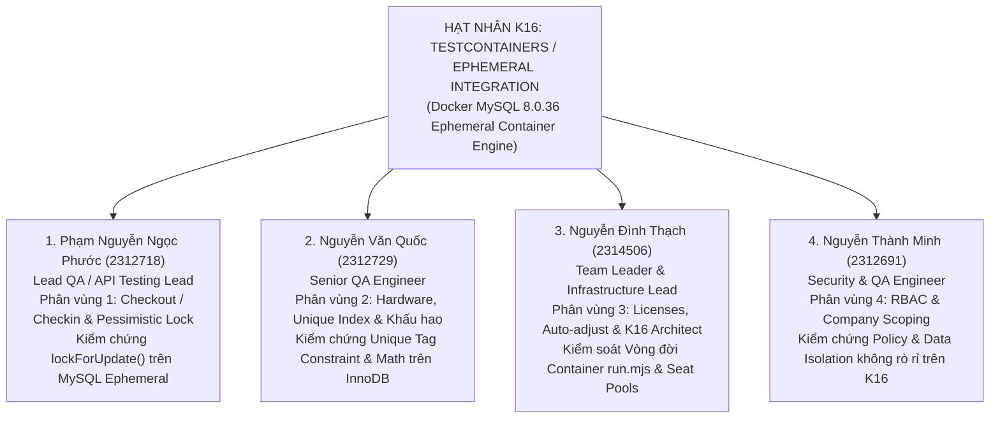
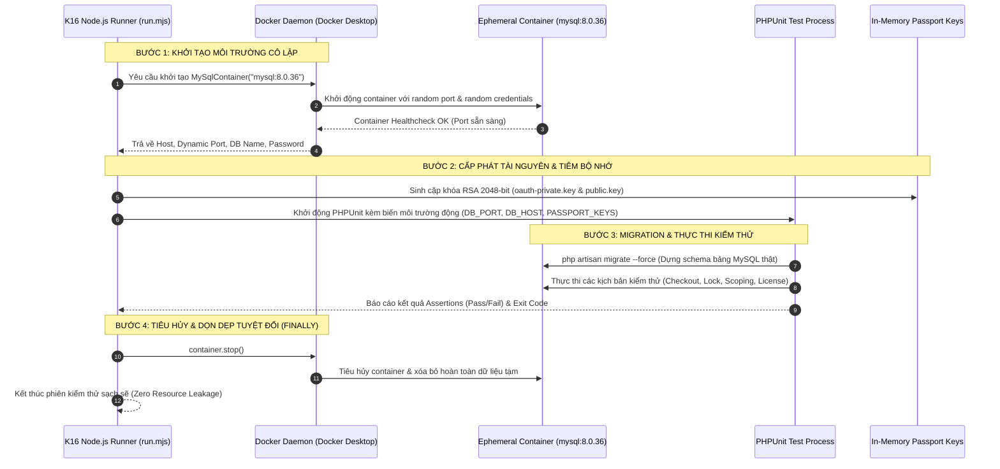
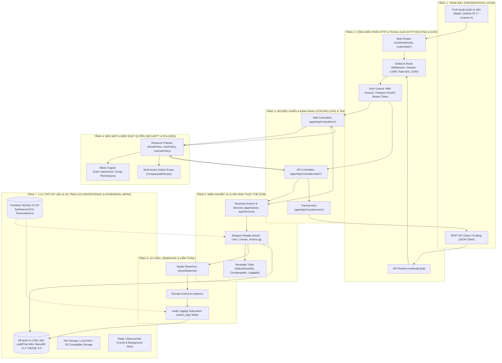

# 🛡️ ĐỒ ÁN KIỂM THỬ PHẦN MỀM: HỆ THỐNG QUẢN LÝ TÀI SẢN CNTT SNIPE-IT
> **ĐỀ TÀI:** Phân tích Kiến trúc và Thực thi Kiểm thử Tự động Hệ thống Snipe-IT (Mã đề tài: R03)  
> **TRỌNG TÂM PHƯƠNG PHÁP LUẬN:** **KẾT HỢP KỸ THUẬT KIỂM THỬ NÂNG CAO K16 — TESTCONTAINERS / EPHEMERAL INTEGRATION LÀM GỐC XUYÊN SUỐT TOÀN BỘ QUY TRÌNH**  
> **Nền tảng công nghệ:** Laravel Framework 12.x | PHP 8.2+ | Ephemeral MySQL 8.0.36 via Docker Desktop | MariaDB 11.4 | Node.js Testcontainers  
> **Kho mã nguồn:** [Snipe-IT Repository](https://github.com/Bee-Max-Ne/Snipe-IT)  
> **Môi trường cục bộ đang chạy:** `http://127.0.0.1:8000` (hoặc `http://localhost:8000`)

---

## 📑 MỤC LỤC TỔNG QUAN

1. [Định vị Phương pháp luận K16: Testcontainers / Ephemeral Integration làm Gốc](#1-định-vị-phương-pháp-luận-k16-testcontainers--ephemeral-integration-làm-gốc)
2. [Phân công Nhiệm vụ 4 Thành viên Chuẩn hóa trên Nền tảng K16 (WBS Chi tiết)](#2-phân-công-nhiệm-vụ-4-thành-viên-chuẩn-hóa-trên-nền-tảng-k16-wbs-chi-tiết)
3. [Quy trình Kiểm thử 4 Bước Chuẩn K16 Testcontainers](#3-quy-trình-kiểm-thử-4-bước-chuẩn-k16-testcontainers)
4. [Bóc tách Kiến trúc Hệ thống Chi tiết (7 Tầng Kiến trúc)](#4-bóc-tách-kiến-trúc-hệ-thống-chi-tiết-7-tầng-kiến-trúc)
5. [4 Phân vùng Kiểm thử Trọng tâm Ứng dụng K16 Ephemeral Database](#5-4-phân-vùng-kiểm-thử-trọng-tâm-ứng-dụng-k16-ephemeral-database)
6. [Đặc tả Chi tiết Bộ Test Cases API (TC-CO-01 đến TC-CO-07) trên K16](#6-đặc-tả-chi-tiết-bộ-test-cases-api-tc-co-01-đến-tc-co-07-trên-k16)
7. [Hiện trạng Cơ sở Dữ liệu & Dữ liệu Mẫu (Seeding Data)](#7-hiện-trạng-cơ-sở-dữ-liệu--dữ-liệu-mẫu-seeding-data)
8. [Hướng dẫn Cài đặt, Vận hành & Thực thi Kiểm thử Tự động với K16 Testcontainers](#8-hướng-dẫn-cài-đặt-vận-hành--thực-thi-kiểm-thử-tự-động-với-k16-testcontainers)

---

## 1. ĐỊNH VỊ PHƯƠNG PHÁP LUẬN K16: TESTCONTAINERS / EPHEMERAL INTEGRATION LÀM GỐC

### 1.1 Khái niệm & Triết lý K16 Testcontainers
Trong các hệ thống quản trị tài sản doanh nghiệp quy mô lớn (ITAM/ERP) như Snipe-IT, việc kiểm thử phần mềm nếu chỉ dừng lại ở Unit Test với SQLite `:memory:` hoặc Mocking sẽ mang lại rủi ro rất cao ("False Positives"):
- **Hạn chế nghiêm trọng của SQLite / In-Memory Database:**
  - Không hỗ trợ cơ chế khóa hàng bi quan (*Pessimistic Concurrency Locking*: `SELECT ... FOR UPDATE`).
  - Không mô phỏng được hành vi của Storage Engine **InnoDB** (ACID transactions, Deadlock detection, Foreign Key Cascade thực tế).
  - Khác biệt về tập ký tự (Collation, UTF8MB4), hàm tính toán ngày tháng và độ chính xác số thực tài chính (`DECIMAL`).
- **Hạn chế của CSDL Cục bộ Dùng chung (Shared Local MySQL):**
  - Gặp lỗi nhiễm chéo trạng thái giữa các bài test (*Cross-test State Pollution*).
  - Phụ thuộc vào dữ liệu tồn dư, khó tái lập (Non-reproducible) và không thể chạy đồng thời trên CI/CD.

> [!IMPORTANT]
> **Tuyên ngôn K16:** Toàn bộ quy trình kiểm thử của cả **4 thành viên** trong dự án Snipe-IT được xây dựng dựa trên **Kỹ thuật Kiểm thử Nâng cao K16 — Testcontainers / Ephemeral Integration** làm nền tảng gốc rễ.  
> Mỗi phiên kiểm thử tự động sẽ kích hoạt một **Container MySQL 8.0.36 độc lập, tồn tại ngắn hạn (ephemeral)**, thực thi toàn bộ luồng di chuyển cấu trúc (*Migrations*), thực thi kiểm thử trên engine thật và **tự động tiêu hủy hoàn toàn** sau khi hoàn tất, đảm bảo tính cô lập 100% và phản ánh chính xác tuyệt đối môi trường Production.

### 1.2 Bảng So sánh Phương pháp luận Kiểm thử

| Tiêu chí Đánh giá | Kiểm thử Giả lập (SQLite / Mock) | Kiểm thử CSDL Cục bộ (Shared Local DB) | Kỹ thuật Nâng cao K16 (Testcontainers Ephemeral MySQL) |
| :--- | :--- | :--- | :--- |
| **Tính trung thực với Production** | Thấp (Engine SQLite khác biệt MySQL) | Trung bình (Tùy cấu hình máy dev) | **Tuyệt đối 100% (Image Docker `mysql:8.0.36` chuẩn)** |
| **Kiểm chứng Khóa Đồng thời (`FOR UPDATE`)** | ❌ Không hỗ trợ | ⚠️ Dễ xung đột và treo connection | **✅ Hỗ trợ chuẩn xác trên InnoDB Engine** |
| **Cô lập Trạng thái (No State Leakage)** | ✅ Có (Xóa sau phiên) | ❌ Kém (Dữ liệu test trước sót lại) | **✅ Tuyệt đối (Container hoàn toàn mới cho từng lượt)** |
| **Khả năng Tự động hóa CI/CD** | ✅ Nhanh nhưng không tin cậy | ❌ Rất khó cấu hình độc lập | **✅ Tương thích hoàn hảo với GitHub Actions CI** |
| **Cấp phát Khóa OAuth Passport** | ❌ Phải ghi đè ổ đĩa máy dev | ⚠️ Dễ lộ Secret Keys | **✅ Cấp phát cặp khóa RSA 2048-bit động trong Memory** |

---

## 2. PHÂN CÔNG NHIỆM VỤ 4 THÀNH VIÊN CHUẨN HÓA TRÊN NỀN TẢNG K16 (WBS CHI TIẾT)

Mô hình kiểm thử của cả 4 thành viên đều xoay quanh hạt nhân kỹ thuật **K16 Testcontainers**:



### 2.1 Bảng Tổng hợp Phân công Trách nhiệm Neo vào Nền tảng K16

| STT | Họ và Tên | Mã Sinh Viên | Vai trò Dự án | Phân vùng Trọng tâm | Ứng dụng Kỹ thuật K16 Testcontainers làm Gốc | Bộ Test Suite Phụ trách Chính |
| :---: | :--- | :---: | :--- | :--- | :--- | :--- |
| **1** | **Phạm Nguyễn Ngọc Phước** | **2312718** | **Lead QA (Senior Testing Engineer)** | **Phân vùng 1:** Module API Checkout, Checkin & Quy trình Cấp phát / Thu hồi | Sử dụng container MySQL K16 để kiểm chứng cơ chế **Pessimistic Concurrency Locking (`lockForUpdate()`)** và Transaction Rollback chống Race Condition mà SQLite không thể thực hiện. | `tests/Feature/Checkouts/Api/AssetCheckoutTest.php`<br/>`tests/Feature/Checkins/Api/AssetCheckinTest.php` |
| **2** | **Nguyễn Văn Quốc** | **2312729** | **QA Engineer (Senior Automation Tester)** | **Phân vùng 2:** Module Quản lý Tài sản Phần cứng, Dòng Model & Khấu hao | Sử dụng CSDL MySQL K16 để kiểm chứng ràng buộc toàn vẹn duy nhất vật lý (**Unique Index `asset_tag`**) và độ chính xác tính toán khấu hao đường thẳng trên Storage Engine thật. | `tests/Unit/AssetTest.php`<br/>`tests/Unit/DepreciationTest.php`<br/>`tests/Unit/AssetModelTest.php` |
| **3** | **Nguyễn Đình Thạch** | **2314506** | **Team Leader & Infrastructure Lead** | **Phân vùng 3:** Module Bản quyền Phần mềm, Phụ kiện, Linh kiện & CI/CD K16 | Trực tiếp kiến trúc bộ điều phối `run.mjs`, quản lý vòng đời container Docker MySQL, cấp phát dynamic keys và kiểm thử tranh chấp ghế bản quyền (**Seat Allocation Pool**) trên CSDL cô lập. | `tests/testcontainers/run.mjs`<br/>`.github/workflows/testcontainers.yml`<br/>`tests/Feature/Licenses/Api/LicenseSeatAllocationLimitTest.php`<br/>`tests/Feature/Licenses/Api/LicenseProductKeyMaskingTest.php`<br/>`tests/Feature/Accessories/Api/AccessoryQuantityOnCheckoutTest.php`<br/>`tests/Feature/Components/Api/ComponentAttachToAssetTest.php` |
| **4** | **Nguyễn Thành Minh** | **2312691** | **QA Engineer (Security & Access Control)** | **Phân vùng 4:** Module Người dùng, Phân quyền RBAC, Đa công ty & Security Policy | Sử dụng môi trường sạch K16 để kiểm thử ma trận RBAC và cơ chế cách ly dữ liệu **CompanyableScope** nhằm đảm bảo không có rò rỉ trạng thái giữa các bài test bảo mật. | `tests/Unit/UserTest.php`<br/>`tests/Unit/CompanyScopingTest.php` |

---

### 2.2 Chi tiết Nhiệm vụ & Quy trình K16 Từng Thành viên

#### 👤 1. Phạm Nguyễn Ngọc Phước — Lead QA (Senior Testing Engineer)
- **Mã sinh viên:** `2312718`
- **Vai trò:** Trưởng nhóm Kiểm thử API & Quy trình Cấp phát (Lead QA / API Testing Lead)
- **Phương pháp luận K16 ứng dụng:**
  1. **Kiểm thử Concurrency Locking trên MySQL Thật:** Cơ chế khóa bi quan `lockForUpdate()` là tính năng cốt lõi của MySQL InnoDB. Thành viên thực thi các test case trên container K16 để kiểm chứng rằng khi 2 luồng API checkout cùng gọi tới tài sản ID = X, InnoDB sẽ lock row chính xác, luồng thứ 2 bị chặn hoặc nhận lỗi, ngăn chặn hoàn toàn lỗi Double-Allocation.
  2. **Đặc tả 7 Kịch bản Kiểm thử Toàn trình (TC-CO-01 đến TC-CO-07):** Xây dựng bộ test case kiểm thử khép kín: Checkout cho User, Checkout cho Location, Chặn tài sản hỏng, Chặn Double Checkout, Chặn 401 không token, Kiểm tra 422 thiếu payload, và Thu hồi Checkin hoàn trả kho.
  3. **Kiểm tra Tính Toàn vẹn của Action Logs:** Xác minh bản ghi nhật ký tại bảng `action_logs` được ghi nhận chuẩn xác trên schema MySQL với đầy đủ khóa ngoại và dữ liệu kiểm toán.
  4. **Lệnh thực thi chuẩn K16:**
     ```powershell
     npm run test:integration:testcontainers -- tests/Feature/Checkouts/Api/AssetCheckoutTest.php --filter=test_asset_can_be_checked_out_and_checked_back_in_through_api
     ```

#### 👤 2. Nguyễn Văn Quốc — QA Engineer (Senior Automation Tester)
- **Mã sinh viên:** `2312729`
- **Vai trò:** Kỹ sư Kiểm thử Phần cứng & Vòng đời Tài chính (Hardware & Financial Life-cycle Tester)
- **Phương pháp luận K16 ứng dụng:**
  1. **Kiểm chứng Ràng buộc Vật lý Duy nhất (Unique Tag Constraint):** Kiểm thử `test_asset_tag_unique_constraint_prevents_duplicate_tag()` trực tiếp trên container MySQL để xác minh chỉ mục `UNIQUE KEY assets_asset_tag_unique (asset_tag)` kích hoạt ngoại lệ `QueryException` (MySQL Error 1062 Duplicate entry) khi cố tình ghi đè mã tài sản.
  2. **Kiểm thử Thuật toán Khấu hao Tuyến tính (Linear Depreciation Math):** Kiểm tra phương thức `getLinearDepreciatedValue()` với kiểu số thực và ngày tháng trên MySQL engine thật, đảm bảo giá trị còn lại không giảm quá giá trị sàn sàn thu hồi (`depreciation_min`).
  3. **Kiểm thử Mã hóa AES & Dynamic Custom Fields:** Xác minh tính toàn vẹn của các trường mở rộng (IMEI, MAC Address) khi mã hóa lưu trữ vào MySQL blob/text field và giải mã hiển thị.
  4. **Lệnh thực thi chuẩn K16:**
     ```powershell
     npm run test:integration:testcontainers -- tests/Unit/AssetTest.php
     ```

#### 👤 3. Nguyễn Đình Thạch — Team Leader & Infrastructure Lead
- **Mã sinh viên:** `2314506`
- **Vai trò:** Trưởng nhóm Dự án & Kỹ sư Kiến trúc Tự động hóa Hạ tầng (Project Lead & Test Automation Architect)
- **Phương pháp luận K16 ứng dụng:**
  1. **Xây dựng Nền tảng K16 Runner ([run.mjs](tests/testcontainers/run.mjs)):**
     - Điều phối `@testcontainers/mysql`, ghim cứng phiên bản `mysql:8.0.36`.
     - Tự động sinh cặp khóa Passport RSA 2048-bit động trong bộ nhớ RAM phục vụ xác thực API token mà không cần ghi file vật lý vào repository.
     - Cơ chế đảm bảo dọn sạch tài nguyên (*Guaranteed Teardown*): Lệnh `container.stop()` đặt trong khối `finally` đảm bảo 100% container bị tiêu hủy kể cả khi bài test bị crash hoặc fail assertion.
  2. **Quản trị CI/CD Pipeline:** Xây dựng quy trình [.github/workflows/testcontainers.yml](.github/workflows/testcontainers.yml) chạy tự động hóa trên GitHub Actions runner có Docker.
  3. **Kiểm thử Bản quyền, Phụ kiện & Linh kiện:** Bổ sung 4 bộ test tích hợp (12 test case) chạy trên MySQL 8.0.36 qua Testcontainers: giới hạn số ghế bản quyền (`numRemaining()`, `free_seats_count`), che giấu Product Key theo quyền `viewKeys`, tự động điều chỉnh tồn kho phụ kiện khi cấp phát/thu hồi và gắn/gỡ linh kiện vào tài sản (bảng `components_assets`). Chi tiết và kết quả tại [mục 5.3](#53-phân-vùng-3-bản-quyền-phần-mềm-phụ-kiện-linh-kiện--k16-cicd).
  4. **Lệnh thực thi chuẩn K16:**
     ```powershell
     npm run test:integration:testcontainers -- tests/Feature/Licenses/Api/LicenseSeatAllocationLimitTest.php
     ```

#### 👤 4. Nguyễn Thành Minh — QA Engineer (Security & Access Control)
- **Mã sinh viên:** `2312691`
- **Vai trò:** Kỹ sư Kiểm thử Bảo mật, Phân quyền & Quản trị Danh tính (Security & IAM Testing Engineer)
- **Phương pháp luận K16 ứng dụng:**
  1. **Kiểm chứng Ma trận Quyền RBAC (`User::hasAccess`):** Sử dụng CSDL MySQL K16 độc lập để nạp dữ liệu quyền hạn phân tầng, kiểm chứng việc cấp phép chính xác cho từng vai trò mà không bị ảnh hưởng bởi cache phân quyền của các phiên kiểm thử trước.
  2. **Kiểm thử Chống Leo thang Đặc quyền (Privilege Escalation Prevention):** Kiểm chứng chính sách `UserPolicy` ngăn chặn người dùng thường tự sửa quyền hoặc xóa tài khoản Superadmin tối cao.
  3. **Kiểm thử Cách ly Dữ liệu Đa Công ty (`CompanyableScope`):** Chạy ma trận kiểm thử Global Scope trên CSDL MySQL thật. Đảm bảo câu lệnh SQL do Eloquent sinh ra luôn có mệnh đề `WHERE company_id = ?`, chứng minh dữ liệu giữa các công ty con hoàn toàn cô lập và không rò rỉ.
  4. **Lệnh thực thi chuẩn K16:**
     ```powershell
     npm run test:integration:testcontainers -- tests/Unit/UserTest.php
     ```

---

## 3. QUY TRÌNH KIỂM THỬ 4 BƯỚC CHUẨN K16 TESTCONTAINERS

Tất cả các bộ test của 4 thành viên đều vận hành theo chu trình vòng đời chuẩn 4 bước do bộ điều phối [tests/testcontainers/run.mjs](file:///d:/KIEM_THU_PHAN_MEM/Do_An/snipe-it-master/tests/testcontainers/run.mjs) kiểm soát:



1. **Bước 1 — Khởi tạo Container Ephemeral Độc lập:** Node.js khởi chạy một container Docker từ image `mysql:8.0.36` với cổng kết nối ngẫu nhiên và mật khẩu ngẫu nhiên.
2. **Bước 2 — Cấp phát Tài nguyên & Tiêm Động:** Tự động sinh cặp khóa RSA 2048-bit cho Laravel Passport trong bộ nhớ, truyền các biến môi trường kết nối trực tiếp vào tiến trình con `phpunit`.
3. **Bước 3 — Di chuyển Schema & Thực thi Kiểm thử:** Thực hiện `migrate` tự động trên CSDL sạch, chạy các ca kiểm thử của các thành viên trên storage engine MySQL thật.
4. **Bước 4 — Tiêu hủy Bảo đảm (Guaranteed Teardown):** Khối `finally` bảo đảm container được tắt và xóa bỏ hoàn toàn, không để lại tài nguyên rác hay rò rỉ dữ liệu trên máy tính phát triển hoặc CI server.

---

## 4. BÓC TÁCH KIẾN TRÚC HỆ THỐNG CHI TIẾT (7 TẦNG KIẾN TRÚC)

Mã nguồn Snipe-IT được thiết kế theo kiến trúc **Domain-Driven Multi-Tier Architecture** mở rộng trên nền tảng Laravel 12:



### Chi tiết Trách nhiệm Từng Tầng:
- **Tầng 1 (Presentation):** Blade Views, AdminLTE v2, Bootstrap 3, Livewire 4, Chart.js 2.9.4.
- **Tầng 2 (Routing & Gateway):** Web routes, API routes (`/api/v1`), middleware xác thực OAuth2 Bearer token (Passport), Rate-limiting, CSRF.
- **Tầng 3 (Controllers & Transformers):** Web Controllers phục vụ giao diện, API Controllers phục vụ RESTful JSON; Transformers đóng vai trò DTO che giấu dữ liệu nhạy cảm.
- **Tầng 4 (Security & Policies):** RBAC Engine (`User::hasAccess()`), Policies kiểm soát quyền hành động theo thực thể, `CompanyableScope` cách ly dữ liệu tổ chức.
- **Tầng 5 (Domain & Logic):** Eloquent Models, Business Actions, Concurrency Locking (`lockForUpdate()`), Traits (`AdjustsQuantity`, `Companyable`).
- **Tầng 6 (Events & Audit):** Model Observers, lưu vết nhật ký bất biến tại bảng `action_logs`.
- **Tầng 7 (Persistence & K16 Infrastructure):** Cơ sở dữ liệu MariaDB 11.4 kết hợp hạ tầng **K16 Ephemeral MySQL Container** phục vụ toàn bộ các bài kiểm thử tự động.

---

## 5. 4 PHÂN VÙNG KIỂM THỬ TRỌNG TÂM ỨNG DỤNG K16 EPHEMERAL DATABASE

### 5.1 Phân vùng 1: API Checkout, Checkin & Khóa Tranh chấp Đồng thời
- **Chủ trì:** Phạm Nguyễn Ngọc Phước (2312718)
- **Tập tin kiểm thử:** [AssetCheckoutTest.php](file:///d:/KIEM_THU_PHAN_MEM/Do_An/snipe-it-master/tests/Feature/Checkouts/Api/AssetCheckoutTest.php) và [AssetCheckinTest.php](file:///d:/KIEM_THU_PHAN_MEM/Do_An/snipe-it-master/tests/Feature/Checkins/Api/AssetCheckinTest.php).
- **Cơ chế K16 cốt lõi:**
  - Sử dụng giao dịch cơ sở dữ liệu `DB::transaction()` kết hợp `lockForUpdate()` trên MySQL InnoDB:
    ```php
    DB::transaction(function () use ($asset, $target) {
        $lockedAsset = Asset::where('id', $asset->id)->lockForUpdate()->first();
        // Kiểm tra tính sẵn sàng và cấp phát an toàn
    });
    ```
  - Kiểm chứng phản hồi API (200 OK, 400 Bad Request, 401 Unauthorized, 422 Unprocessable Entity) và kiểm tra tính toàn vẹn bản ghi `action_logs` trên CSDL MySQL thật.

### 5.2 Phân vùng 2: Tài sản Phần cứng, Ràng buộc Unique & Khấu hao
- **Chủ trì:** Nguyễn Văn Quốc (2312729)
- **Tập tin kiểm thử:** [AssetTest.php](file:///d:/KIEM_THU_PHAN_MEM/Do_An/snipe-it-master/tests/Unit/AssetTest.php), `DepreciationTest.php`, `AssetModelTest.php`.
- **Cơ chế K16 cốt lõi:**
  - Kiểm chứng ràng buộc duy nhất vật lý: `test_asset_tag_unique_constraint_prevents_duplicate_tag()` kích hoạt lỗi MySQL Duplicate Key khi trùng mã thiết bị.
  - Kiểm chứng thuật toán khấu hao đường thẳng `getLinearDepreciatedValue()` đảm bảo giá trị sổ sách không bao giờ giảm dưới `depreciation_min` với độ chính xác số thực của MySQL.

### 5.3 Phân vùng 3: Bản quyền Phần mềm, Phụ kiện, Linh kiện & K16 CI/CD
- **Chủ trì:** Nguyễn Đình Thạch (2314506)
- **Nhánh làm việc:** `feature/license-tests`
- **Hạ tầng:** [run.mjs](tests/testcontainers/run.mjs), [.github/workflows/testcontainers.yml](.github/workflows/testcontainers.yml).
- **Cơ chế K16 cốt lõi:**
  - Kiểm chứng logic tính ghế trống (`License::numRemaining()`, `free_seats_count`), ngăn chặn cấp phát vượt số ghế trên CSDL MySQL độc lập.
  - Kiểm tra che giấu Product Key theo quyền `viewKeys` và tự động điều chỉnh tồn kho phụ kiện/linh kiện khi cấp phát/thu hồi.
  - Quản trị toàn bộ vòng đời container Docker của nhóm và pipeline CI/CD GitHub Actions.

#### 5.3.1 Bộ test case bổ sung của Phân vùng 3

| Tệp kiểm thử | Test case | Kịch bản kiểm chứng |
| --- | --- | --- |
| [LicenseSeatAllocationLimitTest.php](tests/Feature/Licenses/Api/LicenseSeatAllocationLimitTest.php) | `test_license_seat_allocation_limits` | License 5 ghế: cấp phát lần lượt cho 5 user thành công, user thứ 6 bị từ chối và không có ghế nào được gán thêm. |
| | `test_checked_in_seat_can_be_allocated_to_the_next_user` | Thu hồi 1 ghế của license đã đầy thì user tiếp theo được cấp phát đúng ghế vừa trống. |
| | `test_free_seat_count_in_api_reflects_allocations` | API `GET /api/v1/licenses/{id}` trả về `free_seats_count` khớp số ghế còn trống (5 ghế, 3 đã dùng → 2). |
| [LicenseProductKeyMaskingTest.php](tests/Feature/Licenses/Api/LicenseProductKeyMaskingTest.php) | `test_product_key_masking` | User không có quyền `viewKeys` chỉ nhận `product_key` dạng `------------`, key thật không xuất hiện trong response. |
| | `test_product_key_is_visible_to_users_with_view_keys_permission` | User có quyền `licenses.keys` nhận đúng key thật. |
| | `test_product_key_is_masked_in_license_index_for_users_without_view_keys` | Danh sách `GET /api/v1/licenses` cũng che key ở mọi dòng. |
| [AccessoryQuantityOnCheckoutTest.php](tests/Feature/Accessories/Api/AccessoryQuantityOnCheckoutTest.php) | `test_accessory_quantity_adjusts_on_checkout` | Phụ kiện số lượng 10, cấp phát 2 → còn lại 8 (tổng `qty` giữ nguyên 10). |
| | `test_checkin_restores_remaining_quantity` | Thu hồi từng chiếc → số lượng còn lại tăng 9 rồi 10. |
| | `test_cannot_checkout_more_than_remaining_quantity` | Còn 3 mà yêu cầu 4 → bị từ chối, không phát sinh bản ghi cấp phát. |
| [ComponentAttachToAssetTest.php](tests/Feature/Components/Api/ComponentAttachToAssetTest.php) | `test_component_attached_to_hardware` | Gắn 2 thanh RAM vào laptop `LAP-001` → có bản ghi `components_assets`, linh kiện còn lại 8/10. |
| | `test_full_checkin_detaches_component_and_restores_quantity` | Gỡ toàn bộ → xóa bản ghi gắn kết, số lượng trở lại 10. |
| | `test_partial_checkin_keeps_remaining_components_attached` | Gỡ 1 trên 3 → bản ghi gắn kết còn `assigned_qty = 2`. |

#### 5.3.2 Kết quả thực thi trên Testcontainers (MySQL 8.0.36)

Môi trường: PHP 8.4.26, PHPUnit 11.5.55, Docker 29.8.0, container `mysql:8.0.36` tạm thời do `run.mjs` khởi tạo.

```text
$ npm run test:integration:testcontainers -- tests/Feature/Licenses/Api/LicenseSeatAllocationLimitTest.php tests/Feature/Licenses/Api/LicenseProductKeyMaskingTest.php tests/Feature/Accessories/Api/AccessoryQuantityOnCheckoutTest.php tests/Feature/Components/Api/ComponentAttachToAssetTest.php

PHPUnit 11.5.55 by Sebastian Bergmann and contributors.

Runtime:       PHP 8.4.26
Configuration: D:\Projects\Web\Snipe-IT\phpunit.xml

............                                                      12 / 12 (100%)

Time: 02:48.107, Memory: 88.00 MB

OK (12 tests, 68 assertions)
```

Kiểm thử hồi quy toàn bộ Phân vùng 3 (các test có sẵn của License, Accessory, Component cùng 12 test bổ sung) để đảm bảo không phát sinh lỗi:

```text
$ npm run test:integration:testcontainers -- tests/Feature/Licenses tests/Feature/Accessories tests/Feature/Components

PHPUnit 11.5.55 by Sebastian Bergmann and contributors.

Runtime:       PHP 8.4.26
Configuration: D:\Projects\Web\Snipe-IT\phpunit.xml

...............................................................  63 / 346 ( 18%)
............................................................... 126 / 346 ( 36%)
............................................................... 189 / 346 ( 54%)
............................................................... 252 / 346 ( 72%)
............................................................... 315 / 346 ( 91%)
...............................                                 346 / 346 (100%)

Time: 33:02.811, Memory: 244.00 MB

OK (346 tests, 1232 assertions)
```

> **Lưu ý khi chạy toàn bộ:** `memory_limit` mặc định 128M của PHP không đủ cho lần chạy 346 test. Nâng giới hạn cho riêng tiến trình kiểm thử, ví dụ trên Windows/PowerShell: tạo thư mục chứa tệp `memory.ini` với nội dung `memory_limit=1G`, sau đó đặt `$env:PHP_INI_SCAN_DIR` trỏ tới thư mục đó trước khi chạy lệnh trên.

### 5.4 Phân vùng 4: Người dùng, Phân quyền RBAC, Đa công ty & Security Policy
- **Chủ trì:** Nguyễn Thành Minh (2312691)
- **Tập tin kiểm thử:** [UserTest.php](file:///d:/KIEM_THU_PHAN_MEM/Do_An/snipe-it-master/tests/Unit/UserTest.php), `CompanyScopingTest.php`.
- **Cơ chế K16 cốt lõi:**
  - Kiểm thử ma trận RBAC `User::hasAccess()`, ngăn chặn Privilege Escalation trong `UserPolicy`.
  - Kiểm chứng cơ chế cách ly dữ liệu đa người thuê `CompanyableScope` trên CSDL cô lập, chứng minh không xảy ra rò rỉ dữ liệu chéo giữa Công ty A và Công ty B.

---

## 6. ĐẶC TẢ CHI TIẾT BỘ TEST CASES API (TC-CO-01 ĐẾN TC-CO-07) TRÊN K16

Toàn bộ 7 ca kiểm thử sau đây được thực thi và xác nhận trên môi trường **K16 Testcontainers (MySQL 8.0.36 Ephemeral Container)**:

| Mã Test | Tên Phương Thức Kiểm Thử | Loại Kiểm Thử | Mã HTTP | Mục tiêu Kiểm chứng trên K16 Ephemeral MySQL |
| :---: | :--- | :---: | :---: | :--- |
| **TC-CO-01** | `test_asset_can_be_checked_out_through_api` | Positive | `200 OK` | Cấp phát thành công cho User; xác minh bản ghi `assets.assigned_to` và `action_logs` được COMMIT trên MySQL. |
| **TC-CO-02** | `test_asset_can_be_checked_out_to_location_through_api` | Positive | `200 OK` | Cấp phát thành công cho Location; kiểm tra tính nhất quán quan hệ đa hình (`MorphTo`) trên MySQL. |
| **TC-CO-03** | `test_cannot_checkout_undeployable_asset` | Negative | `400 Bad Req` | Chặn cấp phát tài sản không sẵn sàng; ROLLBACK giao dịch và không để lại dữ liệu rác. |
| **TC-CO-04** | `test_cannot_checkout_already_checked_out_asset` | Negative | `400 Bad Req` | Chặn Double-Checkout; kiểm chứng khóa hàng chống ghi đè người dùng đang sở hữu. |
| **TC-CO-05** | `test_unauthenticated_request_is_rejected_at_gateway` | Security | `401 Unauth` | Chặn request thiếu OAuth Bearer Token tại Gateway, bảo vệ tầng Controller và CSDL. |
| **TC-CO-06** | `test_checkout_fails_validation_with_missing_target` | Validation | `422 Unproc` | Báo lỗi khi thiếu dữ liệu mục tiêu cấp phát (`checkout_to_type`). |
| **TC-CO-07** | `test_asset_can_be_checked_in_through_api` | Positive | `200 OK` | Thu hồi tài sản về kho; trả `assigned_to` về `null` và ghi nhận nhật ký hoàn tất quy trình khép kín. |

---

## 7. HIỆN TRẠNG CƠ SỞ DỮ LIỆU & DỮ LIỆU MẪU (SEEDING DATA)

Hệ thống đã được nạp dữ liệu mẫu hoàn chỉnh qua [SystemSampleDataSeeder.php](file:///d:/KIEM_THU_PHAN_MEM/Do_An/snipe-it-master/database/seeders/SystemSampleDataSeeder.php), đảm bảo tất cả **18 bảng cốt lõi đều đạt $\ge 10$ bản ghi**:

| STT | Tên Bảng (`Table`) | Ý nghĩa Nghiệp vụ | Số lượng Bản ghi | Trạng thái Nghiệm thu |
| :---: | :--- | :--- | :---: | :---: |
| 1 | `companies` | Doanh nghiệp / Pháp nhân | **10** | Đạt ($\ge 10$) |
| 2 | `locations` | Vị trí địa lý / Kho bãi | **12** | Đạt ($\ge 10$) |
| 3 | `departments` | Phòng ban chức năng | **14** | Đạt ($\ge 10$) |
| 4 | `groups` | Nhóm vai trò RBAC | **12** | Đạt ($\ge 10$) |
| 5 | `users` | Người dùng & Nhân viên | **12** | Đạt ($\ge 10$) |
| 6 | `manufacturers` | Nhà sản xuất phần cứng | **10** | Đạt ($\ge 10$) |
| 7 | `suppliers` | Nhà cung ứng thiết bị | **11** | Đạt ($\ge 10$) |
| 8 | `categories` | Danh mục phân loại | **19** | Đạt ($\ge 10$) |
| 9 | `depreciations` | Bảng thiết lập khấu hao | **13** | Đạt ($\ge 10$) |
| 10 | `status_labels` | Nhãn trạng thái tài sản | **15** | Đạt ($\ge 10$) |
| 11 | `models` | Dòng đời Model thiết bị | **17** | Đạt ($\ge 10$) |
| 12 | `assets` | Thiết bị phần cứng | **15** | Đạt ($\ge 10$) |
| 13 | `licenses` | Bản quyền phần mềm | **10** | Đạt ($\ge 10$) |
| 14 | `license_seats` | Ghế sử dụng bản quyền | **865** | Đạt ($\ge 10$) |
| 15 | `accessories` | Phụ kiện CNTT | **10** | Đạt ($\ge 10$) |
| 16 | `consumables` | Vật tư tiêu hao | **10** | Đạt ($\ge 10$) |
| 17 | `components` | Linh kiện phần cứng | **10** | Đạt ($\ge 10$) |
| 18 | `action_logs` | Nhật ký kiểm toán thao tác | **127** | Đạt ($\ge 10$) |

- **Tài khoản Superadmin Lead QA:** ID `1`, Email `2312718@dlu.edu.vn`, Username `Bee` (Phạm Nguyễn Ngọc Phước).

---

## 8. HƯỚNG DẪN CÀI ĐẶT, VẬN HÀNH & THỰC THI KIỂM THỬ TỰ ĐỘNG VỚI K16 TESTCONTAINERS

### 8.1 Yêu cầu Tiên quyết
- **Docker Desktop:** Cài đặt và đang chạy dịch vụ Docker daemon.
- **PHP:** `8.2.0` trở lên (bật `pdo_mysql`, `mbstring`, `curl`, `openssl`, `fileinfo`, `gd`, `bcmath`).
- **Node.js:** Phiên bản `18.x` hoặc `20.x`.
- **Composer:** `2.x`.

---

### 8.2 Thực thi Toàn diện Bộ Kiểm thử Nâng cao K16 (Trọng tâm Đồ án)

Để chạy kiểm thử trên môi trường CSDL MySQL 8.0.36 Ephemeral độc lập hoàn toàn tự động:

```powershell
# 1. Chạy bài kiểm thử trọng điểm Asset Checkout / Checkin toàn trình (Phân vùng 1):
npm run test:integration:testcontainers -- tests/Feature/Checkouts/Api/AssetCheckoutTest.php --filter=test_asset_can_be_checked_out_and_checked_back_in_through_api

# 2. Chạy bài kiểm thử Ràng buộc Duy nhất & Mô hình Tài sản Phần cứng (Phân vùng 2):
npm run test:integration:testcontainers -- tests/Unit/AssetTest.php

# 3. Chạy bài kiểm thử Ghế Bản quyền & Điều phối Số lượng (Phân vùng 3):
npm run test:integration:testcontainers -- tests/Feature/Licenses/Api/LicenseSeatAllocationLimitTest.php tests/Feature/Licenses/Api/LicenseProductKeyMaskingTest.php tests/Feature/Accessories/Api/AccessoryQuantityOnCheckoutTest.php tests/Feature/Components/Api/ComponentAttachToAssetTest.php

# 4. Chạy bài kiểm thử Phân quyền RBAC & Đa công ty CompanyableScope (Phân vùng 4):
npm run test:integration:testcontainers -- tests/Unit/UserTest.php
```

---

### 8.3 Thực thi Kiểm thử PHPUnit Cục bộ
```powershell
# Chạy toàn bộ các bài kiểm thử:
php artisan test

# Chạy riêng theo từng tệp:
php artisan test tests/Feature/Checkouts/Api/AssetCheckoutTest.php
php artisan test tests/Feature/Licenses/Api/LicenseSeatAllocationLimitTest.php
php artisan test tests/Unit/UserTest.php
```

---

### 8.4 Cài đặt & Khởi chạy Ứng dụng Cục bộ
```powershell
composer install
npm install
php artisan key:generate
php artisan migrate
php artisan db:seed --class=SystemSampleDataSeeder
php artisan storage:link
npm run dev
php artisan serve --host=127.0.0.1 --port=8000
```
Truy cập giao diện: `http://127.0.0.1:8000`

---

### 8.5 Quy trình Tự động hóa CI/CD với GitHub Actions
Dự án được cấu hình tự động kiểm thử tại [.github/workflows/testcontainers.yml](file:///d:/KIEM_THU_PHAN_MEM/Do_An/snipe-it-master/.github/workflows/testcontainers.yml). Khi có bất kỳ Pull Request hoặc Commit mới vào nhánh `main`, hệ thống CI sẽ tự động kích hoạt Docker daemon, khởi chạy runner K16 Testcontainers, thực thi toàn bộ các bài kiểm thử trọng điểm và chỉ cho phép hợp nhất khi 100% assertions đạt kết quả màu xanh (PASS).

---

## 9. TỔNG KẾT & LIÊN HỆ ĐỒ ÁN

- **Đơn vị đào tạo:** Bộ môn Kiểm thử Phần mềm
- **Đề tài:** Phân tích Kiến trúc và Thực thi Kiểm thử Tự động Hệ thống Snipe-IT (R03 × K16 Testcontainers)
- **Nhóm sinh viên thực hiện:**
  - **Phạm Nguyễn Ngọc Phước** (MSSV: `2312718`) — *Lead QA / API Testing Lead (Phân vùng 1)*
  - **Nguyễn Văn Quốc** (MSSV: `2312729`) — *QA Engineer (Hardware & Financial Life-cycle - Phân vùng 2)*
  - **Nguyễn Đình Thạch** (MSSV: `2314506`) — *Team Leader & Test Automation Architect (Phân vùng 3 & K16 CI/CD)*
  - **Nguyễn Thành Minh** (MSSV: `2312691`) — *QA Engineer (Security & IAM Testing - Phân vùng 4)*
