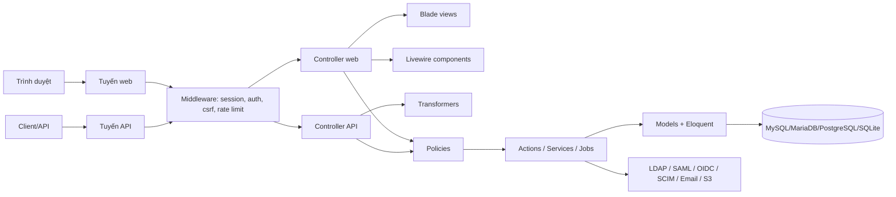

# Tài liệu hệ thống Snipe-IT

## 1. Tổng quan

Snipe-IT là hệ thống quản lý tài sản CNTT mã nguồn mở, được xây dựng trên Laravel 12. Hệ thống giúp tổ chức theo dõi, quản lý và kiểm soát vòng đời của các tài sản như máy tính, thiết bị ngoại vi, phần mềm, phụ kiện, vật tư tiêu hao, giấy phép và các tài sản được cấp phát cho người dùng.

Mục tiêu chính:

- Quản lý kho tài sản và thuộc tính của từng vật phẩm.
- Theo dõi vị trí, trạng thái, bảo hành, khấu hao và lịch sử thay đổi.
- Gán tài sản cho người dùng, phòng ban hoặc vị trí theo quy trình checkout/checkin.
- Kiểm soát quyền truy cập và phân quyền theo vai trò.
- Hỗ trợ báo cáo, nhập/xuất dữ liệu, tích hợp LDAP/SAML/OIDC/SCIM và REST API.

## 2. Bối cảnh nghiệp vụ

Hệ thống phục vụ cho môi trường IT Operations và Asset Management trong doanh nghiệp. Các nhóm người dùng chính:

- Quản trị viên hệ thống: quản lý cấu hình, quyền, dữ liệu, báo cáo, tích hợp.
- Quản trị viên tài sản: tạo và quản lý danh mục, thiết bị, model, vị trí, nhà cung cấp.
- Người dùng cuối: xem tài sản được giao, xác nhận nhận/trả tài sản, gửi và theo dõi yêu cầu.
- Đội hỗ trợ kỹ thuật: bảo trì, hợp đồng, lịch sử thay đổi, khắc phục sự cố.

Các quy trình nghiệp vụ cốt lõi:

1. Tạo model và tài sản trong kho.
2. Gán trạng thái, địa điểm, công ty, phòng ban.
3. Checkout tài sản cho người dùng hoặc vị trí.
4. Theo dõi lịch sử cấp phát/thu hồi.
5. Kiểm tra tình trạng thiết bị và bảo dưỡng.
6. Báo cáo, in nhãn, xuất dữ liệu, thống kê khấu hao.

## 3. Kiến trúc tổng thể

Hệ thống được thiết kế theo mô hình Laravel MVC mở rộng với các lớp bổ trợ:

- Presentation layer: Blade views, AdminLTE, Bootstrap, Livewire widgets.
- HTTP layer: controllers web và API, middleware, routes, transformers.
- Application layer: actions, services, jobs, events, observers.
- Domain layer: models, policies, traits, rules.
- Data layer: MySQL/MariaDB/PostgreSQL/SQLite via Eloquent.
- Integration layer: S3, LDAP, SCIM, SAML, OIDC, SMTP, notification services, queues.

Kiến trúc sơ đồ:



## 4. Công nghệ sử dụng

### 4.1 Backend

- PHP 8.2
- Laravel Framework 12
- Eloquent ORM
- Laravel Passport cho API authentication
- Laravel Mix + webpack cho asset build
- Livewire 4 để triển khai một số component tương tác nhẹ

### 4.2 Frontend

- Blade templates
- AdminLTE 2 / Bootstrap 3
- JavaScript hiện đại theo cấu trúc asset của Laravel Mix
- Chart.js v2.9.4 dùng trong báo cáo và biểu đồ

### 4.3 Cơ sở dữ liệu

- MySQL, MariaDB, PostgreSQL hoặc SQLite
- Khuyến nghị production: MySQL/MariaDB
- Migrations quản lý cấu trúc schema

### 4.4 Tích hợp và vận hành

- Redis/session/queue tùy cấu hình
- SMTP / mail drivers
- S3-compatible object storage cho upload file
- LDAP, SAML, OIDC, SCIM
- Notification channels của Laravel cho Slack, Teams, Google Chat

## 5. Cấu trúc thư mục chính

```text
app/
  Actions/            # nghiệp vụ và hành vi riêng theo tính năng
  Console/            # Artisan commands
  Enums/              # enum nghiệp vụ
  Events/             # sự kiện ứng dụng
  Exceptions/         # ngoại lệ tùy chỉnh
  Helpers/            # helper chung
  Http/
    Controllers/      # controller web + API
    Transformers/     # định dạng JSON API
  Jobs/               # tác vụ nền
  Livewire/           # component Livewire
  Models/             # model Eloquent
  Notifications/      # thông báo email/Slack/Teams
  Observers/          # observer cho model events
  Policies/           # kiểm soát quyền truy cập
  Providers/          # service providers
  Rules/              # validation custom rules
  Services/           # service logic
  SyncAdapters/       # đồng bộ dữ liệu/tích hợp
  Traits/             # trait dùng chung

config/
  # thiết lập ứng dụng, database, auth, mail, session, cache, queue...

database/
  factories/
  migrations/
  seeders/

resources/
  views/
  js/
  less/

routes/
  api.php
  web.php
  web/
  scim.php

public/
  # asset build, file public, static resources

tests/
  Feature/
  Unit/

.env.example
composer.json
package.json
webpack.mix.js
artisan
```

## 6. Chức năng hệ thống theo module

### 6.1 Quản lý tài sản phần cứng

- Tạo danh sách thiết bị và model.
- Quản lý mã tài sản, serial number, manufacturer, supplier, category.
- Theo dõi trạng thái: available, assigned, archived, pending, checkout, repair, etc.
- Quản lý bảo hành, vị trí, phòng ban và công ty.
- Gắn metadata và custom fields.

### 6.2 Cấp phát và thu hồi

- Checkout asset cho user/location.
- Checkin khi tài sản quay lại kho.
- Ghi lịch sử giao nhận, nhận trả, user nhận, thời gian giao, note.
- Tạo điều kiện dựa trên quyền và trạng thái tài sản.

### 6.3 Quản lý phụ kiện, vật tư, linh kiện và license

- Accessories, consumables, components, licenses.
- Quản lý số lượng, nơi lưu kho, user được cấp.
- Theo dõi đơn vị sử dụng và giấy phép phần mềm.

### 6.4 Người dùng, vai trò và tổ chức

- Quản lý user, department, location, company, groups.
- Phân quyền theo policy và role.
- Hỗ trợ multiple companies, company-scoped filters.

### 6.5 Báo cáo và vận hành

- Báo cáo tài sản theo trạng thái, phòng ban, vị trí, khấu hao, bảo trì.
- In nhãn, QR code, barcode.
- Nhập dữ liệu CSV, tối ưu báo cáo theo dữ liệu.
- Khả năng xuất báo cáo và thống kê.

### 6.6 Tích hợp và bảo mật

- LDAP / SAML / OIDC / SCIM
- API REST
- Email và notification channels
- Backup, audit trail, session security

## 7. Luồng yêu cầu điển hình

### 7.1 Web request flow

1. Trình duyệt gửi request tới route web.
2. Middleware kiểm tra session, CSRF, auth, route protection.
3. Controller web nhận request.
4. Controller gọi policy kiểm tra quyền.
5. Model/service/action thực hiện logic nghiệp vụ.
6. Dữ liệu được lưu vào database hoặc điều phối tới service khác.
7. View Blade render giao diện.

### 7.2 API request flow

1. Client gửi HTTP request tới route API.
2. Middleware xác thực và phân quyền.
3. Controller API xử lý request.
4. Policy kiểm tra quyền truy cập.
5. Service/model cập nhật dữ liệu.
6. Transformer định dạng payload JSON.
7. Client nhận dữ liệu dưới định dạng chuẩnized.

### 7.3 Checkout flow

```text
Admin -> Khởi tạo checkout
    -> Chọn asset và target user/location
    -> Policy kiểm tra quyền
    -> Kiểm tra trạng thái asset
    -> Ghi nhận assigned_to, checkout date, note, history
    -> Cập nhật state trong DB
    -> Render response hoặc redirect
```

### 7.4 Checkin flow

```text
Admin -> Yêu cầu checkin
    -> Policy kiểm tra quyền
    -> Xác minh tài sản đang được gán
    -> Cập nhật trạng thái trả về kho
    -> Ghi lịch sử checkin
    -> Trả phản hồi thành công
```

## 8. Mô hình dữ liệu và quyền

Mô hình dữ liệu của Snipe-IT rất phong phú và được tổ chức theo các entity chính:

- Asset
- Model
- Category
- Manufacturer
- Supplier
- Location
- Company
- Department
- User
- Accessory
- Consumable
- Component
- License
- Kit
- CustomField
- Setting
- Activity / Log

Một số nguyên tắc nền tảng:

- Eloquent models đóng vai trò trung tâm.
- Policies quyết định liệu user có được phép thực hiện hành vi hay không.
- API controllers không nên trả raw model attributes trực tiếp; phải dùng transformer.
- Nhiều trường hợp logic nghiệp vụ được tách ra thành Service/Action/Observer để dễ test và bảo trì.

## 9. Bảo mật và phân quyền

Snipe-IT có nhiều lớp bảo vệ:

- Authentication guards cho web và API.
- Laravel Passport cho bearer token API.
- CSRF protection cho web requests.
- Session-based auth và user state.
- Middleware toàn cục và nhóm route web/api.
- Policies cho từng resource và hành vi.
- Role-based access và company-scoped data filtering.

Các điểm quan trọng cần lưu ý:

- Quyền truy cập không nên được kiểm tra lẫn lộn trong view hoặc controller bằng logic ad-hoc.
- Logic phân quyền nên đi qua `app/Policies/`.
- Khi tích hợp multi-company, hệ thống cần filter theo `company_id` và các tiêu chí tương ứng.

## 10. Frontend và UI

UI tập trung vào Blade views trong `resources/views/`. Các view thường theo domain module và giao diện được xây dựng trên AdminLTE 2 / Bootstrap 3.

Các đặc điểm quan trọng:

- UI web là server-rendered, không phải SPA kiểu Inertia/Vite.
- Livewire được dùng cho các widget nhỏ, tương tác cụ thể.
- Frontend asset build tiến hành theo Laravel Mix.
- Nếu thay đổi UI không hiển thị, cần chạy `npm run dev`, `npm run watch` hoặc `npm run prod`.

## 11. Testing và chất lượng

Dự án có hệ thống kiểm thử đa tầng:

- Unit tests: `tests/Unit/`
- Feature tests: `tests/Feature/`
- Testcontainers cho MySQL khi cần môi trường cô lập
- PHPStan, PHPMD, PHPCS, Pint cho quality gate

Lệnh kiểm thử và phân tích thường dùng:

```bash
php artisan test
./vendor/bin/phpunit
composer analyse
php artisan optimize:clear
```

## 12. Quy trình phát triển và vận hành

### 12.1 Cài đặt môi trường

```bash
git clone https://github.com/Bee-Max-Ne/Snipe-IT.git snipe-it
cd snipe-it
cp .env.example .env
composer install
npm ci
php artisan key:generate
php artisan migrate
php artisan storage:link
npm run dev
php artisan serve --host=127.0.0.1 --port=8000
```

### 12.2 Docker

Dự án hỗ trợ Docker và Docker Compose cho môi trường phát triển, cùng với file cấu hình cho môi trường testcontainers và containerized development stack.

### 12.3 Khởi chạy production

- Cấu hình `.env` và database connection đúng.
- Cài đặt PHP extension bắt buộc.
- Thiết lập cache/session/queue.
- Chạy migrate và seed khi cần.
- Chọn storage backend phù hợp (local hoặc S3).

## 13. Điểm mở rộng của hệ thống

Snipe-IT dễ mở rộng ở các điểm sau:

- Thêm loại tài sản hoặc custom field mới.
- Mở rộng policy cho quy tắc phân quyền mới.
- Tạo action/service cho workflow riêng.
- Thiết lập notification channel mới.
- Tích hợp external system bằng API hoặc sync adapter.
- Thêm report module và dashboard mới.

## 14. Rủi ro và lưu ý khi phát triển

- Không nên làm logic nghiệp vụ rải rác trong view hoặc route.
- Cần giữ chuẩn route web và api rõ ràng.
- API trả về JSON nên đi qua transformer để duy trì tính nhất quán.
- Khi thay đổi schema, cần cập nhật migration và test tương ứng.
- Cần kiểm tra khía cạnh multi-company và permission trước khi mở rộng feature.

## 15. Kết luận

Snipe-IT là một hệ thống asset management Laravel giàu tính năng, có kiến trúc rõ ràng, module nghiệp vụ đa dạng và cơ chế bảo mật phân quyền chặt chẽ. Với mô hình MVC + policies + services + transformers, hệ thống phù hợp cho môi trường doanh nghiệp có nhu cầu quản lý tài sản, cấp phát, bảo trì và báo cáo chi tiết.

Tài liệu này cung cấp cái nhìn tổng quan từ góc độ kiến trúc, nghiệp vụ, luồng dữ liệu, cấu trúc thư mục và quy trình vận hành để người mới tiếp cận nhanh hơn và dễ phát triển tính năng mới.
