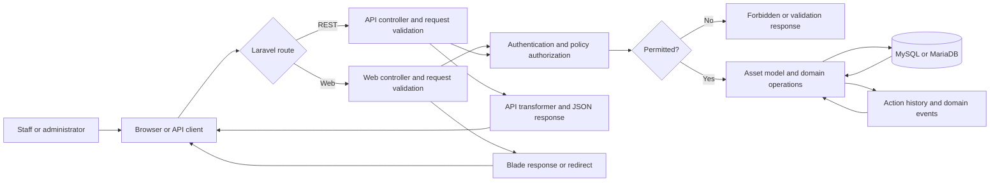

# Milestone 2: System analysis, demo, and advanced testing plan

## Baseline and evidence status

| Item | Current evidence/status |
|---|---|
| Repository | `https://github.com/Bee-Max-Ne/Snipe-IT` |
| Branch / frozen source | `main`, commit `ec8eb741397bf11345f51ae8c7f3a89e1aff1ac5` |
| Stack | Laravel 12 / PHP 8.2+, MySQL or MariaDB, Blade + Laravel Mix, PHPUnit 11 |
| Test database | Testcontainers Node MySQL module, image `mysql:8.0.36` |
| Local runtime evidence | User ran PHP 8.2.12, PHPUnit 11.5.55, Node 25.2.1, Composer 2.10.3 and a Testcontainers integration run |
| Focused business-flow test | Checkout then checkin: 1 test, 11 assertions, passed; local duration 2m 8.481s |
| Full app startup screenshot / 3 UI demo recordings | Not yet captured in this work session |
| GitHub Actions run for the added workflow | Workflow is configured; remote green run has not been supplied/verified |

Do not treat the focused integration test as proof that the full PHPUnit suite
or GitHub Actions run passes.

## Phase 1 — Environment and project setup

### 1.1 Git baseline

The checkout is on `main`; the observed source SHA is
`ec8eb741397bf11345f51ae8c7f3a89e1aff1ac5`. Reproduce with the exact SHA and
record `git rev-parse HEAD` in the team's meeting/report record.

### 1.2 Runtime and local application

The repository requires PHP `^8.2`, uses Laravel Framework `^12.0`, Composer,
Node/npm and Laravel Mix. `composer.lock` and `package-lock.json` are the
dependency lockfiles. The XAMPP CLI reported PHP 8.2.12 during user-run setup.

For source development, use a fresh local DB with `.env` and run migrations.
`dev.docker-compose.yml` builds the source Dockerfile with MariaDB 11.4.7,
Redis 7.4.3 and MailHog v1.0.1. The root `docker-compose.yml` uses the
published application image and is not the correct path for validating local
source edits.

See [Clean-machine onboarding](./milestone-2-onboarding.md) for copyable
PowerShell instructions and port details.

### 1.3 Onboarding deliverable

The onboarding guide records the source SHA, runtime/extensions, dependency
install, DB configuration, migration/seed warning, frontend build, app startup,
ports, Testcontainers command, and evidence-capture checklist. It explicitly
warns that `DatabaseSeeder` truncates tables and removes some upload
directories: use it only against a disposable database.

## Phase 2 — Architecture and business analysis

### Dependency inventory

| Concern | Project dependency/config |
|---|---|
| Framework / HTTP / ORM | Laravel Framework `^12.0`, Eloquent |
| Authentication and OAuth API tokens | Laravel Passport `^12.0`; ephemeral RSA keys are supplied by the Testcontainers runner |
| SQL database | MySQL/MariaDB via Laravel database configuration and `pdo_mysql` |
| Server-rendered UI | Blade, Laravel UI, AdminLTE/Bootstrap 3 |
| Frontend assets | Laravel Mix `^6.0.49`, webpack; commands `npm run dev`, `npm run watch`, `npm run prod` |
| Automated tests | PHPUnit `^11.0`, feature tests under `tests/Feature` |
| Isolated SQL integration testing | `@testcontainers/mysql` `^11.7.2`; runner pins image `mysql:8.0.36` |
| Local source container stack | `dev.docker-compose.yml`: application, MariaDB 11.4.7, Redis 7.4.3, MailHog 1.0.1 |

### Selected core business flows

1. User login/session authentication and permission checks.
2. Asset catalog/model/location management.
3. Checkout an available asset to a user/location/asset, updating assignment and
   action history.
4. Checkin a checked-out asset, clearing assignment and recording checkin state.
5. REST API asset operations through API controllers, policies, transformers,
   and the same SQL data model.

### Component/container architecture


### Business data flow



## Phase 3 — Verification and demo

### Verified automated evidence

The Testcontainers runner starts an isolated `mysql:8.0.36`, creates a unique
database and random credentials, passes the mapped DB endpoint to PHPUnit, and
stops the container in cleanup. Passport RSA keys are generated in memory for
the PHPUnit process.

The focused checkout/checkin API test was run locally and reported:

```text
PHPUnit 11.5.55
PHP 8.2.12
OK (1 test, 11 assertions)
Time: 02:08.481
```

This verifies one end-to-end backend business flow against a real disposable
MySQL container. The full application browser startup, screenshots, and three
separate interactive/UI flows still require local evidence capture; they are
not claimed as completed by an API feature test.

### Manual demo acceptance scenarios

For the local UI demo, use a disposable database and an authorized test admin:

| Flow | Action | Expected evidence |
|---|---|---|
| Login | Sign in with the local setup admin | Dashboard loads; capture sanitized screenshot |
| Checkout | Select a deployable asset and checkout to a test user | Asset shows assigned user; checkout history/log exists |
| Checkin | Check in that same asset | Asset is unassigned; last checkin/history is visible |

Capture screenshots and sanitized server/browser logs in
`reports/milestone-2/evidence/`. Do not include passwords, API tokens, Passport
keys, personal data, or production data.

## Phase 4 — K16 Testcontainers plan

### Technique, scope, assumptions, and limits

Testcontainers provisions throwaway services through a real container runtime
for the duration of a test run. This gives the integration test a disposable
MySQL database and dynamic host port rather than a shared developer/staging
database. It validates real SQL behavior and migrations, but is slower than a
pure unit test, requires Docker, and does not by itself validate production
networking, SMTP delivery, Redis behavior, or deployment topology.

**Scope:** asset checkout/checkin API flow, Laravel authorization/business
logic, MySQL persistence, assignment/counter/timestamp results, and container
lifecycle. Queue, cache, mail delivery, UI browser automation, and every
application feature are outside the initial K16 scope.

**Assumptions:** Docker is available to the runner; PHP has PDO MySQL; Node.js
18+ and Composer/npm dependencies are installed; test DB credentials and
Passport keys are ephemeral; tests use only the generated container DB.

**Risks and mitigations:**

- Docker unavailable/image pull fails: fail visibly; never fall back to a
  shared/local database.
- MySQL image differs from production: compare image/version before claiming
  production parity; current runner pins `mysql:8.0.36`.
- Slow image startup/resource pressure: focused test job has a 15-minute CI
  timeout and test selection is explicit.
- Secret leakage: random DB password and in-memory Passport keys only; avoid
  logging environment values.
- Cleanup failure: runner's `finally` stops the started container; inspect
  Docker state/logs if a run is interrupted forcibly.

### Quantitative pass/fail criteria

| Criterion | Pass | Fail |
|---|---|---|
| Focused checkout/checkin test | PHPUnit exit code 0; exactly 1 selected test passes; at least 11 assertions | Non-zero exit, any failure/error, or test not selected |
| Database isolation | Test connects to generated MySQL container and no fallback DB is used | Uses developer/shared/staging/production DB |
| Container cleanup | Container is stopped after normal success or PHPUnit failure | Runner exits normally but leaves its test container running |
| CI | `Testcontainers Integration` workflow job is green on PR/push | Workflow missing, skipped unexpectedly, or job red |
| Runtime bound | CI job completes within 15 minutes | Job timeout or repeated startup instability |
| Scope honesty | Results state focused test vs whole-suite coverage accurately | One focused test is represented as the entire product suite |

### Current implementation and remaining acceptance

- Implemented: Node Testcontainers runner, pinned MySQL image, random test
  database/credentials, dynamic port injection, ephemeral Passport keys, and
  cleanup.
- Implemented and locally verified: checkout-then-checkin integration test,
  1 test / 11 assertions / pass.
- Configured: dedicated GitHub Actions workflow for the focused test on
  `master`, `develop`, and pull requests.
- Pending external evidence: a green GitHub Actions run; screenshots and
  sanitized logs for the local app and the three manual demo scenarios.

## Milestone status

Repository analysis, diagrams, onboarding instructions, K16 scope/criteria,
and the focused automated integration test are prepared. The milestone is not
fully evidenced until the local UI screenshots/logs and remote CI result are
added. Do not mark those evidence-dependent deliverables complete before they
are captured.
